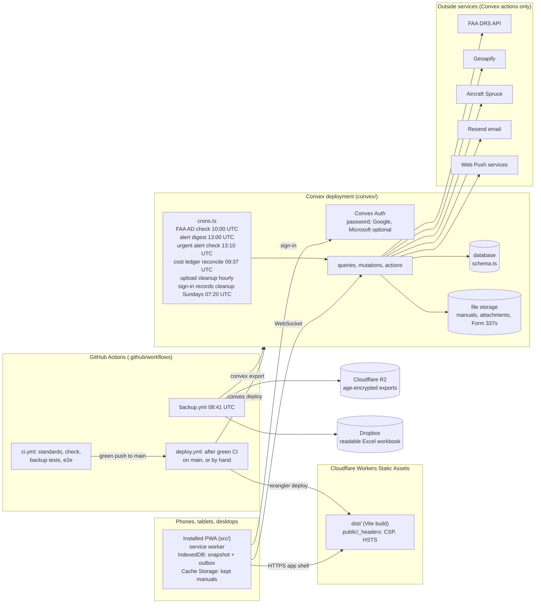
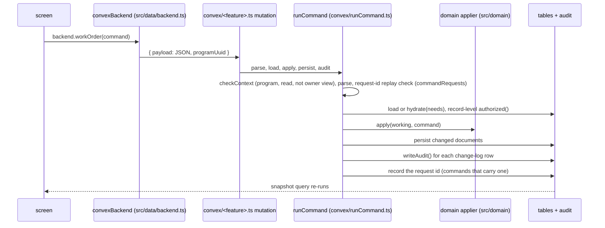

# Angel One: system context

Read this first. It maps the system, names the layers and the rules between them, and points to where things live. It links to the detailed sources rather than repeating them: vocabulary in [GLOSSARY.md](GLOSSARY.md), decisions in [docs/adr/](docs/adr/), engineering rules in [CONSTRAINTS.md](CONSTRAINTS.md), design history in the [architecture report](docs/architecture/README.md), feature behaviour in `docs/*.md`. Verified against the code on 2026-11-03.

## 1. What the system is

Angel One is a progressive web app that keeps the maintenance and status records a mission flight program must hold for its aircraft under 14 CFR Part 91, and runs the daily work that produces them: flight logging, discrepancies and deferrals, the dispatch gate, inspections, component life, airworthiness directives, work orders and job cards, inventory and purchasing. The browser app (React 19, Vite, TanStack Router, Zustand) is served as static files from Cloudflare and talks over a WebSocket to Convex, which holds authentication, all server functions, the database, file storage and scheduled jobs. Data is partitioned by **Flight Program** and filtered by permission group on the server. Pilots can log flights and problem reports offline; everything else needs a connection. The app is the system of record for the six 14 CFR 91.417(a)(2) status records, but it is not the signed maintenance record: it generates unsigned logbook entries for signature ([ADR-0004](docs/adr/0004-logbook-generator-and-status-record-system.md)). A labelled demo mode runs the same app against fictional data in the browser. Status: pre-launch ([go-live checklist](docs/go-live-checklist.md)).

## 2. System map



The browser never calls an outside service: the CSP `connect-src` allows only the site, `blob:` and the production deployment's own `.convex.cloud`/`.convex.site` hosts (written into the published `_headers` at deploy; local and demo builds allow any `*.convex.cloud`/`*.convex.site`). The one planned exception is Sentry error reporting, off until a DSN and its ingest host are added ([monitoring runbook](docs/runbooks/monitoring.md)). Release steps: [release runbook](docs/runbooks/release.md). Backups: [ADR-0008](docs/adr/0008-daily-backups-off-site-90-days-monthly-forever.md), [ADR-0011](docs/adr/0011-readable-records-copy-in-dropbox.md), [backup runbook](docs/runbooks/backup-restore.md).

## 3. Code layers and directory ownership

Layer names match the file-header labels in [CONSTRAINTS.md §2](CONSTRAINTS.md). Most files predate the header rule; bring each one up to it when you touch it.

| Directory | Layer | Owns | Must not |
|---|---|---|---|
| `src/main.tsx`, `src/App.tsx` | UI (entry) | Demo or live root, Convex client and auth provider, sign-in screen, 7-day access gate, service-worker registration (`main.tsx`); shell and lazy route table (`App.tsx`) | Hold business rules |
| `src/components` | UI | Screens and forms. Read `useWorkspace().snapshot`; write through `backend.<method>()` or `enqueue()`; derive visibility from domain (`can`, `programPermission`, `isPilotView`) | Import `convex/` (except `ConvexError` in `ui.tsx`, §5) or `src/data/local.ts`; re-implement a rule that exists in `src/domain`; write the snapshot |
| `src/styles` | UI | Tokens, shared design, per-screen CSS (`screens/`) | Encode behaviour |
| `src/domain` | Domain | Types and zod schemas for stored payloads (`model.ts` plus one module per feature); appliers `(snapshot, command) => …` that mutate a working snapshot (some also push their own audit entries; for the rest the Convex mutation's `audit` hook composes the rows); rules (status, dispatch gate, due dates, close-out, flight submission); permissions (`can`, `scopedSnapshot`) | Import React, Zustand, Convex, `src/data` or `src/components`; touch browser storage; do network I/O (see §5 for current exceptions) |
| `src/data` | Data | Workspace store and outbox (`store.ts`); `Backend` interface and Convex adapter (`backend.ts`); demo adapter (`demoBackend.ts`) and seed (`demo.ts`); IndexedDB (`local.ts`); kept manuals (`deviceManuals.ts`); PDFs and reports (`*Pdf.ts`, `adReport.ts`, `aircraftStatusReport.ts`); file importers (`adImport.ts`, `fmd.ts`) | Render UI or import `src/components`; decide a permission the server does not also decide |
| `convex` | Server | Schema, auth, every public function, permission checks (`access.ts`, `programContext.ts`), the command transaction (`runCommand.ts`), the audit writer, crons, auth HTTP routes, integrations, credential encryption (`secrets.ts`) | Import `src/data` or `src/components` outside tests; return a secret; insert into `audit` except through `writeAudit` |
| `convex/_generated` | Generated | Convex codegen (`api`, `dataModel`) | Be edited by hand |
| `scripts` | Script | Setup (`configure-auth.mjs`, `bootstrap-admin.mjs`), local smoke test, `serve-dist.mjs`, CSP check and deploy-time CSP pin, icons; nightly backup and records workbook (`scripts/backup/`) | Print secrets; import `src/data` except test fixtures |
| `tests`, `*.test.ts` | Test | Playwright specs (`tests/e2e`) and fixtures; vitest and convex-test suites beside the code they test | Ship in the build |
| `.github` | Tooling | CI; Deploy, which a green CI push to `main` starts, or a person by hand; first-time setup; nightly backup; Dependabot | Deploy from `ci.yml` (it holds no secrets; `deploy.yml` releases); release a commit that is not the newest on `main`; hold secrets outside the `production` and `backups` environments |
| `.claude` | Tooling | Standards hooks and settings (owner-only, do not edit); vendored skills (`npx skills update` only) | Be edited by agents |
| `docs` | Docs | Feature behaviour, ADRs, runbooks, architecture report, research | Contradict an accepted ADR without a new one |

Also at the root: `public/` (headers, icons, fonts), `wrangler.jsonc` (Cloudflare site), `worker/` (the Worker that answers requests no built file matches: a 404 for a missing bundle, else the app shell), `legecy php_project/` (retired PHP system, reference only).

## 4. Data flow

**Read path.** One reactive query feeds the whole UI.

```mermaid
sequenceDiagram
  participant Q as operations.snapshot (convex)
  participant WS as useWorkspace (src/data/store.ts)
  participant IDB as IndexedDB (src/data/local.ts)
  participant UI as screens
  Q->>Q: activeIdentity, context() and program-scoped loaders (programContext.ts), history by the window's indexes (historyWindow.ts)
  Q->>Q: workspaceWindow() (src/domain/retention.ts): scopedSnapshot() strips what the caller may not see, history narrowed to the window
  Q-->>WS: Snapshot via useQueries (src/main.tsx; a failure shows WorkspaceUnavailable) → receive()
  WS->>IDB: saveSnapshot(namespace)
  WS-->>UI: snapshot
```

- `Snapshot` (`src/domain/model.ts`) holds the active Flight Program only, and of its history only the retention window (ADR-0013): open items, closed maintenance changed in the last three months, six months of flights, the five latest completed work orders per aircraft, and the collections that stay complete (H5). Cached copies, that window, open offline for seven days from sign-in (`OFFLINE_WINDOW`, `offlineValid`).
- Paged or large data loads on demand through `Backend` queries: History (`auditPage`), older flights, problem reports and work orders (`historyPage`), one older work order (`workOrderHistory`) and records named by uuid (`historyRecords`) from `convex/history.ts`, read through `src/data/historyPages.ts` and `historyLoads.ts` ([history paging](docs/history-paging.md)); engine trends, attachment lists, certification files.
- No stored file reaches the device by address: the snapshot and listings name files, and screens ask `Backend.fileLinks` (`convex/fileLinks.ts`) for links that expire after five minutes, while the file is on screen (`src/components/FileLink.tsx`; [file links](docs/file-links.md)).
- Demo: `demoBackend` keeps the full fictional snapshot under `<namespace>:all` in IndexedDB and hands the workspace `workspaceWindow()` of it (`demoWorkspaceView`), as the server would; its history reads run the same domain functions over the full copy.

**Write path.** Screens call one `Backend` method; the server runs one transaction.



- A Convex mutation is one transaction: any throw writes nothing. Expected domain rejections become `ConvexError` (the `expose` option) so users see the message in production.
- 22 mutations use `runCommand`. Administration, upload and a few others check access themselves and write the change log through `audit()`, or `writeAudit()` directly. The list, and what ADR-0003 still asks for (request ids on every command, uniform stale-version rejection), is in the architecture report's "Done since this report".
- Demo: `demoBackend.modify()` clones the full snapshot, runs the same applier, saves it, and calls `receive(demoWorkspaceView(s))`. Demo writes need `online`.

**Offline outbox** (`src/data/store.ts`, `src/domain/flightSubmission.ts`, `convex/operations.ts` `submit`):

- Only two `Operation` kinds exist: `flight` and `discrepancy` (`operationSchema`). All other writes need a connection.
- `enqueue()` checks the access lease, author, `can()`, `validateFlight`, the checklist link, the dispatch gate and the flight plan, stamps `programUuid`, and stores the entry in the IndexedDB outbox.
- `flush()` sends entries when online, connected and within the lease, only for the signed-in author and the active program. Each goes through `backend.submit` → `operations.submit` → `runCommand` → `submitOperation`, the one sequence shared with the demo.
- A later flight on an aircraft that has the user's own earlier flights in the outbox is queued with the version those flights will leave (`aircraftAfterPendingFlights`), so the legs are accepted in order; if an earlier one is held or refused, the later ones are held.
- The server is idempotent on the entry's uuid. A flight that conflicts with the aircraft (changed version, backdated, before a counter change, lower readings) is stored as a **held flight** (`status: "review"`, `flight.held`), and totals stay unchanged until an administrator reviews it.
- A `ConvexError` (or `[CONVEX …]` message) is permanent: the entry stays in the Sync center with its error. Any other failure is retried on the next flush.
- Sign-out deletes what the device keeps for the user signing out (`signOutLocal`, `clearUserData`): the snapshot, the outbox entries and queued photos they wrote, favorites, read-alert lists, every form draft and kept manual. When their entries or photos have not synced, `useConfirmedSignOut` (`src/components/SignOutConfirm.tsx`) says how many and deletes them only on **Delete and sign out**. Other authors' entries, the theme and other device settings stay. A session that ends without sign-out (`receive(null)`) clears the snapshot and kept manuals but keeps the outbox, since nobody confirmed deleting it ([signing out](docs/offline.md#signing-out-and-shared-devices)).
- Logbook page photos (`src/data/logbookPhotos.ts`, `attachLogbookPhoto` in `store.ts`) are the one other write that waits on the device: a photo of a flight still in the outbox is kept as a blob in its own IndexedDB database and uploaded by `flush()` once the flight is in the snapshot ([logbook page photos](docs/logbook-photos.md)).

## 5. Module boundary rules

Allowed import directions (anything else is a violation):

```text
src/main.tsx, src/App.tsx, src/components ──► src/data ──► src/domain
src/components ───────────────────────────────────────────► src/domain
convex ──► src/domain            scripts/backup ──► src/domain, convex/collections.ts (the codec)
src/main.tsx, src/data/backend.ts ──► convex/_generated (api; dataModel types), convex/react
src/main.tsx ──► @convex-dev/auth/react (sign-in, before the workspace exists)
src/data ──► convex/values (ConvexError only; src/data/errors.ts holds the one message helper, which ui.tsx re-exports)
tests, *.test.ts and test fixtures (scripts/backup/exportFixture.ts) may also import src/data/demo.ts (demoSnapshot)
```

No linter enforces these yet (`.oxlintrc.json` has no import rules). Check with:

```sh
rg -n "from ['\"](\.\./(data|components)|\.\./\.\./convex|react|zustand|convex/|@convex-dev)" src/domain -g '!*.test.ts'  # expect nothing
rg -n "from ['\"]\.\./components" src/data                                              # expect nothing
rg -n "from ['\"]\.\./src/(data|components)" convex -g '!*.test.ts'                     # expect nothing
rg -n "convex/|@convex-dev" src/components                                               # see exceptions below
```

Invariants:

1. **Business rules live once, in `src/domain`.** Both adapters and the server call the same functions; components shape forms into commands and display results.
2. **The server enforces every permission.** Every public query, mutation and action reaches `checkContext`, `authorized`, `admin`, `currentUser` or `activeIdentity` (directly, through `runCommand`, or through a file-local helper such as `access()` or `authorize()`); actions first call an internal function that checks. Apart from the Convex Auth library's sign-in endpoints, the public functions without a check are `identities.providers`, which lists the enabled sign-in buttons, and `pushSubscriptions.publicKey`, which returns the deployment's VAPID public key (public by design: every browser that subscribes receives it; it also tells a caller whether push is configured, nothing more). The HTTP route `/files/v1/<token>` (`convex/fileLinks.ts`) takes no session either: its signed, five-minute token is the credential, issued only by `fileLinks.links` after the snapshot's own listing rule ([file links](docs/file-links.md)). Client checks (`can()` in `enqueue`, hidden navigation) are convenience only. `checkContext` also rejects a stale `programUuid` and every call from an owner view (owners read only the snapshot).
3. **The change log is append-only.** `writeAudit` (`convex/access.ts`) is the only insert into `audit`, and no code patches or deletes a row. A transfer adds `transferredAudit` links instead of re-tagging rows. Corrections append a new entry with a reason. Protection beyond the code: [ADR-0005](docs/adr/0005-audit-log-protection-by-access-and-backups.md), [ADR-0010](docs/adr/0010-one-convex-administrator.md).
4. **The demo adapter goes through the same domain rules.** `demoBackend` calls the same appliers and `submitOperation`; a rejected demo outbox entry is rethrown as `ConvexError` so the Sync center treats it like a server rejection.
5. **No secrets reach the browser.** The bundle reads only `VITE_CONVEX_URL`, `VITE_DEMO_MODE`, `VITE_ALLOW_DEMO`, and the public Sentry DSN and release (`VITE_SENTRY_DSN`, `VITE_SENTRY_RELEASE`). Integration keys live in Convex environment variables or in rows sealed with AES-GCM (`convex/secrets.ts`, `CREDENTIALS_ENCRYPTION_KEY`), are decrypted only inside server actions, and status queries say whether a key is configured, never what it is. The key that signs file links is derived from the credential key on the server (`fileLinkKey`) and never leaves it.
6. **Every program-scoped call carries the active `programUuid`**, and the server's row loaders (`convex/programContext.ts`) read by that program or its aircraft.
7. **Derived columns are copies, never records.** Every write of a work order, job card, archived job card, cost record, parts request or purchase order goes through `encode` (`convex/collections.ts`), and every write of a flight's start time adds `flightColumns`, so the history window's indexes see every record ([ADR-0013](docs/adr/0013-history-retention-window.md)). Reads decode the columns away, and `migrations:backfillHistoryColumns` fills older rows. File rows copy their owner the same way (`convex/fileColumns.ts`): job-card evidence its card's work order, set on upload and moved when the card joins an order, and an inventory file its item's program, set on every insert and moved by `writeChanged` when a transfer changes the item's program, so the snapshot reads files by order and program instead of once per record; the backfill fills and corrects both. The `recordNumbers` and `costLedger` tables are derived too, and never reach the change log: `writeChanged` and the direct inserts keep a work order's or job card's number row in step, saves number from those rows, and `migrations:rebuildRecordNumbers` rebuilds them; cost commands, issues and a job card joining a work order rewrite that order's `costLedger` rows (`convex/costLedger.ts`), which the board and `history.costReport` sum, and `migrations:rebuildCostLedger` rebuilds them. The `purchasingKeys` table holds what each parts request and purchase order is looked up by (request ids, repaired components, allocations, an active recurring list's aircraft; `convex/purchasingKeys.ts`): every write of one syncs its rows, and the backfill fills them. Saves load a bounded working set by these columns and tables (`convex/workingSet.ts`), never whole history; the parts-request and purchase-order saves too since H5.

Current violations and exceptions (2026-11-03). Record fixes in `REFACTOR_ROADMAP.md`:

- Domain modules that do network I/O: none since Batches 322 and 323. The Geoapify request lives in `convex/addressVerification.ts` and the FAA DRS requests in `convex/faaDrs.ts`; `src/domain` keeps only the pure parsing and merging.
- Rules written twice, once per adapter (invariants 1 and 4), and drifted: none known. The FAA monitor command (`runFaaCommand`), program selection (`selectProgram`) and the account checks the demo skipped moved into `src/domain` (roadmap Finding 59, 2026-11-19); flight review and discrepancy resolve were fixed by T11 and T2 (Batches 267–269, 297–300).
- UI importing Convex directly: `src/components/SignInMethods.tsx:14-17` (`useQuery(api.identities.providers)` at :89, `useAuthActions` at :90; a pre-workspace sign-in screen like `main.tsx`). Screens and the outbox share one message helper, `errorText` in `src/data/errors.ts` (Batches 324, 418, 419); `Components.tsx:465` and `Management.tsx:1119` still show `error.message`.
- Form-to-command shaping stays in components, for example the close-out readings in `WorkOrders.tsx`; ADR-0006 moves only those readings into the domain, after launch.
- Minor: `src/data/auditHistory.ts:1` is a React hook in the data layer; `src/data/store.ts:64-68` hard-codes draft-key prefixes owned by `GuidedFlight.tsx:55`, `FlightSession.tsx:49` and `Checklists.tsx:77`.

## 6. Core domain glossary

The 34 terms you meet first. Full definitions and words to avoid: [GLOSSARY.md](GLOSSARY.md). Terms marked "(not in GLOSSARY.md yet)" are defined only here.

| Term | Meaning |
|---|---|
| Flight Program | The organization unit that owns aircraft, locations, stock and memberships; the first access boundary. Not "tenant". |
| Permission group | Named bundle of permissions (`read`, `flight`, `discrepancy`, `resolve`, `maintenance`) over all or selected aircraft of one program. Not "role". |
| Aircraft scope (not in GLOSSARY.md yet) | A group's `aircraftIds`; empty means every aircraft in the program, except owner groups, which must name theirs (`groupCoversAircraft`). |
| Flight Program administrator | Member of a `programAdmin` group: manages the whole program. |
| System administrator | `isAdmin` account: manages every program, user and group; only one that sees unassigned records. |
| Owner portal (owner view) | Read-only view for an aircraft owner group; `checkContext` refuses its calls, so owners read only the snapshot. |
| Snapshot (not in GLOSSARY.md yet) | The scoped read model (`src/domain/model.ts`) the server sends and the device caches. |
| Command | Validated request to change records in one step; applied by a domain applier, idempotent where it carries a request id. |
| Pending entry (outbox) | Flights and problem reports recorded on the device, waiting to sync (Sync center). |
| Held flight (not in GLOSSARY.md yet) | A synced flight that conflicts with the aircraft's counters; `status: "review"` until an administrator accepts or rejects it (conflict review). |
| Counter change (not in GLOSSARY.md yet) | An administrator's correction of aircraft counters, recorded as a counter event; flights before it need chronology review. |
| Aircraft status | Computed airworthy, due soon or grounded, with reasons. |
| Dispatch gate | Check that blocks a flight on a grounded aircraft; a dispatch override records the reason with the flight. |
| Discrepancy | A reported defect, open until resolved or deferred. Not "squawk". |
| Deferral | Postponing a discrepancy under an MEL item and category, with placard text and a deadline. |
| Inspection | Recurring or one-time requirement on an aircraft or component, due by hours, cycles or calendar. |
| Component | Serialized, life-tracked part, installed at a position or held in inventory. |
| Component requirement | Service or life limit on a component in hours, cycles or calendar time. |
| Overdue | Limit reached: usage at 0 remaining, calendar from the day after the due date. Grounds the aircraft. |
| Airworthiness directive (AD) | FAA-mandated action tracked per aircraft or component, monitored against FAA DRS. |
| Compliance record | Append-only entry that an AD action was done; corrected only by appending. |
| Work order | Numbered container (`WO-YYYY-NNNN`) of requested work on one aircraft, finished by close-out. |
| Job card | Executable card for findings, work, parts, evidence and signoffs (`TC-YYYY-NNNN`); in a work order, the order's own copy of a job card template. Not "task card". |
| Job card template | A job card kept on an inspection, component requirement or discrepancy as reusable instructions; never worked or signed. Not "task template". |
| Signoff | A named person's recorded completion of a required step; internal work tracking, not return to service. |
| Close-out | Completing a work order: applies component movements, freezes readings, produces the summary. |
| Logbook entry | Generated, unsigned 43.9/43.11 text or PDF for signature in the aircraft logbook. |
| Correction | Audited change to a completed record that keeps the original and a reason. |
| Audit entry (change log) | Who changed what and when, with before, after and reason; shown in History. |
| Status records (91.417) | The six permanent records the operator keeps: total time, life-limited parts, time since overhaul, inspection status, AD status, Form 337 copies. |
| Form 337 (not in GLOSSARY.md yet) | FAA major repair and alteration form; copies are kept on the aircraft record and archived, never deleted. |
| Kept manual (not in GLOSSARY.md yet) | A reference manual stored on the device (Cache Storage) to open offline. |
| Demo mode | Labelled in-browser mode with fictional data, isolated from live data. |
| Off-site copy | Nightly encrypted export in R2 (90 days; first of each month forever). |

## 7. Where to look

| Task | Start here |
|---|---|
| Add a field to work orders | `src/domain/workOrders.ts` (`workOrderSchema`, `workOrderCommandSchema`, `saveWorkOrder`), then `src/components/WorkOrders.tsx`. Records are stored as zod-validated JSON in `payload`, so `convex/schema.ts` changes only for a new index; old payloads must still parse (optional or defaulted field). Check `workOrderCloseout.ts`, `src/data/logbookPdf.ts` and `scripts/backup/recordsWorkbook.ts`. Tests: `src/domain/workOrders.test.ts`, `convex/workOrders.test.ts`, `tests/e2e/work-orders.spec.ts`. |
| Change who can see or do X | `src/domain/model.ts` (`can`), `src/domain/programs.ts` (`programPermission`, `scopedSnapshot`), `src/domain/ownerView.ts`, `convex/programContext.ts` (`checkContext`, loaders), `convex/access.ts` (`authorized`, `admin`); navigation in `src/components/AppShell.tsx`. Read [Flight Program access](docs/flight-program-access.md). |
| Add a Convex function | `convex/<feature>.ts`. Applier-backed write: `runCommand` (pattern: `convex/workOrders.ts` `save`). Other writes: `checkContext` plus `authorized`/`admin` plus `audit()`. Add the method to `Backend`, `convexBackend` and `demoBackend`. Test with convex-test seeded from `demoSnapshot()`. |
| Add or change a business rule | The `src/domain` module for the feature and its `*.test.ts`; never in a component or one adapter. |
| Change offline behaviour | `src/data/store.ts` (`enqueue`, `flush`, `permanentSyncError`), `src/data/local.ts`, `src/domain/model.ts` (`operationSchema`, `OFFLINE_WINDOW`), `src/domain/flightSubmission.ts`, `convex/operations.ts` `submit`, `src/main.tsx` (access gate, service worker), `vite.config.ts` (PWA). |
| Add a scheduled job | `convex/crons.ts` pointing at an internal function; chained work with `ctx.scheduler.runAfter` (see `convex/workOrderCopies.ts`, `convex/faa.ts`). Jobs outside Convex: `.github/workflows/`. |
| Add a screen | Lazy route in `src/App.tsx`, navigation in `src/components/AppShell.tsx`, styles in `src/styles/screens/`. |
| Add an integration key | Seal it with `convex/secrets.ts`, read it in an internal function, use it in an action; see [credential key runbook](docs/runbooks/credentials-key.md). |
| Change backups or the workbook | `scripts/backup/nightly.sh`, `scripts/backup/recordsWorkbook.ts`, `.github/workflows/backup.yml`; run `npm run test:backup`. |
| Release or roll back | `.github/workflows/deploy.yml`, [release runbook](docs/runbooks/release.md), README "Deployment" for one-off steps on deployments with older data. |

## 8. Conventions and checks

Engineering rules: [CONSTRAINTS.md](CONSTRAINTS.md) (headers, TSDoc, function size, no suppressions; enforced on changed files by the edit hook and CI). Commits carry no AI attribution ([CLAUDE.md](CLAUDE.md)).

```sh
npm run check            # typecheck, oxlint, vitest (domain, data, convex-test, backup workbook), build
npm run check:standards  # headers and suppressions in files changed since origin/main
npm run test:e2e         # Playwright against the production build; demo adapter only
npm run test:backup      # nightly backup script with fake Convex and R2
npm run test:local       # against `npm run dev:local`: real auth, sync, blocked public writes
```

The browser suite builds with `VITE_ALLOW_DEMO=true`, so it never reaches Convex; server persistence and authorization are covered by the convex-test suites in `convex/*.test.ts`.

Decisions ([docs/adr/](docs/adr/)):

| ADR | Decision |
|---|---|
| [0001](docs/adr/0001-sso-in-app-not-cloudflare-access.md) | Access control stays in the app; Cloudflare Access is not the gate. |
| [0002](docs/adr/0002-administrator-provisioned-accounts.md) | Administrators provision accounts; no public sign-up or self-service reset. |
| [0003](docs/adr/0003-server-writes-through-one-command-transaction.md) | Server writes go through one command transaction (`runCommand`). |
| [0004](docs/adr/0004-logbook-generator-and-status-record-system.md) | Logbook-entry generator and status-record system, not the signed record. |
| [0005](docs/adr/0005-audit-log-protection-by-access-and-backups.md) | Change log protected by limited access and off-site backups, not hash chaining. |
| [0006](docs/adr/0006-architecture-cleanup-priorities-before-launch.md) | Which architecture cleanups happen before launch. |
| [0007](docs/adr/0007-convex-pro-single-seat.md) | Convex Pro, one seat, one project. |
| [0008](docs/adr/0008-daily-backups-off-site-90-days-monthly-forever.md) | Daily off-site backups, 90 days, monthly forever. |
| [0009](docs/adr/0009-password-for-everyone-plus-google-and-microsoft.md) | Everyone keeps a password; Google and Microsoft alongside. |
| [0010](docs/adr/0010-one-convex-administrator.md) | One Convex administrator. |
| [0011](docs/adr/0011-readable-records-copy-in-dropbox.md) | Readable records copy in Dropbox. |
| [0012](docs/adr/0012-urgent-alerts-by-web-push-and-immediate-email.md) | Urgent alerts reach people by Web Push and an immediate email; expiring dates are records. |
| [0013](docs/adr/0013-history-retention-window.md) | The workspace keeps a retention window of history; older records load page by page. |
