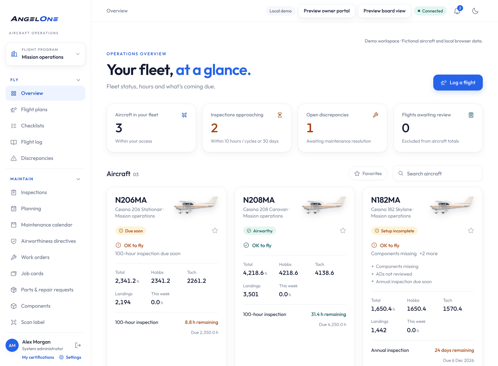
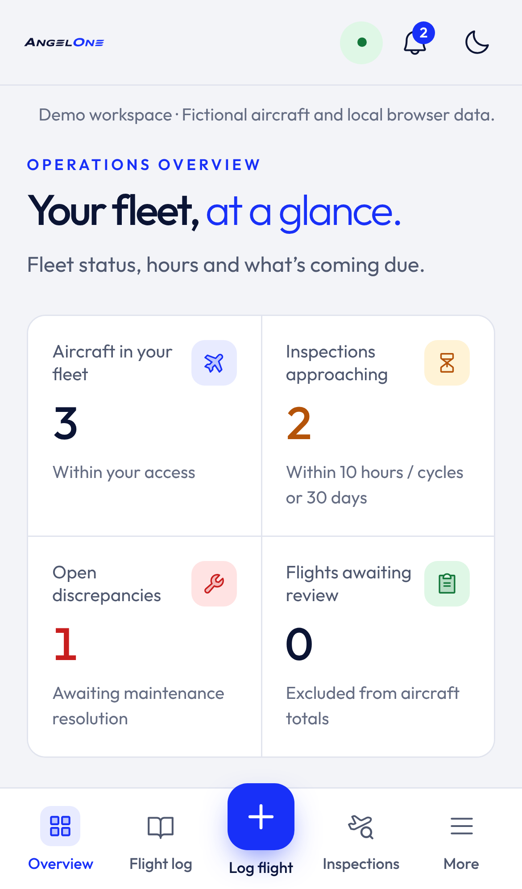
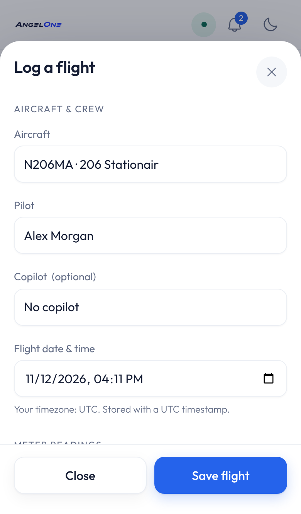
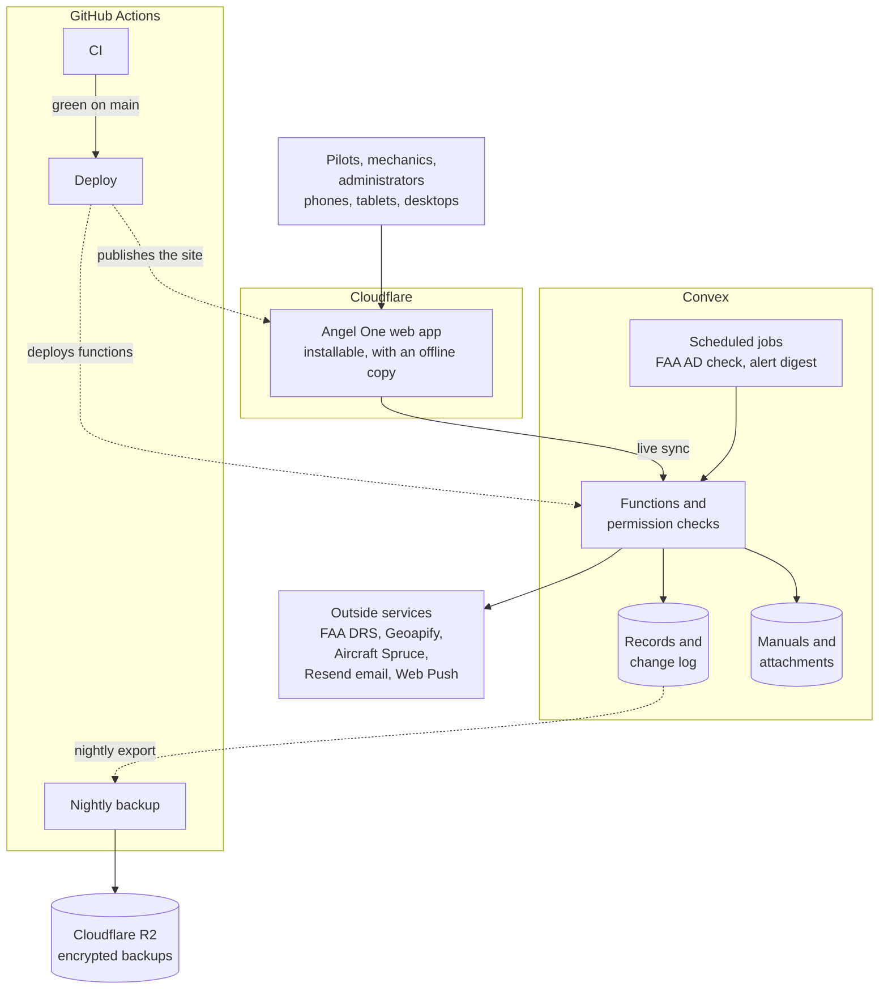

# Angel One

**Aircraft operations and maintenance records for a mission flight program.**

Angel One keeps the maintenance and status records a 14 CFR Part 91 operator must hold for its aircraft, and runs the daily work that produces them: flight logging, discrepancies, inspections, work orders, parts and airworthiness directives. Everything is scoped by **Flight Program** with permission groups, and pilots can log flights and report discrepancies with no signal.

<p align="center">
  
</p>

| At a glance       |                                                                                                                                                                            |
| ----------------- | -------------------------------------------------------------------------------------------------------------------------------------------------------------------------- |
| **What it is**    | An installable web app (PWA) built with React, Vite, TanStack Router and Zustand, on a Convex backend                                                                      |
| **Who uses it**   | Pilots, mechanics and inspectors, program administrators, aircraft owners and board members                                                                                |
| **Status**        | Deployed. Final go-live checks are under way and real records begin at launch, planned for 13 November 2026 (as of 9 November 2026). See [Project status](#project-status) |
| **Where it runs** | Website on Cloudflare, backend on Convex, releases through GitHub Actions                                                                                                  |
| **Try it**        | `npm ci`, then `npm run dev`, then choose **Explore the local demo**                                                                                                       |

> [!IMPORTANT]
> Angel One generates logbook entry wording and is the system of record for **status records**. It is not the signed maintenance record ([ADR-0004](docs/adr/0004-logbook-generator-and-status-record-system.md)).

## Flight plan

| Leg               | Section                                                                   | Go here to                                              |
| ----------------- | ------------------------------------------------------------------------- | ------------------------------------------------------- |
| Walk-around       | [What it does](#what-it-does)                                             | See every feature, by who uses it                       |
| Under the cowling | [How it is built](#how-it-is-built)                                       | Understand the stack and the system map                 |
| Preflight         | [Start the app](#start-the-app)                                           | Run the demo in two commands                            |
| Taxi              | [Connect Convex and create accounts](#connect-convex-and-create-accounts) | Add a real backend, sign-in and the first administrator |
| Off the grid      | [Offline and installation](#offline-and-installation)                     | Install it on a phone and learn what works offline      |
| Run-up            | [Verification](#verification)                                             | Run the checks before a change ships                    |
| Departure         | [Deployment](#deployment)                                                 | Release to production and back it up                    |
| En route          | [Operations](#operations)                                                 | Find the runbook for the job at hand                    |
| Charts            | [Documentation map](#documentation-map)                                   | Find any feature page, decision or review               |
| Stowage           | [Repository layout](#repository-layout)                                   | Find where the code lives                               |
| Crew rules        | [Working on the code](#working-on-the-code)                               | Follow the engineering standards                        |
| Ground equipment  | [Dev container and Docker](#dev-container-and-docker)                     | Develop inside a container                              |

## What it does

_The walk-around: every part looked at in turn, grouped by who uses it._

<p align="center">
  
  &nbsp;&nbsp;&nbsp;
  
</p>

### Pilots

- **Log a flight** on a phone, online or offline. The form shows the starting Hobbs and tach for the pilot to verify, and pending entries sync by themselves ([offline entries](docs/offline.md)).
- **Report a discrepancy** from the same place, also offline.
- **See whether the aircraft may fly**: aircraft status, a dispatch gate and MEL deferrals (terms in the [glossary](GLOSSARY.md)).
- **Checklists and flight plans**: imported ForeFlight checklists and ICAO flight plan PDFs read in the browser ([checklists](docs/checklists.md), [flight plans](docs/flight-plans.md), [flight log options](docs/flight-log-options.md)).
- **Photograph the paper logbook line** for a flight ([logbook page photos](docs/logbook-photos.md)).
- **Open manuals offline** with **Keep on this device** ([reference library](docs/reference-library.md)).

### Mechanics and inspectors

- **Inspections** by hours, calendar, cycles or landings, built from templates ([inspection templates](docs/inspection-templates.md), [landing schedules](docs/landing-schedules.md), [maintenance workflows](docs/maintenance-workflows.md)).
- **Work orders, task templates and job cards** with signoffs, and generated logbook entry wording ([work orders](docs/work-orders.md), [task cards](docs/task-cards.md), [logbook entries](docs/logbook-entries.md)).
- **Component life tracking** with templates and printed tags ([component templates](docs/component-templates.md), [tracked components in inventory](docs/component-inventory.md)).
- **Airworthiness directives** with FAA DRS monitoring ([airworthiness directives](docs/airworthiness.md)).
- **Inventory** with QR labels, shelf life and core returns ([tags and labels](docs/inventory-printing.md), [attachments](docs/inventory-attachments.md)).
- **Parts and purchasing**: parts and repair requests, purchase orders, vendors and Aircraft Spruce ordering ([requests](docs/parts-and-repair-requests.md), [parts availability](docs/maintenance-parts.md), [purchase orders](docs/purchase-orders.md), [vendors](docs/vendors.md), [Aircraft Spruce](docs/aircraft-spruce.md)).
- **Certificates**: pilot and mechanic certificates with license copies ([user certifications](docs/user-certifications.md)).
- **CSV imports** for maintenance records and task files ([maintenance CSV import](docs/maintenance-csv-import.md), [task file import](docs/task-csv-import.md)).
- **Engine trends and cost tracking.**

### Program administrators

- **Set up an aircraft**: a wizard that loads an aircraft's history from CSV templates after a dry run ([aircraft setup](docs/aircraft-setup.md)).
- **Flight Programs, permission groups and users** ([Flight Program access](docs/flight-program-access.md), [aircraft and programs](docs/aircraft-programs.md)).
- **Alerts** under the bell, a daily email digest, urgent alerts by email and on devices, and expiring dates such as insurance or a service key ([alerts](docs/alerts.md)).
- **Forecasting and planning** of what falls due across the fleet.
- **Conflict review** for flights that collide, and a review step when two people change the same record ([offline entries and colliding changes](docs/offline.md)).
- **Change history**: an append-only change log with a weekly summary ([change history](docs/change-history.md)).
- **Paper check**: a monthly list to tick against the paper logbooks ([paper check](docs/reconciliation.md)).
- **Records package**: the complete record set for one aircraft as one ZIP file ([records package](docs/records-export.md)).
- **Addresses**: saved shipping addresses and address lookup ([saved addresses](docs/saved-addresses.md), [addresses](docs/address-verification.md)).

### Owners and board members

- **Owner portal**: a reduced, read-only view of the aircraft an owner group names ([Flight Program access](docs/flight-program-access.md)).
- **Board view**: a read-only fleet summary with a PDF to take to the meeting ([board view](docs/board-view.md)).

<details>
<summary><strong>Details worth knowing before you enter data</strong></summary>

- There is no legacy operational data to import. Create aircraft with verified opening Hobbs and tach readings, total-time adjustments, cycles and landings, then create users and permission groups. The PHP source in `legecy php_project/` remains a reference for business behavior.
- The flight form shows read-only **Starting Hobbs** and **Starting tach** for pilot verification, with separate ending-reading inputs. Starting readings stay paired with the aircraft version when the form opens. Historical flights display their recorded starting readings, not today's counters. The flight log includes all four start and end values. Offline starting readings use the cached record; conflicts still require review.
- Aircraft total time uses the selected Hobbs or tach meter plus **Total time adjustment**.
- Flight Programs have an editable directory with name, address, email, contact name and website.
- While paper logbooks run beside the app, the monthly [paper check](docs/reconciliation.md) lists each aircraft's flights and sign-offs to tick against the paper.

</details>

The agreed scope is in [first delivery](docs/first-delivery.md), the original brief in [requirements.md](requirements.md), and the vocabulary in [GLOSSARY.md](GLOSSARY.md).

## How it is built

_Under the cowling: what is in there and how the parts connect._



| Part         | Built with                                                                                                   |
| ------------ | ------------------------------------------------------------------------------------------------------------ |
| App          | React, Vite, TanStack Router and Zustand; a PWA with a service worker and an offline copy in IndexedDB       |
| Shared rules | TypeScript domain modules and zod schemas in `src/domain`, used by both the browser and the server           |
| Backend      | Convex: database, file storage, functions, scheduled jobs and Convex Auth                                    |
| Hosting      | Cloudflare Workers Static Assets, configured in `wrangler.jsonc`, with security headers in `public/_headers` |
| Checks       | TypeScript, oxlint, Vitest and Playwright                                                                    |
| Pipeline     | GitHub Actions: CI, Deploy, Nightly backup and First-time setup                                              |

The browser talks only to the website and Convex. Every outside service is called from Convex.

For the full system map, the layers and the rules between them, read [CONTEXT.md](CONTEXT.md). The standing decisions are in [`docs/adr/`](docs/adr/) and the [architecture report](docs/architecture/README.md) has the detail.

## Start the app

_Preflight: from a fresh checkout to a running demo._

Requires Node.js 22.12+ and npm.

```sh
npm ci
npm run dev
```

Open <http://localhost:5173>. Choose **Explore the local demo** to use fictional aircraft with persistent browser storage. The demo is explicitly labeled and isolated from live Convex data. You can also run `npm run dev:demo`. Demo accounts do not authenticate real users.

| Command               | What it does                                           |
| --------------------- | ------------------------------------------------------ |
| `npm run dev`         | The app on port 5173, with the demo available          |
| `npm run dev:demo`    | The app straight into demo mode                        |
| `npm run dev:backend` | A Convex development backend, local or cloud           |
| `npm run dev:local`   | An account-free local Convex backend                   |
| `npm run setup:auth`  | Sign-in keys and `SITE_URL` on the selected deployment |
| `npm run setup:admin` | The first administrator, on an empty deployment only   |
| `npm run build`       | Typecheck and production build                         |
| `npm run preview`     | Serve the production build                             |

The checking commands are listed under [Verification](#verification).

## Connect Convex and create accounts

_Taxi: a real backend, sign-in and the first administrator._

**1. Start a backend.** In a separate terminal:

```sh
npm run dev:backend
```

Choose a local or cloud development project. For an account-free local backend, run `npm run dev:local`. Convex writes `.env.local` with `VITE_CONVEX_URL`; restart Vite if necessary. Keep the backend terminal running. The `dev:local` command pins the backend version compatible with this Debian Bookworm container; newer backend binaries may require newer system libraries. If your container filesystem does not report file-change events, restart this command after backend edits to push the current functions.

**2. Configure authentication, then create the first administrator.**

```sh
npm run setup:auth
npm run setup:admin
```

- `setup:auth` generates signing keys on the selected deployment without printing them, preserves an existing key, and sets `SITE_URL` (default `http://localhost:5173`; override with the `SITE_URL` environment variable).
- It also creates `CREDENTIALS_ENCRYPTION_KEY` (32 random bytes, base64) if the deployment has none. That key encrypts saved Aircraft Spruce, FAA and Geoapify credentials with AES-GCM; saving those credentials fails until it is set. To set it by hand: `openssl rand -base64 32 | npx convex env set CREDENTIALS_ENCRYPTION_KEY`. Never change or delete it in place on a deployment with saved credentials, or administrators must re-enter them; to rotate it, follow [the credential key runbook](docs/runbooks/credentials-key.md). Unencrypted values are refused.
- `setup:admin` prompts for name, email, and a hidden password (15–128 characters, not a common password). It passes the password to the deployment through a temporary `BOOTSTRAP_ADMIN_PASSWORD` environment variable (over stdin, never in process arguments) and removes it afterward. It only works with an empty user database and invokes an internal function, never a public signup endpoint. Keep credentials private.

**3. Set up access in the app.** System administrators create Flight Programs, permission groups, and users. Assign each user to program-specific groups to grant access. Select the active Flight Program in the header; aircraft and locations inherit it automatically. See [Flight Program access](docs/flight-program-access.md) for setup, roles, transfers, and offline isolation.

### Settings that live on the deployment

Some settings are set on the Convex deployment, not in the app's **Settings** page.

| Setting                                                                                          | What it turns on                                                  | More                                                                             |
| ------------------------------------------------------------------------------------------------ | ----------------------------------------------------------------- | -------------------------------------------------------------------------------- |
| `SITE_URL`                                                                                       | Sign-in redirects and the links in emails                         | Set by `npm run setup:auth`                                                      |
| `CREDENTIALS_ENCRYPTION_KEY`                                                                     | Encryption of saved Aircraft Spruce, FAA and Geoapify credentials | [Credential key runbook](docs/runbooks/credentials-key.md)                       |
| `RESEND_API_KEY`, `RESEND_FROM`                                                                  | The daily alert digest and urgent alert emails                    | [Alerts](docs/alerts.md)                                                         |
| `VAPID_PUBLIC_KEY`, `VAPID_PRIVATE_KEY`, `VAPID_SUBJECT`                                         | Urgent alerts on devices (Web Push)                               | [Monitoring runbook](docs/runbooks/monitoring.md#alerts-by-email-and-on-devices) |
| `AUTH_GOOGLE_ID`, `AUTH_GOOGLE_SECRET`                                                           | The Google sign-in button                                         | [Accounts runbook](docs/runbooks/accounts.md#google-and-microsoft-sign-in)       |
| `AUTH_MICROSOFT_ENTRA_ID_ID`, `AUTH_MICROSOFT_ENTRA_ID_SECRET`, `AUTH_MICROSOFT_ENTRA_ID_ISSUER` | The Microsoft sign-in button                                      | [Accounts runbook](docs/runbooks/accounts.md#google-and-microsoft-sign-in)       |

Each sign-in button appears only when all of its provider's variables are set. In the app, **Settings → System** holds the FAA and Geoapify keys and data backups; **Settings → Flight Program** holds each program's details, labor rate and Aircraft Spruce account.

### Alerts by email and on devices

- Maintenance alerts appear under the bell in the header for everyone, including demo mode.
- To also email a daily digest (13:00 UTC) of new alerts, set a [Resend](https://resend.com) API key and a verified sender on the deployment: `npx convex env set RESEND_API_KEY re_...` and `npx convex env set RESEND_FROM "Angel One <alerts@your-domain>"`. Without both, email is skipped and in-app alerts keep working. Digests link back to `SITE_URL`.
- Program administrators receive digests by default; anyone can change this under Settings → My account (or My certifications).
- Urgent alerts (a grounded aircraft, an overdue inspection or AD, a component past its limit, an expired date) also go out at once: by email to program administrators and maintenance members (switch under Settings → My account; at most 60 a day so the digest fits Resend's free 100), and to devices members switch on under Settings → This device once the deployment has Web Push keys. See the [monitoring runbook](docs/runbooks/monitoring.md#alerts-by-email-and-on-devices) and [alerts](docs/alerts.md).
- System administrators whose alert email is on also get an "Off-site backups" warning, at the top of their digest or on its own, while the newest nightly off-site backup is more than 36 hours old or none has been recorded; Settings → System shows the newest copy.

### Accounts and sign-in

- Administrators can reset passwords; a reset also ends the user's sessions and clears a sign-in lockout (10 failed attempts per hour). Disabling a user ends their sessions.
- Public password signup and password-reset registration paths are disabled server-side.
- Passwords that administrators set need 15–128 characters and must not be common; existing shorter passwords keep working until their next reset.
- Once their sign-in clients are configured, users can also sign in with a Google or Microsoft account whose verified email matches their account; this never creates an account ([ADR-0009](docs/adr/0009-password-for-everyone-plus-google-and-microsoft.md)). See the [accounts runbook](docs/runbooks/accounts.md).

### Local test administrator

The local smoke test creates a development-only administrator if needed and saves its credentials to ignored `.env.local-admin.json`. If that file exists in this workspace, use that account for the existing local database instead of rerunning the empty-database bootstrap. Test aircraft are clearly named `TEST-*`. Create a separate Convex project for operational use.

## Offline and installation

_Off the grid: what works with no signal, and how to put the app on a phone._

```sh
npm run build
npm run preview
```

Open the preview URL online, sign in, and allow the app to cache before testing offline. The service worker is enabled in production builds, not the Vite development server. On iOS use Safari → Share → **Add to Home Screen**; on Android/desktop use the browser's install action. Production requires HTTPS. Native app-store packages are outside this PWA delivery.

| With no connection you can                                              | You need a connection for                   |
| ----------------------------------------------------------------------- | ------------------------------------------- |
| Add flights and discrepancies                                           | Access changes, corrections and resolutions |
| Take a photo of the paper logbook line for a flight that has not synced | Switching Flight Program                    |
| Open reference manuals kept on the device                               | Everything else                             |

- A photo taken for a flight that has not synced waits on the device and uploads after it ([logbook page photos](docs/logbook-photos.md)).
- Reference manuals a user keeps on the device (**Keep on this device** in the Reference library) also open offline; see [reference library](docs/reference-library.md#keep-on-this-device).
- Pending entries appear in **Sync center** and sync automatically when connected. Conflicting flights go to administrator review without changing aircraft totals.
- Access expires seven days after login; pending entries remain saved. Sign in with the original account to sync them.
- What happens to a refused entry, a held flight, or a record two people changed at once is in [offline entries and colliding changes](docs/offline.md).

## Verification

_Run-up: the checks before every departure._

```sh
npm run check
npx playwright install chromium
npm run test:e2e
```

| Command                   | What it checks                                                          |
| ------------------------- | ----------------------------------------------------------------------- |
| `npm run check`           | Typecheck, lint, unit and server tests, and the production build        |
| `npm run check:standards` | File headers and the no-suppression rule, on files changed since `main` |
| `npm run test:e2e`        | Browser tests against the production build                              |
| `npm run test:local`      | Real sign-in and database behavior against a local Convex backend       |
| `npm run test:backup`     | The nightly backup job, without credentials                             |
| `npm run format:check`    | Formatting of application-owned files                                   |

- **Browser tests** run against the production build, served with the production security headers (`scripts/serve-dist.mjs`); any Content-Security-Policy violation fails the run. Run `npm run build` after changes. They cover offline reload/sync, conflict review, expiry, mobile navigation, administration, read-only starting meter verification, inspection completion, component service, and inventory movements. The optional live-browser test runs when `.env.local-admin.json` exists and a local Convex backend is running.
- **Local backend test.** With `npm run dev:local` running, `npm run test:local` tests actual authentication and database behavior. It refuses non-local URLs. It provisions development-only records and tests login, aircraft creation, idempotent sync, discrepancy resolution, review, and blocked public writes.
- **Manuals.** Reference manuals are not stored in the repository; upload them to the app's Reference library. The manual-upload browser test uses a small sample PDF, or the full Cessna 441 manual when a local copy named `16802162-Cessna_441_Maintenance_Manual_D2518-15-13_Mm.pdf` sits in the repository root (it is git-ignored).
- **Browser libraries.** The Dev Container includes Chromium runtime libraries after a rebuild. On a Linux host, install Playwright system dependencies with `npx playwright install-deps chromium` using administrator privileges.
- iOS Add to Home Screen still needs verification on a physical device.

## Deployment

_Departure: how a change reaches the hangar._

The website runs on Cloudflare (Workers Static Assets, configured in `wrangler.jsonc`, with the security headers in `public/_headers`) and the backend on Convex.

| Step                   | What happens                                                                                                                                             |
| ---------------------- | -------------------------------------------------------------------------------------------------------------------------------------------------------- |
| A push to `main`       | **CI** runs the checks, the backup job's tests and the browser tests, with a dependency audit and a secret scan alongside                                |
| CI finishes green      | **Deploy** starts by itself: it deploys the Convex functions, builds the site against that deployment with demo mode off, and publishes it to Cloudflare |
| A release by hand      | Run the **Deploy** workflow from `main`; it refuses unless you confirm a backup was taken                                                                |
| Every night, 08:41 UTC | **Nightly backup** copies production off-site: encrypted, to Cloudflare R2, plus an optional readable Excel workbook in Dropbox                          |

- First-time setup (Cloudflare account and API token, domain, Convex deploy key, GitHub secrets and the `production` environment), releasing and rollback are in the [release runbook](docs/runbooks/release.md).
- Without a terminal, set up a new, empty production deployment with the manual **First-time setup** workflow, once, before the first Deploy: see [First-time setup (no terminal)](docs/runbooks/release.md#first-time-setup-no-terminal).
- Before deploying by hand, take a Convex backup (dashboard > Backups) and save the deployment's environment variables as described in the [backup runbook](docs/runbooks/backup-restore.md). Running the nightly backup by hand, checking it and restoring are in the same runbook, and `npm run test:backup` tests it without credentials.
- The settings that are set on the deployment are listed under [Settings that live on the deployment](#settings-that-live-on-the-deployment).
- Never upload `.env.*`, local backend state, or test credentials. No production deployment is performed by the setup scripts.

### One-off steps for deployments with older data

**Fresh deployments skip this section.** The production deployment started empty on 2026-11-03 (no data was migrated; the old test deployment was deleted), so the step below has nothing to do there. It repairs data written by earlier versions and stays documented for any deployment that holds such data.

After deploying a version that adds the `memberships` table, populate it once from existing accounts. It is safe to rerun, batches itself until every user is processed, and does nothing once complete:

```bash
npx convex run memberships:backfill
```

Until it runs, Flight Program member lists (pilot pickers, group-deletion reviews) show only accounts changed after the deploy. Permissions are unaffected: they still come from each user's group list.

After deploying the version that stores the aircraft on job-card evidence and work-order files, fill it in on files uploaded before, once. It is safe to rerun, batches itself through both tables, and does nothing on a fresh deployment or once complete:

```bash
npx convex run attachments:backfillAircraft
```

Until it runs, those older files still show: the workspace snapshot reads them through a slower fallback on every load.

## Operations

_En route: keeping it flying._

### Project status

**Deployed, with real records beginning at launch.** The remaining work is tracked in the [go-live checklist](docs/go-live-checklist.md); it includes finishing the off-site backup setup, switching on error monitoring, and acceptance testing on actual pilot and mechanic devices.

- **Security**: an [in-house review](docs/security/review-2026-11-02.md) was completed on 2026-11-02. Its critical finding (an auth-library flaw that let anyone delete records) and its Medium and Low fixes are merged. The old test deployment that predated it has been deleted; production starts fresh on the fixed code. A [second review](docs/security/review-2026-11-04.md) on 2026-11-04 found nothing Critical or High; its fixes are merged and its open items are listed there. To report a vulnerability, see [SECURITY.md](SECURITY.md).
- **Recurring tasks**: the quarterly and yearly upkeep is in the [recurring tasks table](docs/go-live-checklist.md#recurring-tasks).

### Runbooks

| When you need to                                   | Open                                                                   |
| -------------------------------------------------- | ---------------------------------------------------------------------- |
| Release, roll back or change hosting               | [Release and rollback](docs/runbooks/release.md)                       |
| Back up, check a backup or restore                 | [Backup and restore](docs/runbooks/backup-restore.md)                  |
| Keep the readable Excel copy of the records        | [Dropbox records copy](docs/runbooks/dropbox-records-copy.md)          |
| Switch on error reporting, uptime checks or alerts | [Monitoring](docs/runbooks/monitoring.md)                              |
| Respond to an incident                             | [Incident response](docs/runbooks/incident-response.md)                |
| Get in when every administrator is locked out      | [Break-glass administrator access](docs/runbooks/break-glass-admin.md) |
| See who owns each outside account                  | [Accounts](docs/runbooks/accounts.md)                                  |
| Reach the production database                      | [Production database access](docs/runbooks/database-access.md)         |
| Rotate the credential encryption key               | [Credential encryption key](docs/runbooks/credentials-key.md)          |

## Documentation map

_The chart table: where everything is written down._

| Looking for                          | Start at                                                                                                                           |
| ------------------------------------ | ---------------------------------------------------------------------------------------------------------------------------------- |
| What a word means                    | [GLOSSARY.md](GLOSSARY.md)                                                                                                         |
| How a feature behaves                | [`docs/`](docs/), one page per feature; the tour in [What it does](#what-it-does) links to each                                    |
| Why something was decided            | [`docs/adr/`](docs/adr/), one record per standing decision                                                                         |
| How the system fits together         | [CONTEXT.md](CONTEXT.md) and the [architecture report](docs/architecture/README.md)                                                |
| What is left before and after launch | [Go-live checklist](docs/go-live-checklist.md)                                                                                     |
| How to operate production            | [`docs/runbooks/`](docs/runbooks/), listed under [Runbooks](#runbooks)                                                             |
| Security reviews and reporting       | [2 Nov review](docs/security/review-2026-11-02.md), [4 Nov review](docs/security/review-2026-11-04.md), [SECURITY.md](SECURITY.md) |
| The agreed scope and original brief  | [First delivery](docs/first-delivery.md) and [requirements.md](requirements.md)                                                    |
| A sample program to explore          | [Hosted sample aviation program](docs/sample-program.md)                                                                           |

## Repository layout

_Stowage: where things are kept._

| Path                 | Holds                                                                                              |
| -------------------- | -------------------------------------------------------------------------------------------------- |
| `src/components`     | Screens and forms                                                                                  |
| `src/domain`         | The business rules: types, schemas and calculations shared by the browser and the server           |
| `src/data`           | The workspace store, the offline outbox, the demo backend, and PDF and export writers              |
| `src/styles`         | Design tokens and per-screen styles                                                                |
| `convex`             | The backend: schema, sign-in, every function, permission checks, the change log and scheduled jobs |
| `scripts`            | Setup scripts, the local smoke test, the production-headers server, and the nightly backup job     |
| `tests`              | Browser tests and shared fixtures; unit and server tests sit beside the code they test             |
| `docs`               | Feature pages, decisions, runbooks, security reviews and the architecture report                   |
| `public`             | Security headers, icons and fonts                                                                  |
| `.github`            | CI, Deploy, Nightly backup, First-time setup and dependency updates                                |
| `legecy php_project` | The retired PHP system, kept as a reference for business behavior                                  |

## Working on the code

_Crew rules: how changes are made here._

- **Read [CONTEXT.md](CONTEXT.md) first.** It maps the system and names the rules between the layers.
- **Follow [CONSTRAINTS.md](CONSTRAINTS.md).** Every code file starts with a header stating its responsibility, layer and dependencies; every export is documented; no lint or type-check suppressions. CI checks the enforced rules on every changed file.
- **These are safety-critical records.** Prefer appending corrections over editing history, and never weaken an authorization or audit path to make a change smaller.
- **Use the words in [GLOSSARY.md](GLOSSARY.md)** in code, screens and docs.
- **Refactoring work** is queued in [REFACTOR_ROADMAP.md](REFACTOR_ROADMAP.md).
- **Before you call a change done**, run the checks under [Verification](#verification).
- **Found a vulnerability?** Follow [SECURITY.md](SECURITY.md).

## Dev container and Docker

_Ground equipment: a ready-made workshop._

Compose publishes Vite port 5173 and local Convex ports 3210/3211 on the host loopback interface. Cloud Convex development also works.

<details>
<summary><strong>Develop in a dev container</strong></summary>

Prerequisites: Docker Desktop (or Docker Engine with Compose) running on your computer, and an editor that supports the [Dev Container specification](https://containers.dev/), such as VS Code with the **Dev Containers** extension.

1. Open this repository in your editor.
2. Open the Command Palette (`Cmd+Shift+P` on macOS, `Ctrl+Shift+P` on Linux/Windows).
3. Run **Dev Containers: Reopen in Container**.

The editor builds the image and opens `/workspace` inside the container. Its terminals run as the non-root `node` user with Node.js 22, npm, Git, and native build tools. The configuration follows the [Dev Container specification](https://containers.dev/implementors/json_reference/).

After pulling a changed configuration into an existing environment, run **Dev Containers: Rebuild Container** to apply it.

</details>

<details>
<summary><strong>Start with Docker Compose</strong></summary>

From the repository root:

```sh
docker compose up -d --build
```

In your editor, run **Dev Containers: Attach to Running Container**, select this project's `app` container, and open `/workspace`.

To apply this repository's extension configuration, use **Dev Containers: Reopen in Container** from the repository folder. Attaching directly to a running container can use separate editor configuration.

For a terminal without an editor:

```sh
docker compose exec app bash
```

The repository is bind-mounted at `/workspace`: edits made on your computer or inside the container are reflected in both places. Linux dependencies live in a separate `node_modules` Docker volume, and npm's download cache has its own volume. Install dependencies inside the container so native packages match Linux.

</details>

<details>
<summary><strong>Run the application in the container</strong></summary>

Use a terminal inside the container:

```sh
npm install
npm run dev -- --host 0.0.0.0 --port 5173 --strictPort
```

Use `npm ci` instead of `npm install` when installing from an existing lockfile. Open <http://localhost:5173> on your computer. Port 5173 is published only on your computer's loopback interface. Configure the application's Convex environment variables in `.env.local` as needed; environment files are ignored by Git.

</details>

<details>
<summary><strong>Stop or rebuild</strong></summary>

```sh
docker compose down
docker compose up -d --build
```

Stopping with `down` preserves the dependency and npm cache volumes. After changing the Dockerfile while using a dev container, run **Dev Containers: Rebuild Container**.

</details>
