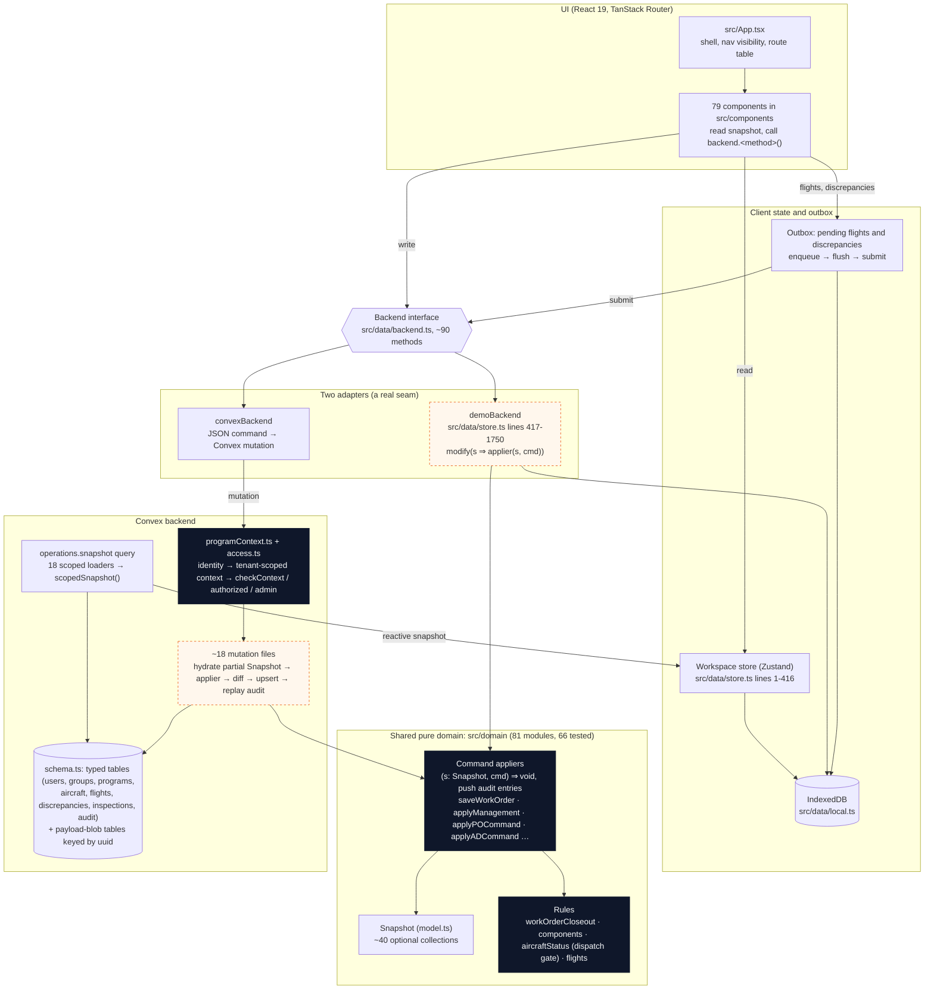

# Angel One architecture report

Date: 2026-11-01. Scope: the whole repository, weighted toward recent change hot spots (`src/data/store.ts`, `convex/schema.ts`, `src/data/backend.ts`, `src/App.tsx`, `src/domain/model.ts`). Vocabulary follows the `codebase-design` skill: **module**, **interface**, **implementation**, **depth**, **seam**, **adapter**, **leverage**, **locality**. Domain terms follow [`GLOSSARY.md`](../../GLOSSARY.md). A visual version with before/after diagrams per candidate is in [`architecture-review-2026-11-01.html`](./architecture-review-2026-11-01.html).

This report decides nothing. Its priorities were decided in [ADR-0006](../adr/0006-architecture-cleanup-priorities-before-launch.md).

## Done since this report (2026-11-03)

The sections below describe the code as reviewed on 2026-11-01. Since then, as refactors with no change to what the server stores or returns:

- **A and B, `runCommand`.** [`convex/runCommand.ts`](../../convex/runCommand.ts) is the one transaction for applier-backed mutations: program check before the payload is read, parse, request-id replay, load (with `hydrate(ctx, state, needs)` for program-scoped collections), apply with an explicit policy for which domain errors become `ConvexError`, persist, then the command's change-log rows written once through `writeAudit` (`convex/access.ts`), the only insert into the audit table. Twenty-one mutations use it: `management.execute`, `fleet.save`, `costs.execute`, `partsRequests.execute`, `purchaseOrders.execute`, `checklists.save`, `flightPlans.save`, `componentTemplates.save`/`apply`, `inspectionTemplates.save`/`activate`/`remove`, `taskImports.save`, `airworthiness.save`, `taskCards.save`, `workOrders.save`, `engineTrends.execute`, `programs.transfer`, and `operations.submit`/`deferDiscrepancy`/`saveDiscrepancyParts`. The seven raw audit inserts write the same rows through `writeAudit`. `convex/runCommand.test.ts` covers the transaction itself; the existing suites cover each command unchanged.
- **C, flight submission.** [`src/domain/flightSubmission.ts`](../../src/domain/flightSubmission.ts) (`submitOperation`) is the one sequence for flights and problem reports from the outbox; `operations.submit` loads and persists for it on the server, the demo adapter in its snapshot. The demo now follows the server where they had drifted: it checks the pilot and copilot, validates the checklist before the plan, trims the flight's problem report, refuses an entry id reused by another author or a report linked to another aircraft's flight, and, as on the server, its held-flight change-log entry carries the hold reason only in the flight's values. Dispatch-gate and oil-stock refusals are `FlightRejection`, which the server exposes as `ConvexError` as before.
- **D, the move.** The demo adapter is in [`src/data/demoBackend.ts`](../../src/data/demoBackend.ts); `store.ts` keeps the workspace and outbox.

Not yet done from ADR-0003, because each changes stored data or what a client sees: request ids for every command (only management and fleet have them; the table is still `managementRequests`), uniform stale-version rejection, dropping per-mutation summary rows, `programUuid` on the rows costs and recurring parts write without one, `undefined` for collections a command did not load, and partial-Snapshot typing (G). Not moved onto `runCommand`, having no domain applier: `operations.reviewFlight` (flight review still exists in both adapters; the next candidate for `flightSubmission.ts`), `operations.resolveDiscrepancy`, `faa.command`, `savedAddresses.save`, `programs.select`, the administration and upload mutations (they keep `audit()`), and the internal job mutations.

## 1. The system in one picture



Dark boxes are **deep** modules (lots of behaviour behind a small interface). Dashed orange boxes are the **shallow** ones this report proposes to deepen.

## 2. What is already deep (do not touch)

- **Authorization** is one module. Every public query and mutation routes through `checkContext`, `authorized` or `admin` in `convex/programContext.ts` and `convex/access.ts`; actions carry no auth themselves and delegate to internal functions that do. The same `can()` and `scopedSnapshot()` rules are shared with the client. Verified by counting public functions against auth calls per file.
- **Business rules live once**, in `src/domain/*`: close-out, component life, dispatch gate, flight validation, AD compliance. 66 of 81 domain modules have vitest suites. The documented contract ("the demo uses the same validation and calculation functions", `docs/maintenance-workflows.md`) holds.
- **The Workspace/outbox** (`store.ts` lines 1 to 416) with `store.test.ts`.
- **`App.tsx`**: shell, program switcher, route table, nav visibility derived from domain. Nothing to deepen.

## 3. Where the friction is

### The write path, as built today

```mermaid
sequenceDiagram
  participant W as WorkOrders.tsx
  participant B as convexBackend
  participant M as convex/workOrders.ts save
  participant D as domain saveWorkOrder
  participant T as tables
  W->>W: FormData → WorkOrderCommand (hours×3600 rounding, cycles fallback)
  W->>B: backend.workOrder(cmd)
  B->>M: mutation { payload: JSON, programUuid }
  M->>M: checkContext · parse · authorized(aircraft, "maintenance")
  M->>T: load 6 blob tables → partial Snapshot (others = [])
  M->>D: saveWorkOrder(working, cmd, now)
  D-->>M: mutated Snapshot + audit entries
  M->>M: hand-diff working vs prior rows
  M->>T: upsert taskCards, inspections, management, workOrders
  M->>T: replay working.audit via access.audit(); one more audit("workOrder.save")
  Note over M,T: this glue is re-written by hand in ~18 mutation files
```

The applier (`saveWorkOrder`) is deep and tested. The **adapter around it has no interface**: each mutation re-derives which collections to load, how to diff and persist them, how to replay audit entries, and how to make the request idempotent. Collections that are not loaded default to `[]`, so a domain rule reading an unloaded collection silently sees "empty" instead of "not loaded".

### Three ways to write an audit entry

`access.audit()` (65 call sites), raw `ctx.db.insert("audit", …)` in seven files (two of which omit `programUuid`), and domain-emitted `s.audit` entries replayed by mutations. The History page indexes by program, so the two un-stamped writers produce rows it cannot find.

### Flight submission exists twice

`convex/operations.ts submit` and `store.ts demoBackend.submit` are the same ~120-line sequence (idempotency, validations, `Flight` construction, oil deductions, `applyFlight`, discrepancy creation, audit action names) written twice. The Convex side gained pilot-membership and active-pilot checks; the demo did not. `src/domain/flights.ts` has no unit test.

### The e2e suite never touches Convex

`playwright.config.ts` builds with `VITE_ALLOW_DEMO=true`, so all 59 Playwright specs exercise the **demo adapter**. Anything that differs between the two adapters (pilot checks, template-copy jobs, FAA and Spruce actions) is invisible to e2e; Convex persistence glue is covered only by the 38 convex-test suites.

### Large UI modules

`Components.tsx` (1810 lines), `PurchaseOrders.tsx` (1633), `TaskCards.tsx` (1631), `WorkOrders.tsx` (1630), `PartsRequests.tsx` (1526), `Management.tsx` (1478), `Airworthiness.tsx` (1206) are mostly rendering and form state (14 to 29 `useState` each) and do import rules from `src/domain`. What stays UI-only is the **FormData → command shaping** (completion readings in `WorkOrders.tsx` 715 to 750, task-card ordering in `TaskCards.tsx` 54 to 93, cents conversion in `PurchaseOrders.tsx`) which has no interface below the component and is therefore testable only through Playwright, against the demo adapter.

## 4. Deepening candidates

| # | Candidate | Files | Strength | Deletion test |
|---|-----------|-------|----------|---------------|
| A | **Server command-transaction module**: `runCommand(ctx, { programUuid, needs, apply, permission })` owning hydrate, persist mapping, audit replay with `programUuid`, idempotency. Mutations shrink to ~10 lines. The demo already has this module as `modify()`. | 18 files in `convex/` (`workOrders`, `management`, `partsRequests`, `purchaseOrders`, `costs`, `fleet`, `taskCards`, `flightPlans`, `checklists`, `componentTemplates`, `inspectionTemplates`, `taskImports`, `programs`, `recurringParts`, …) | **Strong** | Delete the glue and it reappears in 18 callers: earning its keep, just never given an interface. |
| B | **Single audit writer**: `access.audit()` plus `replayAudit(ctx, entries, programUuid)`; delete the seven raw inserts. | `convex/access.ts`, `costs.ts`, `partsRequests.ts`, `purchaseOrders.ts`, `recurringParts.ts`, `savedAddresses.ts`, `aircraftSpruce.ts`, `sampleProgram.ts` | **Strong**, small; fold into A or do first | The raw inserts are pass-throughs: deleting them loses nothing `access.audit` does not do. |
| C | **Flight submission into the domain**: `submitFlight(s, op, now) → { flight, aircraft, discrepancy?, oilChanges, audit[] }` (pure, throws on rejection); Convex persists it plus its member-directory checks, demo applies it. | `convex/operations.ts` 305 to 540, `store.ts` 1151 to 1273, `src/domain/flights.ts`, `oilInventory.ts`, `aircraftStatus.ts` | **Strong** | Delete it and ~120 lines reappear in both adapters. |
| D | **Move `demoBackend` out of `store.ts`**; later derive both adapters from one command → applier → needs table in `src/domain/commands.ts`. | `src/data/store.ts` → `src/data/demoBackend.ts` | **Strong** (move) / **Worth exploring** (table) | The move is locality only. The table passes: per-command dispatch would otherwise live in two adapters. |
| E | **Form → command shaping into `src/domain/<feature>Form.ts`**, starting with close-out completion readings (numbers that reset component life). | `WorkOrders.tsx`, `TaskCards.tsx`, `PurchaseOrders.tsx`, `PartsRequests.tsx`, `Airworthiness.tsx` | **Worth exploring** | One caller each: a hypothetical seam. The win is a test surface, not reuse. Do the close-out readings; skip the rest unless a bug appears. |
| F | **Narrow the `Backend` interface** (~90 methods, ~40 of identical shape). | `src/data/backend.ts` | **Speculative**, leave | Two adapters make it a real seam; the width is honest. Revisit only after D's table exists. |
| G | **Partial `Snapshot` as interface** (design note for A): type each applier's parameter as `Pick<Snapshot, …>` so the compiler reports a rule that reads an unloaded collection. | `src/domain/model.ts`, appliers | **Worth exploring** | Type-level; it is the correctness risk the current shape hides. |

Dependency category for A to D: **in-process** against convex-test and the in-memory demo snapshot. No new ports or mocks are needed.

## 5. Top recommendation

**A with B folded in.** It is the one change that concentrates the server write path, fixes the un-stamped audit rows, makes "which collections does this command need" explicit (addressing G), and turns per-command persistence tests into one transaction test. C is the next most valuable because flight submission is the most safety-relevant write and the only one whose two implementations have already drifted. D's move is mechanical and can ride along with either.

Decisions about which of these to do before go-live, and which to reject with an ADR so they are not re-suggested, are recorded in [ADR-0006](../adr/0006-architecture-cleanup-priorities-before-launch.md).

## 6. Test surface today

| Suite | Count | Exercises |
|-------|-------|-----------|
| vitest (domain + data) | 66 of 81 domain modules; notable gaps: `flights.ts`, `programs.ts`, `model.ts`, `programTransfers.ts`, `faa.ts`, `partsPlanning.ts`, `ownerDue.ts` | Rules through applier interfaces |
| convex-test | 38 suites, seeded from `demoSnapshot()` | The only coverage of Convex persistence glue and authorization |
| Playwright | 59 specs, 7,373 lines | The demo adapter only (`VITE_ALLOW_DEMO=true` build) |

## 7. Decisions already recorded in docs

These explain the current shape and should not be re-litigated by the candidates above:

- Server validates every write, checks record version, and writes the audit entry in the same transaction; request UUIDs make retries idempotent; records are archived, never deleted (`docs/maintenance-workflows.md`, "Consistency").
- Flight Program is the first access boundary; the server filters the snapshot before sending; mutations re-check ownership; only the active program is cached offline (`docs/flight-program-access.md`).
- Only flights and discrepancy additions enter the offline outbox; maintenance writes need a live connection (`docs/maintenance-workflows.md`).
- Demo mode is explicitly labelled and isolated from live data (`README.md`); the e2e suite builds with demo enabled (`playwright.config.ts`).
- A `ConvexError` is a permanent rejection in the outbox; the flush loop re-passes only on a new request (`src/data/store.ts` comments).

Candidates A to D keep every one of these; they change where the glue lives, not what it guarantees.
