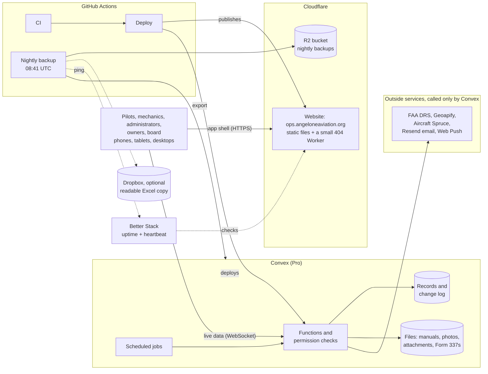

# System overview

What Angel One is, who uses it, how the parts connect, and what it stores. The engineer's version is [CONTEXT.md](../../../CONTEXT.md).

## What it is

- An installable web app (PWA) for a mission flight program's aircraft operations and maintenance records.
- It keeps the records a 14 CFR Part 91 operator must hold, and runs the daily work that makes them: flights, problem reports, inspections, work orders, job cards, parts, purchasing and airworthiness directives (ADs).
- It is the **system of record for the six status records** of 14 CFR 91.417(a)(2): total time, life-limited parts, time since overhaul, inspection status, AD status and Form 337 copies.
- It is **not the signed maintenance record.** It writes unsigned logbook entry wording for signature in the paper (or PDF) logbook ([ADR-0004](../../adr/0004-logbook-generator-and-status-record-system.md)). For its first year the program keeps paper logbooks beside the app ([logbook page photos](../../logbook-photos.md)).
- Live at <https://ops.angeloneaviation.org>. Real records begin when the program decides; no launch date is set.
- Jeff built the original app, a PHP system kept in `legecy php_project/` as a reference for business rules only. Aaron runs and maintains Angel One.

## Who uses it

| Person | What they do in the app |
| --- | --- |
| Pilot | Logs flights and problem reports, online or offline; sees whether an aircraft may fly; reads checklists, flight plans and manuals |
| Mechanic or inspector | Inspections, work orders, job cards and signoffs, components, ADs, parts requests |
| Flight Program administrator | Everything in their program: aircraft, its members and their access, held flights, inventory, purchasing, costs |
| System administrator | Every program: creates programs, accounts and groups, resets passwords, transfers records, deployment settings |
| Aircraft owner | A read-only owner portal for the aircraft their group names |
| Board member | A read-only board view: fleet status, due items, spend, last backup, a PDF for meetings |

App users cost nothing. Only Aaron holds a Convex seat ([ADR-0007](../../adr/0007-convex-pro-single-seat.md), [ADR-0010](../../adr/0010-one-convex-administrator.md)).

## The parts

| Part | What it is | Where it is set up |
| --- | --- | --- |
| Browser app | React 19, Vite, TanStack Router, Zustand; keeps an offline copy in IndexedDB | [`src/`](../../../src/) |
| Shared rules | TypeScript and zod schemas used by both the browser and the server | [`src/domain/`](../../../src/domain/) |
| Backend | Convex: database, files, functions, sign-in (Convex Auth), scheduled jobs | [`convex/`](../../../convex/) |
| Website hosting | Cloudflare Workers Static Assets; security headers | [`wrangler.jsonc`](../../../wrangler.jsonc), [`public/_headers`](../../../public/_headers), [`worker/assets.ts`](../../../worker/assets.ts) |
| Pipeline | CI, Deploy, Nightly backup, First-time setup | [`.github/workflows/`](../../../.github/workflows/) |
| Demo | The same app on fictional data, in the browser only | [`src/data/demoBackend.ts`](../../../src/data/demoBackend.ts) |

Rules that hold everywhere:

- The browser talks only to the website and Convex. Every outside service is called from Convex ([CONTEXT.md §5](../../../CONTEXT.md#5-module-boundary-rules)).
- The server checks every permission. Hidden buttons are convenience only.
- No secret reaches the browser.

Every outside service, its plan and its cost: [Services and costs](../4-money-and-risk/services-and-costs.md).

### Scheduled jobs

| Job | When (UTC) | Defined in |
| --- | --- | --- |
| FAA AD monitoring | Daily 10:00 | [`convex/crons.ts`](../../../convex/crons.ts) |
| Alert email digest | Daily 13:00 | same |
| Urgent alert check | Daily 13:10, and after each change that can cause one | same, [`convex/urgentAlerts.ts`](../../../convex/urgentAlerts.ts) |
| Cost ledger reconcile | Daily 09:37 | same |
| Expired manual upload clean-up | Hourly at :15 | same |
| Unreferenced file sweep | Hourly at :45 | same, [file sweep runbook](../../runbooks/file-sweep.md) |
| Sign-in records clean-up | Sundays 07:20 | same |
| Nightly backup | Daily 08:41 | [`.github/workflows/backup.yml`](../../../.github/workflows/backup.yml) |

## Flight Programs: one deployment, many programs

- A **Flight Program** is the unit that owns aircraft, locations, stock and memberships. It is the first access boundary ([Flight Program access](../../flight-program-access.md)).
- One deployment holds every program. The server filters every read and checks every write by program.
- Flights, problem reports and inspections follow their aircraft. Stock belongs to its location's program.
- A user can belong to several programs with different permissions in each, and picks the active one in the header. Switching needs a connection.
- Only a system administrator moves records between programs (**Transfer Flight Program**), with a reason. Cost records stay with the program that paid (decision D14).
- Isolation is tested: `convex/tenantIsolation.test.ts` attacks every public function from another program ([4 Nov review](../../security/review-2026-11-04.md)).

## Roles and permissions

Access comes from **permission groups**. A group belongs to one program and covers all its aircraft or chosen ones.

| Permission or flag | Lets a member |
| --- | --- |
| `read` | See the program's records for the group's aircraft |
| `flight` | Log flights |
| `discrepancy` | Report problems |
| `resolve` | Resolve problem reports |
| `maintenance` | Work on inspections, components, ADs, work orders, job cards; raise parts requests; export the records package |
| Flight Program administrator | Manage the whole program: aircraft, components, inventory, purchasing, costs, held flights, saved addresses, and its members (create accounts, add existing users, change or remove their access in this program) |
| Aircraft owner (flag) | The owner portal for the named aircraft, nothing else |
| Board member (flag) | The board view, nothing else |
| System administrator (account flag) | Everything, in every program; accounts, groups, transfers, deployment settings |

- Owner and board flags refuse administrator rights and write permissions. Every other call from them is refused ("Aircraft owner access is read-only.", "Board access is read-only.").
- Accounts are created by administrators only: system administrators, and Flight Program administrators for their own program ([`convex/programUsers.ts`](../../../convex/programUsers.ts)). Only system administrators reset passwords, disable accounts and create programs. There is no public sign-up or self-service reset ([ADR-0002](../../adr/0002-administrator-provisioned-accounts.md)).
- The last active system administrator cannot be disabled or demoted ("Keep at least one active administrator.").
- An inspection signoff needs an approved mechanic certificate. Nobody approves their own, administrators included ([user certifications](../../user-certifications.md)).

## The data model, in plain terms

Records are stored as validated JSON documents in Convex tables ([`convex/schema.ts`](../../../convex/schema.ts)); the shapes are zod schemas in [`src/domain/`](../../../src/domain/). The words are defined in [GLOSSARY.md](../../../GLOSSARY.md).

| Group | Main records |
| --- | --- |
| Organisation and people | Flight Programs, users, permission groups, memberships, certificates and license copies |
| Aircraft | Aircraft and their counters (Hobbs, tach, cycles, landings), photos, documents and Form 337 copies, expiring dates |
| Flying | Flights (including held flights), flight plans, checklists, engine trends |
| Defects | Problem reports (discrepancies), deferrals under the MEL |
| Maintenance due | Inspections, components and their requirements and movements, ADs and their compliance records, templates |
| Work | Work orders, job cards, job card evidence, archived job cards, work-order files, costs |
| Parts | Inventory (stock and locations), parts and repair requests, purchase orders, vendors, saved addresses, Aircraft Spruce orders |
| Library | Reference manuals |
| Change log | `audit`: one row per change, with who, when, before, after and reason; never edited |
| Derived (not records) | `recordNumbers`, `costLedger`, `purchasingKeys`: rebuilt from the records, never in the change log ([history paging](../../history-paging.md)) |
| Bookkeeping | Request ids, rate limits, alert deliveries, push subscriptions, backup runs, sign-in tables |

What a device holds is a **snapshot**: the active program's records the user may see, cut to the history window ([How it works](../2-how-it-works/how-it-works.md#history-paging-and-the-3-month-window)).
