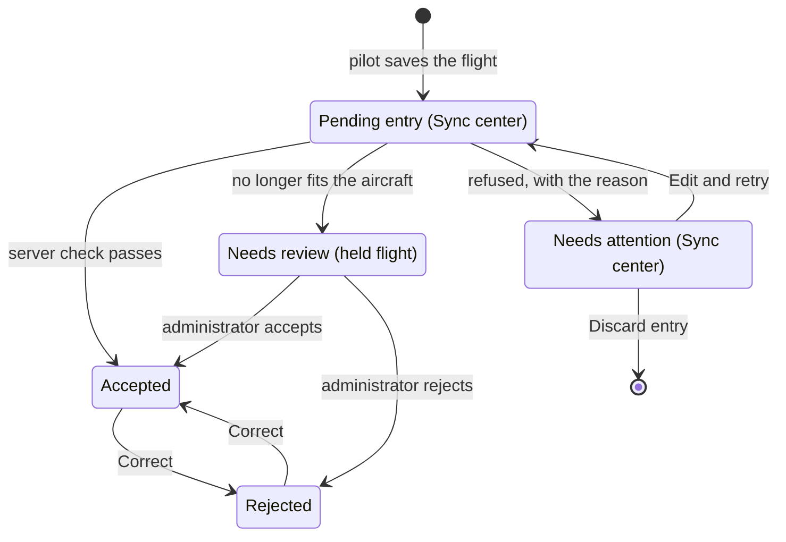
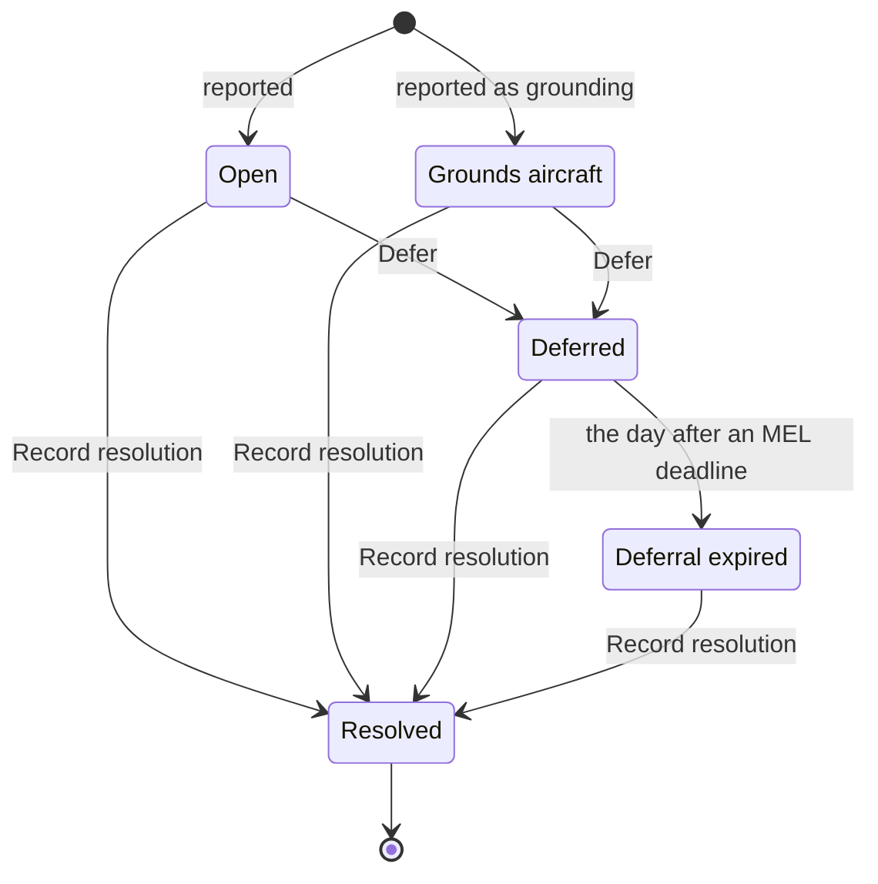
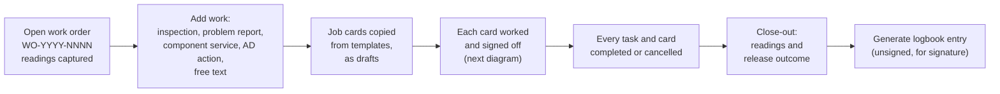
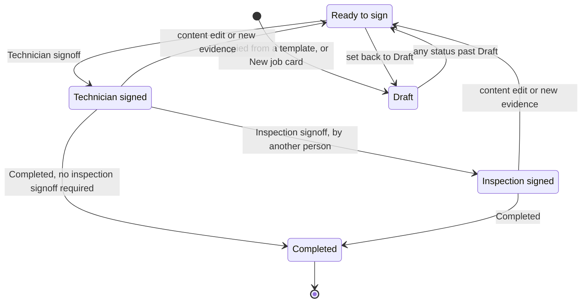
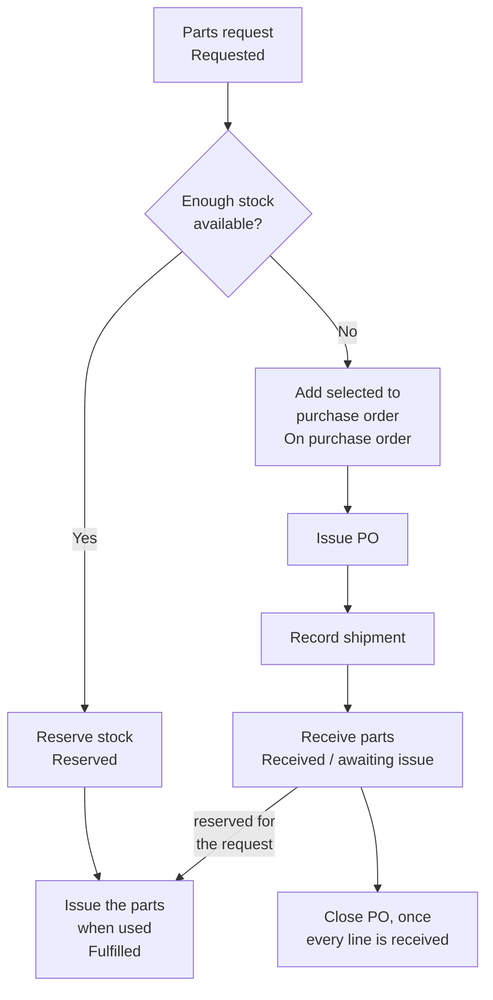
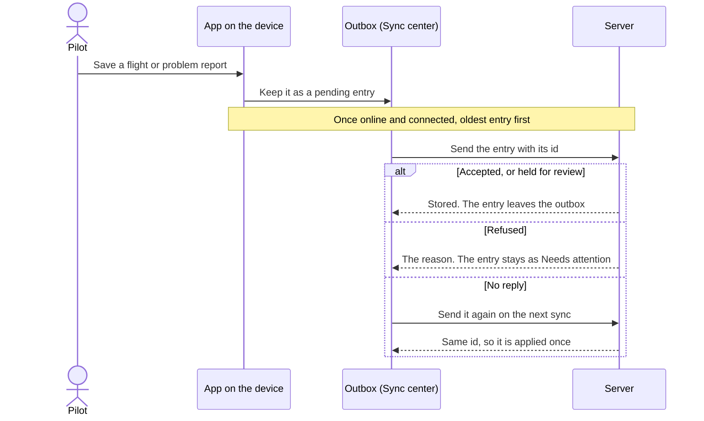

# How it works

[Handbook](../README.md)

How records move through the app, from a flight to a signed-off job card, and the rules underneath. Each section gives the short version and links to the full page. Words are defined in [GLOSSARY.md](../../../GLOSSARY.md).

## The life of a flight

| Step             | What happens                                                                                                                       | Detail                                            |
| ---------------- | ---------------------------------------------------------------------------------------------------------------------------------- | ------------------------------------------------- |
| 1. Start         | The pilot opens **Log flight** on a phone. The form shows the aircraft's starting Hobbs and tach to check, read-only.              | [README: pilots](../../../README.md#pilots)       |
| 2. Dispatch gate | A grounded aircraft is refused before the flight starts. An administrator can record a dispatch override with a reason.            | [Glossary: Dispatch gate](../../../GLOSSARY.md)   |
| 3. End           | The pilot enters ending readings, landings, cycles, fuel and oil. Numbers with a decimal comma ("2342,5") are refused.             | [Flight log options](../../flight-log-options.md) |
| 4. Save          | The entry is saved on the device as a **pending entry** and sent at once when connected. Offline, it waits in the **Sync center**. | [Offline](../../offline.md)                       |

What the server does with the entry, and what an administrator can do after:

- **Accepted** moves the aircraft's totals. **Needs review** and **Rejected** change none ([flights held for review](../../offline.md#flights-held-for-review)).
- Only an administrator reviews, with a reason, and may correct the entry while accepting. Totals and later flights are then rebuilt. Every decision keeps the original values in the change log.

A flight is held, not refused, when, in this order:

1. the aircraft changed after the entry was started;
2. it predates a counter change;
3. it is backdated or duplicates a time;
4. a meter reading is lower than the current counter;
5. a meter reading is **more than 24 hours** past the current counter (almost always a missed decimal point).

Also held: a flight whose aircraft was grounded only by problems reported after it began ("The aircraft was grounded during this flight."). Several legs logged offline by the same pilot on one aircraft are accepted in order ([several legs](../../offline.md#several-legs-logged-offline)).

## The life of a problem report

| Step       | What happens                                                                                                                                                                                                              | Detail                                                  |
| ---------- | ------------------------------------------------------------------------------------------------------------------------------------------------------------------------------------------------------------------------- | ------------------------------------------------------- |
| 1. Report  | **Report a problem**, or the flight form's problem field. Works offline. The report is the discrepancy.                                                                                                                   | [Glossary: Problem report](../../../GLOSSARY.md)        |
| 2. Open    | It shows on **Discrepancies**. One marked grounding grounds the aircraft and sends an urgent alert.                                                                                                                       | [Alerts](../../alerts.md)                               |
| 3a. Defer  | **Defer (MEL / 91.213)**: under an MEL item and category, or as 14 CFR 91.213(d) inoperative equipment, with placard text. An MEL deferral has a repair deadline counted from the day the defect was found (decision D4). | [Maintenance workflows](../../maintenance-workflows.md) |
| 3b. Work   | **Add to work order**, so the repair is planned and signed off there.                                                                                                                                                     | [Work orders](../../work-orders.md)                     |
| 4. Resolve | **Record resolution** closes it, with who and when.                                                                                                                                                                       | [Maintenance workflows](../../maintenance-workflows.md) |

Deferring and resolving both need the `resolve` permission. A report's standing, as the Discrepancies screen labels it:

**Grounds aircraft** and **Deferral expired** ground the aircraft; **Deferred** lets it fly with the placard. A deferred report still counts as open.

One member may hold at most **200 open problem reports**, or **512 KiB** of their text, in a program; deferred reports do not count. Past that, a new report is refused. Administrators are alerted at half of either limit (decision D2, [maintenance workflows](../../maintenance-workflows.md)).

## The life of a work order and job card

- **Open.** Choose the aircraft, scope, supervisor and priority. A blank number becomes the next `WO-YYYY-NNNN`. The order captures the aircraft's readings at that moment ([work orders](../../work-orders.md)).
- **Job cards.** Adding an inspection, component requirement or problem report copies its job card templates into the order as independent draft cards ([job cards](../../task-cards.md)).
- **Signoffs.** Technician signoff first. Where the card requires an inspection signoff, it follows, by a different person, who needs an approved **Certified mechanic** certificate (14 CFR 43.7). Signoffs are internal work tracking, not return to service ([ADR-0004](../../adr/0004-logbook-generator-and-status-record-system.md)).
- **Certificates.** A certificate a user files or changes waits for an administrator's approval. Nobody approves their own, administrators included ([user certifications](../../user-certifications.md)).
- **Close-out.** Every task completed or cancelled, a completion date, a release outcome and confirmed readings. Close-out records inspection compliance and resets component counters only where chosen, in one transaction. A closed order is read-only.
- **Logbook entry.** **Generate logbook entry** writes 43.9/43.11 wording with a separate "Performed by" line, as editable text or an unsigned PDF ([logbook entries](../../logbook-entries.md)). The signed logbook stays the record.

A job card, from draft to completed ([job cards](../../task-cards.md)):

- A saved completion date (today or earlier) is needed before the technician or inspection signoff; until then both signoff buttons are disabled, with the reason beside them.
- A content edit or new evidence clears every signoff; a new technician signoff clears the inspection signoff; setting a card back to Draft clears them all (OD-1). Any other status change keeps them. Cleared signoffs stay in the change log.
- Completed and canceled cards are read-only. A work order cannot close while a card on it is neither.

## The life of a parts request to a purchase order

The second line of a box is the request's status at that point. The steps, and who does each:

| Step           | What happens                                                                                                                                            | Who                                                             |
| -------------- | ------------------------------------------------------------------------------------------------------------------------------------------------------- | --------------------------------------------------------------- |
| 1. Request     | **Parts / repair requests** from a problem report, inspection, task, job card, component or stock item. The source is carried in.                       | Maintenance; a Flight Program administrator for a stock request |
| 2. Check stock | On-hand, reserved and available stock by location. Expired stock is never available.                                                                    | Anyone who can see it                                           |
| 3a. From stock | Reserve, then **issue** reserved parts. An issue to a work order records the unit cost on the order's administrator-only cost record (decision D13).    | Flight Program administrator                                    |
| 3b. To order   | **Add selected to purchase order** (same vendor, currency and ship-to).                                                                                 | Flight Program administrator                                    |
| 4. PO          | **Save draft PO** → **Issue PO** → **Record shipment** → **Receive parts** → **Close PO**. A receipt cannot be dated before the order was issued (D19). | Flight Program administrator                                    |
| 5. Arrive      | Parts received for a request are reserved for it; issue them when used. A stock request reads **Fulfilled** once its parts arrive (D18).                | Flight Program administrator                                    |
| Repair         | Send an uninstalled serialized component out on a repair PO; it reads **Out for repair** until it is received back.                                     | Flight Program administrator                                    |

The purchasing screens and messages say "inventory administrator" for the Flight Program administrator; there is no separate inventory permission.

Detail: [parts and repair requests](../../parts-and-repair-requests.md), [purchase orders](../../purchase-orders.md), [vendors](../../vendors.md), [Aircraft Spruce](../../aircraft-spruce.md).

## The change log: appended, never edited

- Every change writes one change-log row: who, when, what, the values before and after, and a reason where one is required ([change history](../../change-history.md)).
- `writeAudit` in [`convex/access.ts`](../../../convex/access.ts) is the only code that inserts a row. No code updates or deletes one ([CONTEXT.md §5](../../../CONTEXT.md#5-module-boundary-rules), invariant 3).
- A mistake in a completed record is answered with a **correction**: a new entry that keeps the original and states a reason. The records package says so: "Corrections are appended in Angel One with a reason and never edited into history" ([`src/domain/recordsPackage.ts`](../../../src/domain/recordsPackage.ts)).

Why:

- 14 CFR 91.417(a)(2) status records must be kept current, and 91.417(b)(2) keeps them for the life of the aircraft ([ADR-0008](../../adr/0008-daily-backups-off-site-90-days-monthly-forever.md)). Nothing is deleted; old records are archived and hidden ([ADR-0004](../../adr/0004-logbook-generator-and-status-record-system.md)).
- An FAA inspector (91.417(c)) or a buyer (91.419) gets the records with their history in the [records package](../../records-export.md).
- The log is protected by limited database access and locked off-site backups (set up, but no run or restore proven yet: [risks R1](../4-money-and-risk/risks.md#r1-off-site-backups-are-set-up-but-not-proven-yet)), not by hash chaining ([ADR-0005](../../adr/0005-audit-log-protection-by-access-and-backups.md), [ADR-0010](../../adr/0010-one-convex-administrator.md)). A direct database edit is banned except a restore or a written repair, and is recorded by hand with `audit:recordManualEntry` ([database access](../../runbooks/database-access.md)).
- Transfers between programs add links (`transferredAudit`); they never re-tag old rows ([Flight Program access](../../flight-program-access.md#explicit-transfers)).

Who sees which rows follows the same rules as the records themselves ([change history](../../change-history.md)).

## Offline and sync

| Works offline                                    | Needs a connection                                                                   |
| ------------------------------------------------ | ------------------------------------------------------------------------------------ |
| Logging flights and problem reports              | Everything else: corrections, resolutions, work orders, access changes               |
| A logbook line photo for a flight not yet synced | Switching Flight Program                                                             |
| Manuals kept with **Keep on this device**        | **Load older** history; opening files other than kept manuals ("Reconnect to open.") |

How a pending entry reaches the server:

- A banner says how many entries wait ("3 entries waiting to send").
- For a **Needs attention** entry, choose **Edit and retry** or **Discard entry**.
- The device keeps a copy of the active program, cut to the history window, for **seven days from sign-in**. It is not encrypted. Phones and tablets need a screen lock (decision of 19 Nov; [offline](../../offline.md#signing-out-and-shared-devices)).
- Two people saving the same record: the second save is refused with "This record was changed by someone else. Review the differences." Five forms then offer **Keep mine**, **Use theirs** or **Cancel** ([offline](../../offline.md#when-two-people-change-the-same-record)).
- If the server cannot load the program, the app says **Your workspace could not be opened.** and offers the copy on the device.
- A new version shows **A new version is ready. Save any open form first.** with **Reload now**.

## History paging and the 3-month window

The device and every screen hold a **window** of history, not all of it. Older records load page by page ([history paging](../../history-paging.md), [ADR-0013](../../adr/0013-history-retention-window.md), decisions H1–H7).

| Kept in the workspace                                                                                                                                   | Loads with **Load older**                      |
| ------------------------------------------------------------------------------------------------------------------------------------------------------- | ---------------------------------------------- |
| Every open item, however old (held flights, open and deferred problem reports, open work orders and job cards, open parts requests and purchase orders) | Older flights, problem reports, work orders    |
| Flights from the last 6 months (183 days)                                                                                                               | Settled parts requests, closed purchase orders |
| Closed records changed in the last 3 months (90 days)                                                                                                   | Older flight plans                             |
| The 5 latest completed work orders on each aircraft                                                                                                     | The change log, past its newest 250 rows       |
| Always complete: aircraft, inspections, ADs, components, checklists, templates, inventory                                                               |                                                |

- Screens show "Showing the last 3 months · Load older". Counts and text search cover loaded rows and say so (H2, H3).
- The window starts at midnight UTC, so a record at the edge appears in both places, never in neither.
- The records package always pages full history; one made offline is marked partial (H4).
- Why: Convex refuses one request that reads more than 16 MiB. Without the window the workspace stopped loading at about two fleet-years ([Capacity and limits](capacity-and-limits.md)).
- Three derived tables (`recordNumbers`, `costLedger`, `purchasingKeys`) let saves and totals avoid reading history. They are rebuilt after any restore ([Operations](../3-running-it/operations.md#after-a-release-or-a-restore-the-migrations)).

## File links

- No stored file reaches a device by a permanent address. A screen asks the server for a link; the server checks the caller may see the record, the same rule that lists it ([file links](../../file-links.md)).
- A link works for **five minutes**. A copied link then says "This link has expired. Open the file again from Angel One."
- Owners get only their aircraft's photo and current Form 337 copies. Board-only members get no files.
- Offline, files other than kept manuals say "Reconnect to open."; an aircraft photo falls back to the drawing.

## Alerts

| Channel              | What                   | Who                                                                                                | When                   |
| -------------------- | ---------------------- | -------------------------------------------------------------------------------------------------- | ---------------------- |
| Bell and Alerts page | Every alert            | Everyone who can read the aircraft                                                                 | Always                 |
| Daily digest email   | Alerts not yet emailed | Members with **Email me a daily alert digest** on (default on for program administrators)          | 13:00 UTC              |
| Urgent email         | New urgent alerts      | Members with **Email me urgent alerts at once** on (default on for administrators and maintenance) | Right after the change |
| Device push          | The same urgent alerts | Devices switched on under **Alert this device**                                                    | Right after the change |

- **Urgent** means: aircraft grounded, inspection or AD overdue, component past its limit, a date expired, one member's problem reports piling up.
- At most **60 urgent emails a day** for the whole deployment, so the digest fits Resend's free 100 a day. Each program gets a fair share, at least 10 (decision D9).
- **Expiring dates** (insurance, registration, keys, `security.txt`) are records with their own alerts, from 60 days before.
- The server judges "today" in the records time zone (`RECORDS_TIME_ZONE`: `America/Edmonton` in production; `America/New_York` when unset).
- System administrators also get "Off-site backups" in the digest when the newest backup is more than 26 hours old (D10).

Detail: [alerts](../../alerts.md), [ADR-0012](../../adr/0012-urgent-alerts-by-web-push-and-immediate-email.md), [monitoring runbook](../../runbooks/monitoring.md#alerts-by-email-and-on-devices).

## Sign-in

- Everyone signs in with **email and password**. Administrators create accounts ([ADR-0002](../../adr/0002-administrator-provisioned-accounts.md), [ADR-0009](../../adr/0009-password-for-everyone-plus-google-and-microsoft.md), [ADR-0015](../../adr/0015-remove-google-and-microsoft-sign-in.md)).
- Passwords: **15 to 128 characters**, no composition rules, common passwords refused (NIST SP 800-63B).
- **10 failed sign-ins in an hour** lock the account; one attempt returns every 6 minutes. A system administrator's **Reset password** clears it at once ([accounts runbook](../../runbooks/accounts.md)).
- A session lasts **seven days**, matching the offline window. A device clock up to five minutes behind still opens.
- The app has **no second factor** ([risks R14](../4-money-and-risk/risks.md#r14-no-second-factor-2fa)).
- Every sign-in is written to the change log ("User · signed in", with the method).
- Disabling a user or resetting a password ends every session at once.

## Signing out wipes the device

- Signing out deletes everything the app keeps on the device for that person: the copy of the Flight Program, their pending entries and waiting logbook photos, drafts and kept manuals. Device settings stay.
- If anything has not synced, it asks first: **Stay signed in** keeps it; **Delete and sign out** deletes it for good.
- A session that ends without sign-out (seven days, a reset, a disabled account) clears the copy and kept manuals on the next connection, but keeps pending entries.

Detail: [signing out and shared devices](../../offline.md#signing-out-and-shared-devices).
