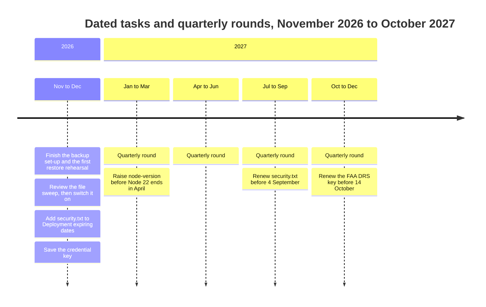

# Checklists

[Handbook](../README.md)

What to check, how often, who does it, and how. Copy a section into an issue or a notebook and tick it off.

- **Sources:** [recurring tasks](../../go-live-checklist.md#recurring-tasks), the [runbooks](../../runbooks/), [ADR-0008](../../adr/0008-daily-backups-off-site-90-days-monthly-forever.md).
- **Times** are rough. The go-live checklist budgets one to two hours a quarter for upkeep.
- **Aaron** runs the app. "An administrator" means a Flight Program administrator unless it says system administrator.

When the dated tasks fall, with the quarterly round between them:

The twice-a-year and yearly tasks have no fixed date: do each with a quarterly round.

## Daily

### In the hangar

- [ ] **Aircraft status.** An administrator or mechanic, 5 min. Overview: any aircraft **Not OK to fly**, and what is due soon ([how](../../wiki/Overview-and-Aircraft.md), [rules](../../maintenance-workflows.md)).
- [ ] **Alerts.** Everyone, 2 min. The bell or the **Alerts** page; urgent ones also arrive by email or push ([how](../../wiki/Alerts.md), [rules](../../alerts.md)).
- [ ] **Held flights.** An administrator, 5 min. Flight log → **Review** each **Needs review** flight; accept (with corrections) or reject. Until then the aircraft's totals leave it out ([how](../../wiki/Flight-Log.md#review-a-held-flight), [rules](../../offline.md#flights-held-for-review)).
- [ ] **Open problem reports.** A mechanic or administrator, 5 min. **Discrepancies**: anything grounding, deferrals near their deadline, reports with no work order ([how](../../wiki/Discrepancies.md), [rules](../../maintenance-workflows.md)).
- [ ] **Certificates waiting for approval.** An administrator, 2 min. **Administration → Users** lists them at the top: check each against the real certificate, then **Approve**. Until then it can't give the inspection signoff ([how](../../wiki/Administration.md#approve-a-certificate), [rules](../../user-certifications.md)).
- [ ] **Sync center.** Each pilot, 1 min. No entries left in **Needs attention** ([how](../../wiki/Offline.md), [rules](../../offline.md#pending-entries-and-the-sync-center)).

### For Aaron

- [ ] **Read any failure email.** 2 min each. A failed Nightly backup (GitHub email), a Better Stack alert (site down, Convex sign-in down, missed heartbeat). Fix by the matching table: [nightly backup errors](../../runbooks/backup-restore.md#when-a-nightly-run-fails), [monitoring](../../runbooks/monitoring.md).
- [ ] **The 13:00 UTC digest.** 2 min. An "Off-site backups" warning means no good backup for 26 hours.

## Weekly

- [ ] **Parts on order.** A Flight Program administrator, 15 min. **Purchase orders**: overdue deliveries, shipments to receive, cores and repairs still out ([how](../../wiki/Purchase-Orders-and-Vendors.md), [rules](../../purchase-orders.md), [parts requests](../../parts-and-repair-requests.md)).
- [ ] **Work orders.** A mechanic or administrator, 10 min. Tasks with a **Parts delay**; orders ready to close ([how](../../wiki/Work-Orders.md), [rules](../../work-orders.md)).
- [ ] **Planning.** An administrator, 10 min. **Planning** screen: what falls due across the fleet in the coming weeks; open work orders for it ([how](../../wiki/Planning-and-Due-Items.md)).
- [ ] **Dependabot.** Aaron, 5 min. Merge any update GitHub marks High or Critical at once, the sign-in library (`@convex-dev/auth`) first. Merging deploys once CI is green ([release runbook](../../runbooks/release.md#what-runs-where)).
- [ ] **Summary.** An administrator, 10 min. Change history → **Summary** for the last 7 days ([how](../../wiki/Weekly-Summary.md), [rules](../../change-history.md)).

## Monthly

- [ ] **Paper check.** An administrator, 15–30 min per aircraft, while paper logbooks run beside the app. Flight log → **Paper check (month)**: tick each recorded flight and completed work order against the paper logbook ([how](../../wiki/Records-Package-and-Exports.md#paper-check), [rules](../../reconciliation.md)).
- [ ] **Expiring dates.** An administrator, 5 min. Settings → Flight Program → **Program expiring dates** (insurance, registration) and Settings → System → **Deployment expiring dates** (keys, `security.txt`). Alerts start 60 days out ([how](../../wiki/Settings.md), [rules](../../alerts.md)).
- [ ] **Keep `main` active.** Aaron, 2 min. GitHub stops scheduled workflows in a public repository after **60 days without activity**, which stops the nightly backup. Check Actions → Nightly backup is enabled and ran last night; if it was disabled, **Enable workflow** ([backup runbook](../../runbooks/backup-restore.md#who-is-told-when-it-fails), [GitHub docs](https://docs.github.com/en/actions/managing-workflow-runs-and-deployments/managing-workflow-runs/disabling-and-enabling-a-workflow)).

## Quarterly

Budget 1–2 hours.

- [ ] **Merge Dependabot pull requests** whose CI is green, one at a time, watching each Deploy. Aaron, 30 min ([recurring tasks](../../go-live-checklist.md#recurring-tasks)).
- [ ] **Confirm last night's backup** succeeded and that a Deploy still works. Aaron, 5 min.
- [ ] **Restore rehearsal.** Aaron, about 1 hour. Newest monthly copy into a scratch deployment; table counts match; an administrator signs in; an aircraft and an attachment open; run the three migrations, then the reconcile check; **Load older** works. Log it in the runbook ([quarterly rehearsal](../../runbooks/backup-restore.md#quarterly-restore-rehearsal)).
- [ ] **Convex log check.** Aaron, 10 min. Convex dashboard → Logs: search "Many bytes read" and "took a long time" on `operations:snapshot`, `operations:reviewFlight` and the saves. Warnings mean roadmap findings 74a or 74d are due ([capacity](../2-how-it-works/capacity-and-limits.md#when-to-look-again)).
- [ ] **Access review.** Aaron, 15 min. The Convex team's members and deploy keys match [accounts](../../runbooks/accounts.md#production-dashboard-administrators); every "Audit · manual entry" since last time matches an issue or a restore ([database access](../../runbooks/database-access.md#checks)); who can open the Dropbox folder ([Dropbox copy](../../runbooks/dropbox-records-copy.md#who-may-have-access-to-the-folder)).
- [ ] **Risk register.** Aaron, 10 min. Update [risks](../4-money-and-risk/risks.md).

## Twice a year

- [ ] **Test break-glass access.** Aaron with the sealed-copy holder, 30 min, during two rehearsals six months apart. Check the sealed copy; sign in with the break-glass account in a private window (once a year from the sealed copy, then rotate it); check its sign-ins are all logged tests; check the Convex sign-in and recovery codes; practise the dashboard repair in the scratch deployment ([break-glass](../../runbooks/break-glass-admin.md#test-twice-a-year)).

## Yearly

- [ ] **Node version.** Aaron, 30 min. Raise `node-version` in all four workflows to the current Node LTS before the pinned one ends (Node 22: April 2027). Rebuild from a clean checkout: `npm ci && npm run check`.
- [ ] **Rotate tokens.** Aaron, 30 min. The Cloudflare API token and, if the Dropbox copy is set up, the Dropbox tokens; record new expiry dates in [accounts](../../runbooks/accounts.md) and under **Deployment expiring dates** ([credentials](credentials.md) says where each lives; [incident runbook: leaked secret](../../runbooks/incident-response.md#leaked-secret) has the steps).
- [ ] **Credentials check.** Aaron, 15 min. The password manager holds everything in [its checklist](credentials.md#your-password-manager-should-hold), and each entry is current; deploy keys and other GitHub-only secrets stay out of it. Two-step sign-in is on for GitHub, Cloudflare, Convex and Better Stack; the Convex deploy keys and Cloudflare API tokens list nothing unexpected ([credentials and keys](credentials.md)).
- [ ] **VAPID key review.** Aaron, 5 min. The push key pair's yearly review date under **Deployment expiring dates**. Rotating it turns alerts off on every device until each is switched on again ([monitoring](../../runbooks/monitoring.md#alerts-by-email-and-on-devices)).
- [ ] **Cost review.** Aaron, 15 min. Convex usage, R2 size and the Dropbox folder against [services and costs](../4-money-and-risk/services-and-costs.md). Monthly archives grow forever by design ([ADR-0008](../../adr/0008-daily-backups-off-site-90-days-monthly-forever.md)).

## One-off and dated

- [ ] **Review the file sweep, then switch it on.** Aaron, 10 min, from 21 Nov 2026. Convex Logs → search `fileSweep would delete`; check a few ids are referenced nowhere; then `FILE_SWEEP=delete` ([file sweep](../../runbooks/file-sweep.md#review-the-first-pass-then-switch-to-delete)).
- [ ] **Finish the backup set-up.** Aaron, about 1 hour. Three steps are left: add the `BACKUP_HEARTBEAT_URL` secret, run the Nightly backup by hand and check it, and do the first restore rehearsal ([set up from scratch](setup-from-scratch.md#7-backups), [rehearsal](../../runbooks/backup-restore.md#quarterly-restore-rehearsal)).
- [ ] **Add `security.txt` to the expiring dates.** Aaron, 5 min. Settings → System → **Deployment expiring dates**, expiring 2027-10-04.
- [ ] **Renew `security.txt` before 2027-09-04.** Aaron, 15 min. It expires **2027-10-04**. Set `Expires` about 11 months ahead in [`public/.well-known/security.txt`](../../../public/.well-known/security.txt), check `Contact` still reaches someone, deploy.
- [ ] **Renew the FAA DRS key before 2027-10-14.** Aaron, 15 min. Renew on the FAA website, then Settings → System → **FAA API key and renewal** with the new expiry ([airworthiness](../../airworthiness.md)).
- [ ] **Re-check CodeQL.** Aaron, 5 min. Reported done on 2026-11-19; on 2026-11-20 GitHub shows it not configured. Settings → Code security → **CodeQL analysis**: turn the default set-up on if it is off ([set-up step](setup-from-scratch.md#54-repository-settings), [risks R13](../4-money-and-risk/risks.md#r13-public-repository)).
- [ ] **Fill the password manager.** Aaron, 30 min. Save everything in [its checklist](credentials.md#your-password-manager-should-hold), recovery codes included.
- [ ] **Narrow the order-health-dashboard token.** Aaron, 10 min. Cloudflare → API Tokens: that project's build token has admin access to every R2 bucket, `angelone-backups` included. Limit it to that project's own bucket, or delete it if unused ([credentials](credentials.md#every-credential)).
- [ ] **Delete the old sign-in variables.** Aaron, 2 min. Delete any `AUTH_GOOGLE_*` or `AUTH_MICROSOFT_ENTRA_ID_*` variable in Convex; the code no longer reads them ([ADR-0015](../../adr/0015-remove-google-and-microsoft-sign-in.md)).
- [ ] **Keep the credential key safe.** Aaron, 5 min, now that backups are unencrypted ([ADR-0014](../../adr/0014-backups-stored-unencrypted.md)). Recommended: keep `CREDENTIALS_ENCRYPTION_KEY` in Aaron's password manager: the backup job saves no environment variables, and without the key a restore onto a new Convex account can't open the saved FAA, Geoapify and Aircraft Spruce credentials.

## Whenever it happens

- [ ] **After any restore:** run, each until it reports 0: `migrations:backfillHistoryColumns`, `migrations:rebuildRecordNumbers`, `migrations:rebuildCostLedger`; then `migrations:reconcileCostLedger` must answer `differing: 0` ([operations](operations.md#after-a-release-or-a-restore-the-migrations)). Then record the restore with `audit:recordManualEntry`.
- [ ] **After a release that names a one-off command:** run it as the pull request says ([README](../../../README.md#one-off-steps-for-deployments-with-older-data)).
- [ ] **After changing `CREDENTIALS_ENCRYPTION_KEY` or `CREDENTIALS_ENCRYPTION_KEYS`:** update the copy in Aaron's password manager; no backup holds it while encryption is off ([backup runbook](../../runbooks/backup-restore.md#when-an-environment-variable-changes)).
- [ ] **After a schema change that renames or removes a table:** do a restore rehearsal ([ADR-0008](../../adr/0008-daily-backups-off-site-90-days-monthly-forever.md)).
- [ ] **When the reconcile logs "The cost ledger differs from its records.":** run `migrations:rebuildCostLedger` until 0.
- [ ] **When a person leaves:** a system administrator disables their account; remove them from the Dropbox folder; if they held a Convex key, rotate it ([accounts](../../runbooks/accounts.md#disabling-a-user)).
- [ ] **When a device is lost:** follow [lost or stolen device](../../runbooks/incident-response.md#lost-or-stolen-device).
- [ ] **A red Deploy saying "is not the newest commit on main"** after two quick merges is expected, not a failure.
