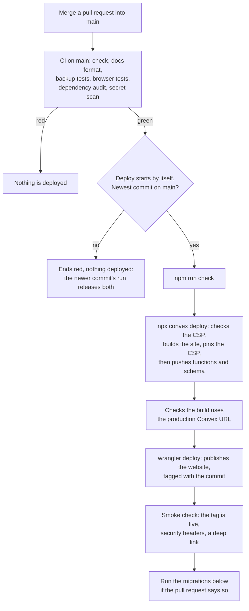
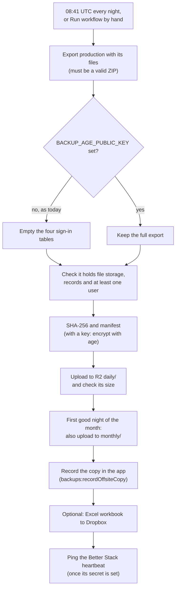

# Operations

[Handbook](../README.md)

How production is released, backed up, watched and repaired. Each section summarises a runbook; the runbook has the exact steps. Setting everything up from nothing is in [Set up from scratch](setup-from-scratch.md). What to do on a schedule is in [Checklists](checklists.md).

| Runbook                                                          | Use it to                                                                     |
| ---------------------------------------------------------------- | ----------------------------------------------------------------------------- |
| [Release and rollback](../../runbooks/release.md)                | Release, roll back, change hosting, read the security headers                 |
| [Backup and restore](../../runbooks/backup-restore.md)           | Run, check and restore backups; rehearse a restore                            |
| [Dropbox records copy](../../runbooks/dropbox-records-copy.md)   | Set up the optional readable Excel copy                                       |
| [Monitoring](../../runbooks/monitoring.md)                       | Better Stack, Sentry, alert email and device push                             |
| [File sweep](../../runbooks/file-sweep.md)                       | Review, then switch on, deleting unreferenced files                           |
| [Incident response](../../runbooks/incident-response.md)         | Any incident: compromise, leaked secret, bad deploy, data loss, lost device   |
| [Break-glass administrator](../../runbooks/break-glass-admin.md) | Get back in when no administrator can sign in                                 |
| [Production database access](../../runbooks/database-access.md)  | The rules for touching production data, and the hand-written change-log entry |
| [Credential encryption key](../../runbooks/credentials-key.md)   | Rotate the key that seals the FAA, Geoapify and Aircraft Spruce credentials   |
| [Accounts](../../runbooks/accounts.md)                           | Who owns each outside account; user lockouts and the sign-in log              |

## Releasing

**Merging a pull request into `main` is the release.** What happens after the merge:



Deploy starts by itself after green CI: no required reviewer is set on the `production` environment today, and branch protection on `main` is off by Aaron's decision ([risks R21](../4-money-and-risk/risks.md#r21-branch-protection-is-off)). Only this workflow publishes the site. Cloudflare's own Git build must stay disconnected, and a build guard (`scripts/cloudflareBuildGuard.ts`) refuses to build there ([release runbook](../../runbooks/release.md#cloudflare)).

Before you merge ([release runbook](../../runbooks/release.md#release)):

- [ ] CI is green on the pull request.
- [ ] Schema changes accept the documents already stored.
- [ ] A Convex backup taken (dashboard → Backups → **Backup now**, with file storage) and the password-manager copy of `CREDENTIALS_ENCRYPTION_KEY` is current.

What Deploy refuses ([`deploy.yml`](../../../.github/workflows/deploy.yml)):

| Deploy stops when                                                                                                                       | Message or sign                    | What to do                                                             |
| --------------------------------------------------------------------------------------------------------------------------------------- | ---------------------------------- | ---------------------------------------------------------------------- |
| Its commit is not the newest on `main`                                                                                                  | "is not the newest commit on main" | Nothing. Two merges landed close together; the newer run releases both |
| A manual run without the backup box ticked                                                                                              | "Take a Convex backup…"            | Take the backup, then run again with the box ticked                    |
| A manual run without green CI for that commit                                                                                           | Refusal in the log                 | Wait for CI, or use the emergency box (below)                          |
| The Convex URL (or a Sentry host, if switched on) isn't allowed by the CSP, the CSP can't be pinned, or a source map is left in `dist/` | Refusal before anything is pushed  | Fix the cause; nothing changed in production                           |
| The deploy key is not a production key                                                                                                  | Refusal                            | Replace `CONVEX_DEPLOY_KEY` in the GitHub `production` environment     |

- **By hand:** Actions → **Deploy** → **Run workflow** from `main`, tick the backup box. Use it after a website rollback or a changed GitHub variable.
- **Emergency box:** skips only the green-CI check, for a broken production whose fix is on `main` while CI can't pass for an unrelated reason. Never past a failed secret scan ([release runbook](../../runbooks/release.md#emergency-deploy-without-green-ci)).
- **Order:** Convex goes live a few seconds before the website, so functions must keep working for the previous website and for installed apps not yet reloaded.

After every deploy, check the live site ([release runbook](../../runbooks/release.md#after-every-deploy)): sign in, open a work order and an attachment, reload a deep link, see the update prompt in an installed app, print a purchase order preview, and no "Content Security Policy" errors in the console.

## Rolling back

| Problem in        | What to do                                                                                                                                          |
| ----------------- | --------------------------------------------------------------------------------------------------------------------------------------------------- |
| The screens       | Roll the website back in Cloudflare (Workers & Pages → **angel-one** → **Deployments** → **Rollback**). Instant                                     |
| Data or functions | **Convex can't roll back.** Revert the commit on `main` with a pull request; Deploy releases the revert. If data was damaged, restore from a backup |

Detail: [release runbook: rollback](../../runbooks/release.md#rollback).

## After a release or a restore: the migrations

History paging added derived columns and tables. They must be filled after a release that adds derived columns or lookup keys (its pull request says so; done on production after both such releases on 20 Nov 2026, all 0) and **again after every restore** ([history paging](../../history-paging.md#before-deploying-s7), [README](../../../README.md#one-off-steps-for-deployments-with-older-data)).

Run the three migrations in this order, each until it reports 0, then the reconcile check. Use the Convex dashboard (Production → **Functions** → `migrations` → **Run function**, arguments `{}`), or a terminal signed in to Convex as Aaron (`npx convex login`):

```sh
npx convex run --prod migrations:backfillHistoryColumns   # repeat until 0 missing
npx convex run --prod migrations:rebuildRecordNumbers     # repeat until 0
npx convex run --prod migrations:rebuildCostLedger        # repeat until 0
npx convex run --prod migrations:reconcileCostLedger      # must answer differing: 0
```

The deploy keys live only in GitHub and are not kept to paste here ([credentials](credentials.md)). Until the migrations finish:

| Not yet done             | Effect                                                                                                                                                          |
| ------------------------ | --------------------------------------------------------------------------------------------------------------------------------------------------------------- |
| `backfillHistoryColumns` | The workspace loads more than it needs; history pages refuse; purchasing saves can miss a reused request id, an open repair or an allocation on an older record |
| `rebuildRecordNumbers`   | A blank work order or job card number can repeat an older one                                                                                                   |
| `rebuildCostLedger`      | The board and Costs can show less than was spent                                                                                                                |

The nightly 09:37 UTC reconcile logs "The cost ledger differs from its records." if the ledger drifts; then run `rebuildCostLedger` again.

## Backups and restore

| Copy                         | Where                                        | Kept                           |
| ---------------------------- | -------------------------------------------- | ------------------------------ |
| Convex scheduled backup      | Convex dashboard → Backups                   | 7 days                         |
| Nightly export               | R2 bucket `angelone-backups`, `daily/`       | 90 days, locked                |
| Monthly archive              | Same bucket, `monthly/`                      | Forever, locked                |
| Environment variables        | Same bucket, `env/`, only with encryption on | Forever, locked                |
| Readable workbook (optional) | Dropbox app folder                           | 90 days daily; monthly forever |

The nightly job ([`backup.yml`](../../../.github/workflows/backup.yml), [`scripts/backup/nightly.sh`](../../../scripts/backup/nightly.sh)), step by step:



- **A failed step** stops the run: nothing later happens, no heartbeat is sent, and no copy is ever deleted or overwritten. With a key, the job also saves changed environment variables to `env/` before it records the copy.
- **Encryption** is off ([ADR-0014](../../adr/0014-backups-stored-unencrypted.md)), so (recommended) keep `CREDENTIALS_ENCRYPTION_KEY` in Aaron's password manager, and protect the bucket and its token as you would the records ([risks R2](../4-money-and-risk/risks.md#r2-unencrypted-backups)).
- **Status today:** the bucket, its lock and lifecycle rules, the R2 token, the scoped backup deploy key, the time zone and the failure emails are set up. Still for Aaron to do: the `BACKUP_HEARTBEAT_URL` secret, the first manual run and the first restore rehearsal. Until that run is checked, do not count on an off-site copy ([backup set-up](setup-from-scratch.md#7-backups)).
- **Check a run:** green in Actions; Settings → System → **Off-site backups** shows the time; the files are in R2.
- **Who is told:** GitHub emails a failed scheduled run to whoever last changed or re-enabled the workflow; Better Stack alerts on a missed heartbeat (once the `BACKUP_HEARTBEAT_URL` secret is set); system administrators get "Off-site backups" in the digest after 26 hours.
- **Restore:** stop writes, take a fresh backup, restore (Convex dashboard for 7 days, R2 for older), re-apply access changes made since, run the migrations above, verify, then record the restore with `audit:recordManualEntry` ([backup runbook: real restore](../../runbooks/backup-restore.md#real-restore-production)).
- **Rehearse** every quarter into a scratch deployment, never one others can sign in to ([quarterly rehearsal](../../runbooks/backup-restore.md#quarterly-restore-rehearsal)).

Policy: [ADR-0008](../../adr/0008-daily-backups-off-site-90-days-monthly-forever.md), [ADR-0011](../../adr/0011-readable-records-copy-in-dropbox.md).

## Monitoring

| What                                                | Set up?                                             | Alerts                                  |
| --------------------------------------------------- | --------------------------------------------------- | --------------------------------------- |
| Better Stack: the site and Convex's sign-in service | Yes, 20 Nov 2026                                    | Email                                   |
| Better Stack: backup heartbeat (24 h period)        | Yes; the `BACKUP_HEARTBEAT_URL` secret still to add | Email when a night's ping is missing    |
| GitHub failed-workflow email                        | Yes; goes to Aaron                                  | Email                                   |
| The app's daily digest                              | On for system administrators who switch it on       | Backup age, expiring dates, maintenance |
| Sentry (browser and server errors)                  | No; Better Stack only for now                       | —                                       |
| Convex dashboard logs and usage                     | Always there                                        | None: look quarterly                    |

Cloudflare Bot Fight Mode blocks uptime monitors; it is off. Detail: [monitoring runbook](../../runbooks/monitoring.md).

## Settings on the deployment

Set in the Convex dashboard (Settings → Environment Variables) or with `npx convex env set`. Values never go in the repository. The full list, with whether each is required: [set up from scratch](setup-from-scratch.md#33-environment-variables).

| Variable                                                 | Turns on                                                                                                                                           |
| -------------------------------------------------------- | -------------------------------------------------------------------------------------------------------------------------------------------------- |
| `SITE_URL`                                               | The links in alert emails                                                                                                                          |
| `JWT_PRIVATE_KEY`, `JWKS`                                | Sessions                                                                                                                                           |
| `CREDENTIALS_ENCRYPTION_KEY`                             | Sealed integration credentials and file-link signing                                                                                               |
| `RESEND_API_KEY`, `RESEND_FROM`                          | Alert email                                                                                                                                        |
| `VAPID_PUBLIC_KEY`, `VAPID_PRIVATE_KEY`, `VAPID_SUBJECT` | Device push                                                                                                                                        |
| `RECORDS_TIME_ZONE`                                      | The calendar day for server alerts (default `America/New_York`; production: `America/Edmonton`, on Convex and in the GitHub `backups` environment) |
| `FILE_SWEEP`                                             | `report` (default), `delete` or `off`                                                                                                              |

Settings → System → **Deployment status** shows which features are on.

## Incidents and break-glass

| Situation                         | First move                                                             | Runbook                                                                                          |
| --------------------------------- | ---------------------------------------------------------------------- | ------------------------------------------------------------------------------------------------ |
| An account taken over             | A system administrator disables it (ends every session)                | [Incident: account compromise](../../runbooks/incident-response.md#suspected-account-compromise) |
| A secret leaked                   | Revoke it at its source, then replace it                               | [Incident: leaked secret](../../runbooks/incident-response.md#leaked-secret)                     |
| One program saw another's records | SEV1: a server bug or a wrong group                                    | [Incident: cross-tenant](../../runbooks/incident-response.md#cross-tenant-data-exposure)         |
| A bad release                     | Disable the Deploy workflow; roll back the website or revert on `main` | [Incident: bad deploy](../../runbooks/incident-response.md#bad-deploy)                           |
| Lost or wrong data                | Stop entries; keep the damaged state; correct or restore               | [Incident: data loss](../../runbooks/incident-response.md#data-loss-or-corruption)               |
| A lost device                     | Reset the user's password; remote-erase                                | [Incident: lost device](../../runbooks/incident-response.md#lost-or-stolen-device)               |
| No administrator can sign in      | The break-glass account; last resort, a dashboard repair               | [Break-glass](../../runbooks/break-glass-admin.md)                                               |

- Severity: SEV1 at once, SEV2 the same day, SEV3 the next business day.
- Keep a timeline in UTC. Never edit or delete production data or change-log rows to contain an incident.
- Write a blameless review within 5 business days, as `docs/security/incident-YYYY-MM-DD.md`.
- Still blank in the runbooks: the incident folder, the contact sheet, the deputy, the sealed-copy holder. Gaps they name: no tested way to take the whole app offline; no command ends every session at once; the app can't wipe a device that stays offline.

## Touching production data

- **Banned**, except a restore or a repair the app cannot make, raised as an issue first ([database access](../../runbooks/database-access.md)).
- Take a backup, copy the document, make the smallest edit, then record it at once with `audit:recordManualEntry`. It appears in Change history as "Audit · manual entry".
- Never edit or delete a change-log (`audit`) row, for any reason.
