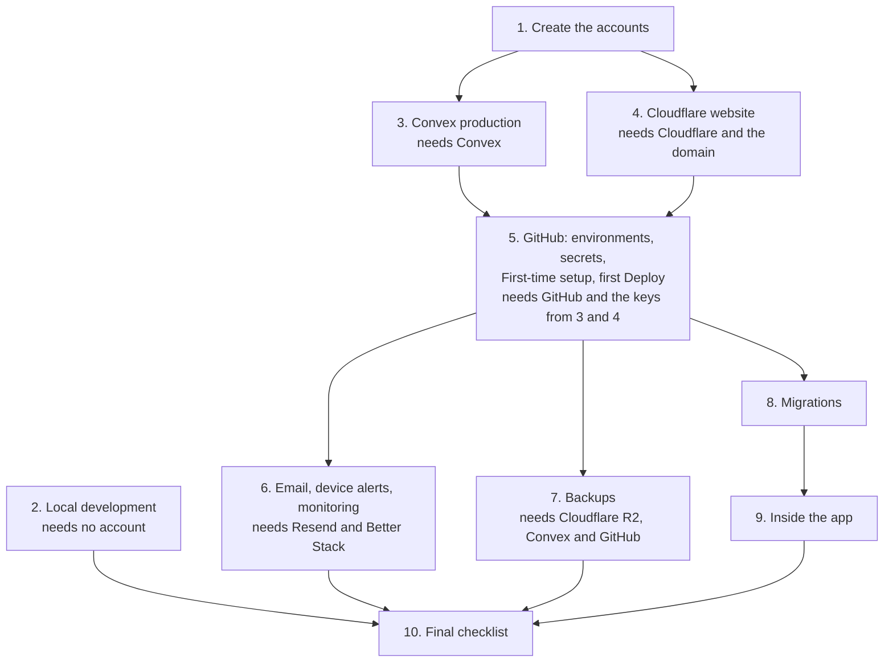

# Set up Angel One from scratch

[Handbook](../README.md)

This guide takes you from no accounts and no code to a working live app and a working local copy, in order. Every name, secret, variable and command below is the one the code and workflows use. Long procedures stay in their runbooks and are linked, not copied.

- What each service is for and what it costs: [services and costs](../4-money-and-risk/services-and-costs.md).
- How the pieces fit together: [system overview](../1-start-here/system-overview.md).
- Where every key lives and how to replace it: [credentials](credentials.md).
- Aaron is the one Convex administrator ([ADR-0010](../../adr/0010-one-convex-administrator.md)).

Never put a real key, password or token in the repository, an issue or a chat: the repository is public. Secrets go only into the dashboards named below.

The order of the work, and the accounts each section needs:



Section 3.2 (sign-in keys and the first administrator) is easiest from GitHub, so it waits for section 5.

## Contents

1. [Accounts to create](#1-accounts-to-create)
2. [Local development on a clean machine](#2-local-development-on-a-clean-machine)
3. [The production Convex deployment](#3-the-production-convex-deployment)
4. [The Cloudflare website](#4-the-cloudflare-website)
5. [GitHub](#5-github)
6. [Email, device alerts and Better Stack](#6-email-device-alerts-and-better-stack)
7. [Backups](#7-backups)
8. [One-off migrations](#8-one-off-migrations)
9. [Inside the app](#9-inside-the-app)
10. [Final checklist](#10-final-checklist)
11. [What next](#11-what-next)

## 1. Accounts to create

Use organization accounts, not personal ones, with two-step sign-in on. Record who holds each account and its renewal date in the [accounts runbook](../../runbooks/accounts.md) as you go.

| #   | Account                                                                                                                                                             | What it is for                                                                                          | Needed?                                                                                        |
| --- | ------------------------------------------------------------------------------------------------------------------------------------------------------------------- | ------------------------------------------------------------------------------------------------------- | ---------------------------------------------------------------------------------------------- |
| 1   | [GitHub organization](https://github.com/account/organizations/new) and a public repository (today `angelone-aviation/AO-aircraft-maintenance`)                     | Code, CI, Deploy, the nightly backup, issues                                                            | Required                                                                                       |
| 2   | [Cloudflare](https://dash.cloudflare.com/sign-up), with the app's domain [added as a zone](https://developers.cloudflare.com/fundamentals/manage-domains/add-site/) | DNS, the website (Workers Static Assets) and R2 backup storage                                          | Required                                                                                       |
| 3   | [Convex](https://dashboard.convex.dev), Pro plan, **one** member ([ADR-0007](../../adr/0007-convex-pro-single-seat.md))                                             | Database, functions, files, sign-in, scheduled jobs                                                     | Required                                                                                       |
| 4   | [Resend](https://resend.com/signup), with a verified sending domain                                                                                                 | The daily alert digest and urgent alert emails                                                          | Optional; without it, alerts stay in the app                                                   |
| 5   | [Better Stack](https://betterstack.com/uptime)                                                                                                                      | Uptime monitors and the backup heartbeat                                                                | Strongly recommended                                                                           |
| 6   | [FAA DRS API key](https://drs.faa.gov/drs-api)                                                                                                                      | Airworthiness-directive search and daily monitoring                                                     | Optional; AD monitoring is off without it                                                      |
| 7   | [Geoapify](https://myprojects.geoapify.com/)                                                                                                                        | Address lookup on purchase orders                                                                       | Optional; addresses can be checked by hand                                                     |
| 8   | Dropbox (organization account)                                                                                                                                      | The readable Excel copy of the records ([ADR-0011](../../adr/0011-readable-records-copy-in-dropbox.md)) | Optional                                                                                       |
| 9   | Sentry                                                                                                                                                              | Browser and server error reports                                                                        | Optional, off today ([monitoring runbook](../../runbooks/monitoring.md#sentry-browser-errors)) |
| 10  | Aircraft Spruce                                                                                                                                                     | Parts catalogue and ordering, one login per Flight Program, entered in the app                          | Optional                                                                                       |

## 2. Local development on a clean machine

All of this section was run on a fresh copy of `main` on 2026-11-20 and passed.

1. Install [Node.js](https://nodejs.org/en/download) **22.12 or newer** (`package.json` `engines`; CI uses Node 22) and Git. For the backup tests also install `age`, `zip`, `unzip` and `jq`.
2. Clone and install:

   ```sh
   git clone https://github.com/angelone-aviation/AO-aircraft-maintenance.git
   cd AO-aircraft-maintenance
   npm ci
   ```

3. **Demo mode, no backend:** `npm run dev`, open <http://localhost:5173> and choose **Explore the local demo**, or run `npm run dev:demo`. Demo data is fictional and stays in that browser.
4. **A real development backend.** In a second terminal, start one of:

   | Command               | What you get                                                                                                                                                      |
   | --------------------- | ----------------------------------------------------------------------------------------------------------------------------------------------------------------- |
   | `npm run dev:local`   | A local Convex backend on this computer, no Convex account. Pinned to backend `precompiled-2026-09-28-5c7cb5b`, which runs on Debian Bookworm (the dev container) |
   | `npm run dev:backend` | `npx convex dev`: log in and choose a cloud **development** deployment, or a local one                                                                            |

   Either writes `.env.local` with `VITE_CONVEX_URL` (and `CONVEX_DEPLOYMENT`). Keep it running; restart Vite if it was already running. `.env.example` lists the browser variables; backend secrets never go in `.env` files.

5. Set up sign-in on that backend, then make an administrator:

   ```sh
   npm run setup:auth    # signing keys, CREDENTIALS_ENCRYPTION_KEY, SITE_URL=http://localhost:5173
   npm run setup:admin   # prompts for name, email and password; empty database only
   ```

   Or, on a `dev:local` backend, skip `setup:admin` and run `npm run test:local`: the smoke test makes a development administrator and saves it in git-ignored `.env.local-admin.json`.

6. Run the app with `npm run dev` and sign in.
7. Run the checks:

   | Command                                                    | Checks                                                                                                                                                                                                                                       |
   | ---------------------------------------------------------- | -------------------------------------------------------------------------------------------------------------------------------------------------------------------------------------------------------------------------------------------- |
   | `npm run check`                                            | Typecheck, lint, unit and server tests, production build                                                                                                                                                                                     |
   | `npx playwright install chromium`, then `npm run test:e2e` | Browser tests against the production build with the production headers; any CSP violation fails. Run it with no `.env.local`, as CI does: with one, the build talks to your local backend, not the demo-only build the specs are written for |
   | `npm run test:local`                                       | Real sign-in and database calls against the local backend (refuses any non-local URL)                                                                                                                                                        |
   | `npm run test:backup`                                      | The nightly backup job against a fake Convex and R2                                                                                                                                                                                          |
   | `npm run check:standards`                                  | File headers and the no-suppression rule on files changed since `origin/main`                                                                                                                                                                |

To start over locally, stop the backend and delete `.env.local`, `.env.local-admin.json` and `.convex/`. The [README](../../../README.md#dev-container-and-docker) covers the dev container.

## 3. The production Convex deployment

### 3.1 Create the project

1. In the [Convex dashboard](https://dashboard.convex.dev), create a project. It comes with a **Production** deployment; its URL looks like `https://<name>.convex.cloud`, and its HTTP actions (sign-in, file links) answer on `https://<name>.convex.site`.
2. Production deployment → **Settings** → **Deploy keys** → **Generate a deploy key** ([docs](https://docs.convex.dev/cli/deploy-key-types)). It starts with `prod:`. When the panel asks what the key may do, allow ([role actions](https://docs.convex.dev/team-management/role-actions#data-plane-and-runtime)):
   - `deployment:deploy`: Deploy pushes the functions and schema;
   - `deployment:env:view` and `deployment:env:write`: First-time setup reads and sets the variables;
   - `deployment:data:view`: First-time setup checks the `users` table is empty;
   - `deployment:functions:runInternalActions`: `admin:bootstrap` and the migrations are internal actions.

   The key goes into GitHub ([section 5](#5-github)) and nowhere else.

3. Production deployment → **Backups**: turn on the **daily scheduled backup, including file storage** ([Convex backups](https://docs.convex.dev/database/backup-restore)).

### 3.2 Sign-in keys and the first administrator

Two ways; both run the same scripts.

- **No terminal (recommended):** the **First-time setup** workflow, after the GitHub `production` environment exists. Steps are in [section 5.3](#53-first-time-setup-and-the-first-deploy).
- **From a terminal**, with the deploy key in the shell only:

  ```sh
  read -rs CONVEX_DEPLOY_KEY && export CONVEX_DEPLOY_KEY
  SITE_URL=https://ops.angeloneaviation.org npm run setup:auth
  npx convex deploy          # functions and schema, no website
  npm run setup:admin        # empty database only
  unset CONVEX_DEPLOY_KEY
  ```

What the scripts do:

- `setup:auth` (`scripts/configure-auth.mjs`) creates `JWT_PRIVATE_KEY` and `JWKS` as a pair and `CREDENTIALS_ENCRYPTION_KEY`, keeps any that exist, never prints a key, and sets `SITE_URL` from the shell (else keeps the deployment's, else `http://localhost:5173`).
- `setup:admin` (`scripts/bootstrap-admin.mjs`) checks the password (15–128 characters, not common, not containing the email), puts it on the deployment as the temporary `BOOTSTRAP_ADMIN_PASSWORD`, calls the internal `admin:bootstrap`, and removes the variable again, also on failure. It refuses a deployment that already has users.
- **Afterwards:** confirm `BOOTSTRAP_ADMIN_PASSWORD` is gone (dashboard → Settings → Environment Variables), and delete the GitHub secret `FIRST_ADMIN_PASSWORD` if you used the workflow.

### 3.3 Environment variables

Set them in the dashboard (production deployment → **Settings** → **Environment Variables**, [docs](https://docs.convex.dev/production/environment-variables)) or with `npx convex env set NAME --prod` and the value on stdin. Every name below is read by code in `convex/`, or by the sign-in library it runs (`JWT_PRIVATE_KEY`, `JWKS`). Which are secret, where Aaron keeps them, and what to do if one is lost or leaked: [credentials and keys](credentials.md).

| Name                                                           | Where it goes | Required                                  | What it's for                                                                                                                                                                                                                    | Example format                               |
| -------------------------------------------------------------- | ------------- | ----------------------------------------- | -------------------------------------------------------------------------------------------------------------------------------------------------------------------------------------------------------------------------------- | -------------------------------------------- |
| `SITE_URL`                                                     | Convex        | Yes for email links; `setup:auth` sets it | The website address in the links of alert emails; without it they carry no links ([release runbook](../../runbooks/release.md#convex-production-deployment))                                                                     | `https://ops.example.org`, no trailing slash |
| `JWT_PRIVATE_KEY`                                              | Convex        | Yes                                       | Signs sign-in tokens ([3.2](#32-sign-in-keys-and-the-first-administrator))                                                                                                                                                       | PKCS#8 PEM on one line                       |
| `JWKS`                                                         | Convex        | Yes                                       | The public half of the signing key ([3.2](#32-sign-in-keys-and-the-first-administrator))                                                                                                                                         | `{"keys":[{"use":"sig","kty":"RSA",...}]}`   |
| `CREDENTIALS_ENCRYPTION_KEY`                                   | Convex        | Yes; `setup:auth` makes it                | Signs the file links (without it no attachment, photo or manual opens) and seals the saved FAA, Geoapify and Aircraft Spruce credentials; never change it in place ([credential key runbook](../../runbooks/credentials-key.md)) | 32 random bytes, base64 (44 characters)      |
| `CREDENTIALS_ENCRYPTION_KEYS`, `CREDENTIALS_ENCRYPTION_KEY_ID` | Convex        | No                                        | Key rotation only ([credential key runbook](../../runbooks/credentials-key.md))                                                                                                                                                  | `k2=<base64>` and `k2`                       |
| `RECORDS_TIME_ZONE`                                            | Convex        | No; default `America/New_York`            | The calendar day for "overdue", "expired" and alerts ([alerts](../../alerts.md))                                                                                                                                                 | `America/Chicago` (IANA name)                |
| `RESEND_API_KEY`                                               | Convex        | No                                        | Alert emails ([section 6.1](#61-email-resend))                                                                                                                                                                                   | `re_xxxxxxxx`                                |
| `RESEND_FROM`                                                  | Convex        | With `RESEND_API_KEY`                     | The verified sender ([section 6.1](#61-email-resend))                                                                                                                                                                            | `Angel One <alerts@mail.example.org>`        |
| `VAPID_PUBLIC_KEY`, `VAPID_PRIVATE_KEY`                        | Convex        | No                                        | Urgent alerts on devices ([section 6.2](#62-device-alerts-web-push))                                                                                                                                                             | base64url key pair                           |
| `VAPID_SUBJECT`                                                | Convex        | With the VAPID keys                       | The contact push services see ([section 6.2](#62-device-alerts-web-push))                                                                                                                                                        | `mailto:accounts@example.org`                |
| `FAA_DRS_API_KEY`                                              | Convex        | No                                        | A fallback FAA key; the normal place is **Settings → System** ([airworthiness](../../airworthiness.md))                                                                                                                          | FAA-issued key                               |
| `GEOAPIFY_API_KEY`                                             | Convex        | No                                        | A fallback Geoapify key; the normal place is **Settings → System**                                                                                                                                                               | 32 hex characters                            |
| `FILE_SWEEP`                                                   | Convex        | No; unset means `report`                  | What the hourly file sweep does ([file sweep runbook](../../runbooks/file-sweep.md))                                                                                                                                             | `delete`                                     |
| `BOOTSTRAP_ADMIN_PASSWORD`                                     | Convex        | Temporary only                            | The first password, removed again by `setup:admin` ([3.2](#32-sign-in-keys-and-the-first-administrator))                                                                                                                         | —                                            |
| `CONVEX_SITE_URL`                                              | Set by Convex | —                                         | Provided by Convex; do not set it                                                                                                                                                                                                | —                                            |

**Settings → System → Deployment status** in the app shows which optional features are on.

## 4. The Cloudflare website

The site is the Vite build in `dist/`, served by Workers Static Assets (`wrangler.jsonc`), with one small Worker (`worker/assets.ts`) that answers a missing `/assets/` bundle with an uncached 404 and every other unmatched path with the app shell. Details: [release runbook](../../runbooks/release.md#cloudflare).

1. **Account ID:** Cloudflare dashboard → Workers & Pages → copy **Account ID**.
2. **API token:** [Account API Tokens](https://developers.cloudflare.com/fundamentals/api/get-started/account-owned-tokens/) (or [user tokens](https://dash.cloudflare.com/profile/api-tokens)) → template **Edit Cloudflare Workers**; account resources this account only, zone resources the app's zone only; set an expiry. If a deploy fails on the custom domain with a permission error, add **Zone → DNS → Edit** for that zone.
3. **Domain:** the address is `routes` in `wrangler.jsonc` (today `ops.angeloneaviation.org`, a [custom domain](https://developers.cloudflare.com/workers/configuration/routing/custom-domains/)). For another domain, change it there, in `public/.well-known/security.txt` and `public/.well-known/security-policy.txt`, and in `SECURITY.md`. The zone must be in the **same** Cloudflare account. Do **not** create the DNS record by hand: the first deploy creates it and its certificate.
4. **Do not** use Cloudflare's "Create an app" or "Continue with GitHub". The Deploy workflow creates and updates the Worker `angel-one`. Its Git build must stay disconnected (Workers & Pages → `angel-one` → **Settings** → **Build** → **Disconnect**): it builds without the backend address and published a broken site for about 30 minutes on 20 Nov 2026. A build guard ([`scripts/cloudflareBuildGuard.ts`](../../../scripts/cloudflareBuildGuard.ts), wired into `vite.config.ts`) now refuses to build when Cloudflare's builder sets `WORKERS_CI`, so a reconnected Git build fails instead of publishing. Never reconnect it ([release runbook](../../runbooks/release.md#cloudflare)).
5. **Headers and CSP:** `public/_headers` sets the security headers. It allows any `*.convex.cloud` / `*.convex.site` host so local and test builds work; Deploy checks the production URL against it (`scripts/check-csp-origin.mjs`) and then pins the published copy to production's own two hosts (`scripts/pin-csp-origin.mjs`). A Convex custom domain needs hand edits first ([release runbook](../../runbooks/release.md#convex-production-deployment), step 3).
6. **Turn these zone settings off.** Each injects a script or rewrites headers, and the strict CSP (no inline scripts) blocks or conflicts with them. Never add `'unsafe-inline'` to make one work.

   | Setting                                                                                                                            | Where                                                                           | Why off                                                                                                                                                                 |
   | ---------------------------------------------------------------------------------------------------------------------------------- | ------------------------------------------------------------------------------- | ----------------------------------------------------------------------------------------------------------------------------------------------------------------------- |
   | **Add security headers** ([managed transform](https://developers.cloudflare.com/rules/transform/managed-transforms/))              | Rules → Settings → Managed Transforms                                           | Overrides the reviewed headers in `public/_headers` (security review 2026-11-04, C1)                                                                                    |
   | **Bot Fight Mode** ([docs](https://developers.cloudflare.com/bots/get-started/bot-fight-mode/))                                    | Security → Settings → **Bot traffic**                                           | Injects an inline script the CSP blocks (a violation on every page), and returns 403 to uptime monitors and Deploy's smoke check (C4)                                   |
   | **JavaScript detections** ([docs](https://developers.cloudflare.com/cloudflare-challenges/challenge-types/javascript-detections/)) | Security → Settings → **Bot traffic**                                           | Injects a script on every page, which the CSP blocks. Bot Fight Mode always includes it, so turning that off removes it; on Super Bot Fight Mode turn it off separately |
   | **Web Analytics automatic setup** ([docs](https://developers.cloudflare.com/web-analytics/get-started/))                           | Web Analytics → the site → **Manage site** → **Disable**, if the site was added | Injects the beacon script, which the CSP blocks; the app sends no analytics                                                                                             |

7. HSTS is two years with subdomains. Adding `preload` is a separate decision for Aaron, and hard to undo.

## 5. GitHub

### 5.1 Environments, secrets and variables

Create each under Settings → **Environments** → **New environment** ([docs](https://docs.github.com/en/actions/how-tos/deploy/configure-and-manage-deployments/manage-environments)). Deployment branches: **selected branches, `main` only**. Put secrets on the environment, never as repository secrets.

| Environment  | Rules                                                                                                                               |
| ------------ | ----------------------------------------------------------------------------------------------------------------------------------- |
| `production` | Optional required reviewer (free on a public repository). Not set on Angel One's production today: Deploy starts by itself after CI |
| `backups`    | **No** required reviewers: they would hold every nightly run                                                                        |

Every secret and variable the workflows read (keeping, losing and leaking them: [credentials and keys](credentials.md)):

| Name                                                             | Where it goes                         | Required                                                      | What it's for                                                                                    | Example format                                         |
| ---------------------------------------------------------------- | ------------------------------------- | ------------------------------------------------------------- | ------------------------------------------------------------------------------------------------ | ------------------------------------------------------ |
| `CONVEX_DEPLOY_KEY`                                              | `production` secret                   | Yes                                                           | Deploy and First-time setup push to Convex ([5.2](#52-what-the-workflows-do))                    | `prod:<name>\|<token>` (a production key)              |
| `CLOUDFLARE_API_TOKEN`                                           | `production` secret                   | Yes                                                           | Deploy publishes the Worker ([section 4](#4-the-cloudflare-website))                             | Cloudflare API token                                   |
| `CLOUDFLARE_ACCOUNT_ID`                                          | `production` secret                   | Yes                                                           | The account the Worker lives in ([section 4](#4-the-cloudflare-website))                         | 32 hex characters                                      |
| `PRODUCTION_URL`                                                 | `production` variable                 | Yes for First-time setup; turns on Deploy's smoke check       | The website address for the smoke check ([5.3](#53-first-time-setup-and-the-first-deploy))       | `https://ops.example.org`, no trailing slash           |
| `FIRST_ADMIN_PASSWORD`                                           | `production` secret                   | Only while running First-time setup; delete after             | The first administrator's password ([5.3](#53-first-time-setup-and-the-first-deploy))            | 15–128 characters                                      |
| `VITE_SENTRY_DSN`                                                | `production` (or repository) variable | No                                                            | Browser error reports ([monitoring runbook](../../runbooks/monitoring.md#sentry-browser-errors)) | `https://<key>@o123.ingest.us.sentry.io/456`           |
| `SENTRY_AUTH_TOKEN`, `SENTRY_ORG`, `SENTRY_PROJECT`              | `production` secrets                  | No                                                            | Source-map upload ([monitoring runbook](../../runbooks/monitoring.md#sentry-browser-errors))     | `sntrys_...`, slugs                                    |
| `CONVEX_BACKUP_DEPLOY_KEY`                                       | `backups` secret                      | Yes for backups                                               | Exports production for the nightly backup ([section 7](#7-backups))                              | `prod:<name>\|<token>` (a production key)              |
| `R2_ACCOUNT_ID`                                                  | `backups` secret                      | Yes for backups                                               | The bucket's Cloudflare account ([section 7](#7-backups))                                        | 32 hex characters                                      |
| `R2_ACCESS_KEY_ID`, `R2_SECRET_ACCESS_KEY`                       | `backups` secrets                     | Yes for backups                                               | The bucket's R2 token ([section 7](#7-backups))                                                  | 32 and 64 hex characters                               |
| `R2_BUCKET`                                                      | `backups` variable                    | No; default `angelone-backups`                                | The bucket's name ([section 7](#7-backups))                                                      | `angelone-backups`                                     |
| `BACKUP_AGE_PUBLIC_KEY`                                          | `backups` secret                      | No; unset stores unencrypted copies ([section 7](#7-backups)) | Turns on encryption ([backup runbook](../../runbooks/backup-restore.md#to-turn-encryption-on))   | `age1...`                                              |
| `BACKUP_HEARTBEAT_URL`                                           | `backups` secret                      | No                                                            | The Better Stack heartbeat ([6.3](#63-better-stack))                                             | `https://uptime.betterstack.com/api/v1/heartbeat/<id>` |
| `DROPBOX_APP_KEY`, `DROPBOX_APP_SECRET`, `DROPBOX_REFRESH_TOKEN` | `backups` secrets                     | No                                                            | The readable workbook in Dropbox ([runbook](../../runbooks/dropbox-records-copy.md))             | Dropbox app values                                     |
| `RECORDS_TIME_ZONE`                                              | `backups` variable                    | No                                                            | The workbook's time zone, as on Convex ([3.3](#33-environment-variables))                        | `America/Chicago`                                      |

### 5.2 What the workflows do

| Workflow                                      | When                                                                               | What                                                                                                                                                                                                                                                                                                                                                                                                                                                   |
| --------------------------------------------- | ---------------------------------------------------------------------------------- | ------------------------------------------------------------------------------------------------------------------------------------------------------------------------------------------------------------------------------------------------------------------------------------------------------------------------------------------------------------------------------------------------------------------------------------------------------ |
| **CI** (`ci.yml`)                             | Every pull request and push to `main`; no secrets                                  | Standards check on changed files, `npm run check`, Prettier on the docs, `npm run test:backup`, Playwright; plus **Dependency audit (production)** (`npm audit --omit=dev --audit-level=high`) and **Secret scan (gitleaks)** 8.30.1 over all history, checksum-pinned. Test values are allowed only in `.gitleaks.toml`; a rotated real secret's fingerprint goes in `.gitleaksignore` ([release runbook](../../runbooks/release.md#what-runs-where)) |
| **Deploy** (`deploy.yml`)                     | After a green CI push to `main`, or by hand from `main` with the backup box ticked | Releases only the **newest** commit on `main`, and only with green CI for it (a manual run checks; an old run re-run deploys nothing). Runs `npm run check`, `npx convex deploy` (which builds the site against production and pins the CSP), checks the build, `wrangler deploy` tagged with the commit, then the smoke check if `PRODUCTION_URL` is set                                                                                              |
| **First-time setup** (`first-time-setup.yml`) | By hand, once                                                                      | See 5.3                                                                                                                                                                                                                                                                                                                                                                                                                                                |
| **Nightly backup** (`backup.yml`)             | 08:41 UTC daily, or by hand                                                        | See [section 7](#7-backups)                                                                                                                                                                                                                                                                                                                                                                                                                            |

Full detail, emergency override and rollback: [release runbook](../../runbooks/release.md).

### 5.3 First-time setup and the first deploy

1. Fill in the `production` environment (5.1), including `PRODUCTION_URL` and `FIRST_ADMIN_PASSWORD`.
2. Actions → **First-time setup** → **Run workflow** → branch `main`, the administrator's name and email, tick **This is a new, empty production deployment**. It refuses a deployment that has users, then runs `setup:auth` with `SITE_URL` = `PRODUCTION_URL`, `npx convex deploy`, and `setup:admin`. Safe to rerun until the administrator exists.
3. Delete `FIRST_ADMIN_PASSWORD` from the environment.
4. Take a Convex backup (dashboard → Backups → **Backup now**) and check the password-manager copy of `CREDENTIALS_ENCRYPTION_KEY` is current ([backup runbook](../../runbooks/backup-restore.md#when-an-environment-variable-changes)), then Actions → **Deploy** → **Run workflow** from `main`, tick the backup box. CI must be green for the newest commit. (Any push to `main` before step 1 starts a Deploy that fails for lack of secrets; that is harmless.)
5. Sign in at `PRODUCTION_URL`. Then run the [one-off migrations](#8-one-off-migrations).

### 5.4 Repository settings

1. **Branch protection** for `main` (off on Angel One today by Aaron's decision, [risks R21](../4-money-and-risk/risks.md#r21-branch-protection-is-off); [docs](https://docs.github.com/en/repositories/configuring-branches-and-merges-in-your-repository/managing-protected-branches/about-protected-branches)): require a pull request and the status checks **Check and browser tests**, **Dependency audit (production)** and **Secret scan (gitleaks)**.
2. Settings → **Code security**: turn on Dependabot alerts and security updates ([docs](https://docs.github.com/en/code-security/how-tos/secure-your-supply-chain/secure-your-dependencies/configure-security-updates)). Weekly version updates come from `.github/dependabot.yml` (grouped minor and patch, seven-day cooldown). Merge them one at a time: each merge deploys.
3. Settings → Code security → **CodeQL analysis** → **Set up** → **Default** ([docs](https://docs.github.com/en/code-security/how-tos/find-and-fix-code-vulnerabilities/configure-code-scanning/configure-code-scanning)). Free on a public repository. On Angel One: reported done on 2026-11-19; on 2026-11-20 GitHub shows it not configured. Aaron to re-check ([risks R13](../4-money-and-risk/risks.md#r13-public-repository)).
4. Aaron: profile picture → Settings → Notifications → **System** → **Actions**: Email, **Only notify for failed workflows**. Then Actions → Nightly backup → **···** → **Disable workflow**, then **Enable workflow**, so failure emails reach him ([why](../../runbooks/backup-restore.md#who-is-told-when-it-fails)).

## 6. Email, device alerts and Better Stack

### 6.1 Email (Resend)

1. Resend → [Domains](https://resend.com/domains) → add a sending subdomain, for example `mail.example.org` ([docs](https://resend.com/docs/dashboard/domains/introduction)). A subdomain keeps Resend's records apart from the domain's own mail (Google Workspace today).
2. Add the records Resend lists (DKIM `TXT`, SPF `TXT` and the bounce `MX`) in Cloudflare DNS ([Resend's Cloudflare guide](https://resend.com/docs/guides/dns/cloudflare)). Wait for **Verified**.
3. Resend → [API keys](https://resend.com/api-keys) → a **Sending access** key for that domain.
4. On Convex: `RESEND_API_KEY` and `RESEND_FROM` ([table](#33-environment-variables)).
5. Free tier: 100 emails a day; the app spends at most 60 on immediate emails. Limits and logs: [monitoring runbook](../../runbooks/monitoring.md#alerts-by-email-and-on-devices).

### 6.2 Device alerts (Web Push)

1. On a trusted computer: `npx web-push generate-vapid-keys`.
2. On Convex: `VAPID_PUBLIC_KEY`, `VAPID_PRIVATE_KEY`, `VAPID_SUBJECT` ([table](#33-environment-variables)). Never in the repository.
3. Record the pair under **Settings → System → Deployment expiring dates** with a yearly review. Rotating it turns off every device's alerts.

### 6.3 Better Stack

1. Two HTTP monitors: the website (`https://ops.angeloneaviation.org/`) and sign-in (`https://<name>.convex.site/.well-known/openid-configuration`).
2. A [heartbeat](https://betterstack.com/docs/uptime/cron-and-heartbeat-monitor/) with a 24-hour period and a grace of a few hours; its URL → `backups` secret `BACKUP_HEARTBEAT_URL`.
3. Bot Fight Mode must be off ([section 4](#4-the-cloudflare-website)), or the website monitor gets 403.

Sentry stays off; to switch it on, follow the [monitoring runbook](../../runbooks/monitoring.md#sentry-browser-errors).

## 7. Backups

Policy: daily off-site copies kept 90 days, monthly copies forever ([ADR-0008](../../adr/0008-daily-backups-off-site-90-days-monthly-forever.md)). Encryption is optional and off by default ([ADR-0014](../../adr/0014-backups-stored-unencrypted.md), Aaron's decision).

1. Cloudflare → R2 → [create a bucket](https://developers.cloudflare.com/r2/buckets/create-buckets/) `angelone-backups` (another name needs the `R2_BUCKET` variable). Keep it private: no public access, no `r2.dev` address, no custom domain.
2. [Bucket lock rules](https://developers.cloudflare.com/r2/buckets/bucket-locks/): prefix `daily/` 90 days; `monthly/` and `env/` indefinite. Leave `state/` unlocked.
3. [Lifecycle rule](https://developers.cloudflare.com/r2/buckets/object-lifecycles/): delete `daily/` objects after 91 days.
4. R2 → **Manage API tokens** → [create a token](https://developers.cloudflare.com/r2/api/tokens/) with **Object Read & Write** on that bucket only → `R2_ACCESS_KEY_ID`, `R2_SECRET_ACCESS_KEY`, plus `R2_ACCOUNT_ID`, as `backups` secrets.
5. A second Convex production deploy key, generated as in [3.1](#31-create-the-project) → `CONVEX_BACKUP_DEPLOY_KEY`. Allow exactly `deployment:backups:create`, `deployment:backups:download`, `deployment:backups:view` and `deployment:data:view` (for `npx convex export --include-file-storage`) and `deployment:functions:runInternalMutations` (for the internal mutation `backups:recordOffsiteCopy`). Add `deployment:env:view` only when you turn encryption on (`npx convex env list`).
6. **Encryption.** Leave `BACKUP_AGE_PUBLIC_KEY` unset: each copy is stored unencrypted as `.unencrypted.zip`, with its four sign-in tables emptied and no `env/` copy ([what a plain copy holds](../../adr/0014-backups-stored-unencrypted.md#what-a-copy-holds), [how to turn encryption on](../../runbooks/backup-restore.md#to-turn-encryption-on)). Recommended: keep `CREDENTIALS_ENCRYPTION_KEY` in Aaron's password manager: nothing else saves it.
7. Optional: the readable Dropbox workbook ([runbook](../../runbooks/dropbox-records-copy.md)).
8. Actions → **Nightly backup** → **Run workflow**. Check: the run is green, the `.unencrypted.zip` and its manifest are in R2 under `daily/` (and `monthly/` for the month's first copy) with nothing in `env/`, and **Settings → System → Off-site backups** shows it.
9. Do the first [restore rehearsal](../../runbooks/backup-restore.md#quarterly-restore-rehearsal) and log it. Repeat quarterly.
10. Aaron turns on **Email me a daily alert digest** (Settings → Alerts): the "no off-site backup for over 26 hours" warning is emailed only to system administrators with it on, and needs Resend ([6.1](#61-email-resend)).

## 8. One-off migrations

Run these after the first deploy, after **any** restore, and after a release that adds derived columns or lookup keys (its pull request says so), in this order, each until it reports `0`. All are internal functions with no arguments; each changes no record and writes no change-log row.

| #   | Function                            | Done when                                                                      |
| --- | ----------------------------------- | ------------------------------------------------------------------------------ |
| 1   | `migrations:backfillHistoryColumns` | `missing: 0`                                                                   |
| 2   | `migrations:rebuildRecordNumbers`   | `missing: 0`                                                                   |
| 3   | `migrations:rebuildCostLedger`      | `missing: 0`                                                                   |
| 4   | `migrations:reconcileCostLedger`    | `differing: 0`, and no "The cost ledger differs from its records." in the logs |

- **Dashboard:** production deployment → **Functions** → `migrations` → pick the function → **Run function**; leave the arguments `{}` → **Run** ([docs](https://docs.convex.dev/dashboard/deployments/functions)).
- **Terminal**, signed in to Convex (`npx convex login`): `npx convex run --prod migrations:backfillHistoryColumns`, and so on. During first-time set-up, with the new deploy key still in the shell, drop `--prod`: the key selects production. Afterwards the deploy keys live only in GitHub ([credentials](credentials.md)).

Why each exists: [history paging](../../history-paging.md#before-deploying-s7).

## 9. Inside the app

Sign in as the first administrator, then:

1. **Records time zone:** set `RECORDS_TIME_ZONE` on Convex first if not on US Eastern time ([table](#33-environment-variables)). Angel One's production uses `America/Edmonton`, on Convex and as the `backups` variable.
2. **Flight Program:** **Flight Programs** (in the menu) → **Add Flight Program**, with name, address, email, contact and website. Select it at the top of the sidebar (under **All sections** on a phone).
3. **Permission groups:** a new program already has six: Observers, Pilots, Maintenance technicians, Program managers, Aircraft owners and Board (read-only). Administration → Permission groups → edit them or add your own (read, flight, discrepancy, resolve, maintenance, or **Flight Program administrator**; or **Aircraft owner** / **Board member** read-only views), each with **All aircraft in this program** or selected aircraft ([Flight Program access](../../flight-program-access.md)).
4. **Users:** Administration → Users → create each person and assign programs and groups. Accounts are made by administrators only; there is no public sign-up ([accounts runbook](../../runbooks/accounts.md)).
5. **Integrations:** Settings → System → **FAA API key and renewal** ([airworthiness](../../airworthiness.md)) and the Geoapify key ([addresses](../../address-verification.md)); Settings → Flight Program → Aircraft Spruce account and labor rate.
6. **Aircraft:** Aircraft → **Set up an aircraft**: verified opening Hobbs and tach, total-time adjustment, cycles and landings; installed components from [component templates](../../component-templates.md); inspections and AD compliance from the CSV templates (download in the wizard, dry run before saving) ([aircraft setup](../../aircraft-setup.md), [inspection templates](../../inspection-templates.md), [maintenance CSV import](../../maintenance-csv-import.md)).
7. **Expiring dates:** Settings → Flight Program → **Program expiring dates** (insurance, registration) and Settings → System → **Deployment expiring dates** (Cloudflare token, VAPID keys, `security.txt`) ([alerts](../../alerts.md#expiring-dates)).
8. **Manuals:** Reference library → **Upload manual** (PDF up to 200 MiB). On each hangar device, add the app to the Home Screen and use **Keep on this device** ([reference library](../../reference-library.md)).
9. **File sweep:** after reviewing its first report, set `FILE_SWEEP=delete` ([file sweep runbook](../../runbooks/file-sweep.md)).
10. **Break-glass account:** set it up ([runbook](../../runbooks/break-glass-admin.md)).

## 10. Final checklist

- [ ] `npm ci && npm run check` passes on a clean clone; `npm run test:e2e` and `npm run test:backup` pass.
- [ ] CI is green on `main`, and the last **Deploy** run is green with its smoke check.
- [ ] The website loads at `PRODUCTION_URL`; a deep link such as `/work-orders` reloads.
- [ ] The browser console shows no Content-Security-Policy errors; the response headers include `Content-Security-Policy` naming only production's `<name>.convex.cloud` and `<name>.convex.site`, and `Strict-Transport-Security`.
- [ ] The Cloudflare settings in [section 4](#4-the-cloudflare-website) are off.
- [ ] The administrator signs in; `BOOTSTRAP_ADMIN_PASSWORD` is not on Convex and `FIRST_ADMIN_PASSWORD` is not in GitHub.
- [ ] **Settings → System → Deployment status** shows email and device alerts on (if set up).
- [ ] An expiring date dated yesterday produces an urgent email and a device alert ([check](../../runbooks/monitoring.md#alerts-by-email-and-on-devices)); archive it afterwards.
- [ ] FAA and Geoapify keys show **Active** / **On** in Settings → System.
- [ ] An uploaded attachment and a manual open.
- [ ] The migrations in [section 8](#8-one-off-migrations) report 0 and `differing: 0`.
- [ ] A manual **Nightly backup** run is green, the copy is in R2 and in Settings → System, and Better Stack received the heartbeat.
- [ ] Both Better Stack monitors are up.
- [ ] A restore rehearsal is logged in the [backup runbook](../../runbooks/backup-restore.md#quarterly-restore-rehearsal).
- [ ] Every account and renewal date is in the [accounts runbook](../../runbooks/accounts.md).
- [ ] An installed app (iOS Safari Add to Home Screen, Android install) opens and logs a flight offline.

## 11. What next

- Using the app: [user wiki](../../wiki/Home.md).
- The handbook: [contents](../README.md), [system overview](../1-start-here/system-overview.md), [code structure](../6-for-developers/code-structure.md), [services and costs](../4-money-and-risk/services-and-costs.md).
- Day-to-day running: [operations](operations.md) and [checklists](checklists.md); the [recurring tasks](../../go-live-checklist.md#recurring-tasks).
