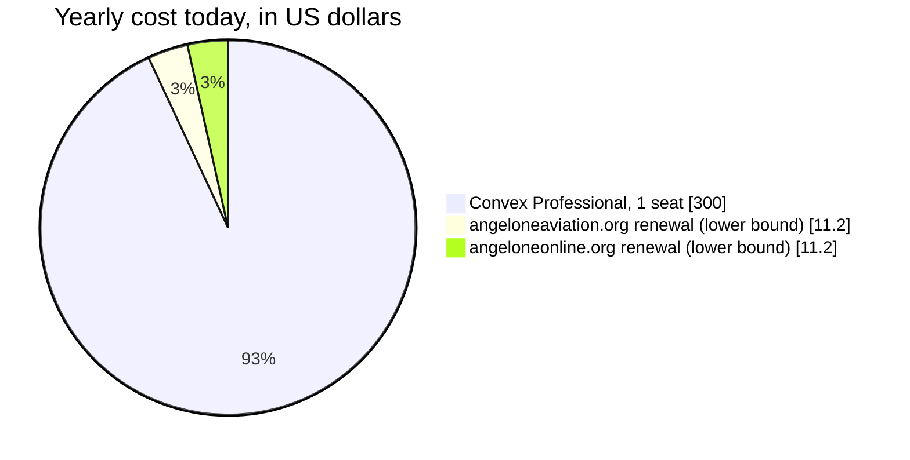

# Services and costs

[Handbook](../README.md)

Every outside service Angel One uses: what it does, which plan, what it costs, what breaks without it, and who owns the account.

- **Prices are as of November 2026**, from each vendor's own pricing page (linked), in US dollars, before tax.
- **Who owns each account** is recorded in the [accounts runbook](../../runbooks/accounts.md). Most rows were filled in on 20 Nov 2026; the rest are on the [go-live checklist](../../go-live-checklist.md). Angel One (the organisation) pays for the services.
- Numbers marked **estimate** are worked out here, not measured or billed.
- How the services connect: the diagram in the [system overview](../1-start-here/system-overview.md#the-parts).

## At a glance

| Service                                                          | Plan                    | Cost today                                                                                                                       | Needed?                   |
| ---------------------------------------------------------------- | ----------------------- | -------------------------------------------------------------------------------------------------------------------------------- | ------------------------- |
| Convex                                                           | Professional, 1 seat    | $25 a month                                                                                                                      | Yes: the whole backend    |
| Cloudflare Workers (website)                                     | Free                    | $0                                                                                                                               | Yes                       |
| Cloudflare R2 (backups)                                          | Free tier               | $0                                                                                                                               | Yes, for off-site backups |
| Cloudflare DNS                                                   | Zone on Cloudflare      | $0 (no paid plan in use)                                                                                                         | Yes                       |
| GitHub (code, CI, Deploy, backups)                               | Free, public repository | $0                                                                                                                               | Yes                       |
| Resend (email)                                                   | Free                    | $0                                                                                                                               | For alert emails          |
| Web Push (Google, Apple, Mozilla)                                | No account              | $0                                                                                                                               | For device alerts         |
| Better Stack (uptime, backup heartbeat)                          | Free                    | $0                                                                                                                               | Recommended               |
| Domain registrar (`angeloneaviation.org`, website, app and mail) | SiteGround              | SiteGround's renewal price: check in SiteGround (often higher than at-cost); at least about $11.20 a year (lower-bound estimate) | Yes                       |
| Domain registrar (`angeloneonline.org`, email)                   | SiteGround              | SiteGround's renewal price: check in SiteGround (often higher than at-cost); at least about $11.20 a year (lower-bound estimate) | Yes                       |
| FAA DRS API key                                                  | Not set up              | Not known                                                                                                                        | For AD monitoring         |
| Geoapify (address lookup)                                        | Free; not set up        | $0                                                                                                                               | Optional feature          |
| Aircraft Spruce                                                  | Not set up              | Not known                                                                                                                        | Optional feature          |
| Google Workspace                                                 | Organisation email      | Not part of the app's cost                                                                                                       | No                        |
| Dropbox                                                          | Optional; not set up    | $0 if on Basic                                                                                                                   | No                        |
| Sentry                                                           | Optional; not used      | $0                                                                                                                               | No                        |

## Totals

| Size                                             | Monthly                         | Yearly                                     |
| ------------------------------------------------ | ------------------------------- | ------------------------------------------ |
| **Today** (production holds no real records yet) | **$25**                         | **at least about $322**                    |
| **Load-test size** (6 aircraft, 20 years)        | **$25 to about $40** (estimate) | **at least about $322 to $502** (estimate) |

- **Today:** Convex $25 × 12 = $300, plus the two domains at SiteGround's renewal price, at least about $11.20 each (lower-bound estimate: Cloudflare's at-cost .org price, not SiteGround's): at least about $322. Everything else is on a free plan.
- **Load-test size:** records alone stay inside Convex Pro's included amounts. The upper figure allows for heavy use and a few GB of uploaded files ([below](#how-the-load-test-figure-is-estimated)). $40 × 12 = $480, plus the two domains: at least about $502.
- **Not included:** Google Workspace (the organisation's email, paid or not whatever the app does), parts bought through Aircraft Spruce, and anyone's time.

Where today's yearly cost goes, with each domain at its lower-bound estimate (SiteGround's real renewal price is likely higher):

Source: the [Convex](#convex-backend) and [domain](#domain-registrars) prices below. Every other service costs $0 today.

### How the load-test figure is estimated

- **Database storage.** A full export of 20 years of the model is 68 MB ([size test](../../qa/bug-hunt-2026-11-10/README.md#size-test), "Records export"). Far inside Convex Pro's 50 GB: $0 extra.
- **Database I/O.** A workspace load reads 3.9–8.8 MiB at 20 years ([capacity](../2-how-it-works/capacity-and-limits.md#the-20-year-measurements)). Assume 17 people opening it about 4 times a day at about 7 MiB: about 14 GB a month. Live updates re-read it on changes, so allow up to 3 times that. **Estimate:** 15–45 GB a month, inside the 50 GB included. Each GB over costs $0.20.
- **Data egress.** The nightly export: 68 MB × 30 nights = about 2 GB a month, plus uploaded files × 30. Inside 50 GB while files stay under about 1.5 GB ([ADR-0007](../../adr/0007-convex-pro-single-seat.md)). Each GB over costs $0.12: with 2 GB of files, about 62 GB a month, so about $1.45 a month.
- **R2 storage, records.** 90 daily copies (about 6 GB) plus monthly copies kept forever (240 by year 20, about 8 GB). **Estimate:** about 14 GB, so about $0.06 a month over the 10 GB free tier.
- **R2 storage, uploaded files.** Every export carries every file, so 2 GB of files adds about 180 GB of daily copies (about $2.70 a month), and each monthly copy kept forever adds 2 GB more: about $0.36 a month more for every year of operation, about $7.20 a month by year 20 (**estimate**).
- **Resend.** A daily digest per opted-in member plus at most 60 urgent emails a day. Inside 100 a day while no more than 40 people take the digest ([monitoring runbook](../../runbooks/monitoring.md#alerts-by-email-and-on-devices)).
- **GitHub Actions.** Free while the repository is public: $0.

With 2 GB of files held throughout, that is about $11.40 a month over Convex's $25 by year 20; "about $40" leaves room for more files or heavier use.

Not known: how many files the program will upload, and Convex's cloud bandwidth for this app. Check Convex's usage page after the first months of real records.

## Each service

### Convex (backend)

|                 |                                                                                                                                                                                                                                                                                                                                                                                     |
| --------------- | ----------------------------------------------------------------------------------------------------------------------------------------------------------------------------------------------------------------------------------------------------------------------------------------------------------------------------------------------------------------------------------- |
| Does            | Database, file storage, every server function, sign-in, scheduled jobs                                                                                                                                                                                                                                                                                                              |
| Plan            | **Professional, one developer seat** ([ADR-0007](../../adr/0007-convex-pro-single-seat.md), [ADR-0010](../../adr/0010-one-convex-administrator.md)). App users are not seats                                                                                                                                                                                                        |
| Price           | $25 per developer a month. Includes 50 GB database storage, 50 GB database I/O, 100 GB file storage, 25M function calls, 250 GB-hours of action compute, 50 GB egress. Over that: $0.20/GB database storage and I/O, $0.03/GB files, $2 per million calls, $0.30 per GB-hour, $0.12/GB egress ([pricing](https://www.convex.dev/pricing))                                           |
| Why Pro         | Daily scheduled backups, 50 GB of egress for the nightly export, log streams and exception reporting. The free plan has no backups, log streams or exception reporting                                                                                                                                                                                                              |
| If it goes away | The app stops: no sign-in, no data, no sync. Pending entries wait on devices. Recovery: restore the latest R2 backup into a new Convex deployment ([backup runbook](../../runbooks/backup-restore.md)); the first was made on 20 Nov 2026, but no restore has been rehearsed ([risks R1](risks.md#r1-off-site-backups-run-but-no-restore-is-proven-yet)). There is no other backend |
| Account holder  | Aaron, the one Convex member. The account should belong to the program before real records ([ADR-0007](../../adr/0007-convex-pro-single-seat.md))                                                                                                                                                                                                                                   |

### Cloudflare (website, backups, DNS)

|                 |                                                                                                                                                                                                                                                                                                                                            |
| --------------- | ------------------------------------------------------------------------------------------------------------------------------------------------------------------------------------------------------------------------------------------------------------------------------------------------------------------------------------------ |
| Does            | Hosts the website (Workers Static Assets, plus a tiny Worker that answers a missing file with 404); holds the nightly backups in R2; serves the `angeloneaviation.org` DNS zone                                                                                                                                                            |
| Plan            | Workers Free. R2 within its free tier                                                                                                                                                                                                                                                                                                      |
| Price           | Static asset requests are free and unlimited; Workers Free allows 100,000 Worker requests a day; Workers Paid is $5 a month ([Workers pricing](https://developers.cloudflare.com/workers/platform/pricing/)). R2: $0.015 per GB-month, 10 GB free each month, no egress fees ([R2 pricing](https://developers.cloudflare.com/r2/pricing/)) |
| Watch           | Cloudflare's own Git build (Workers Builds) must stay disconnected ([risks R22](risks.md#r22-cloudflares-git-build-publishes-the-site)). The deploy token still has admin access to every R2 bucket, the backups' included ([risks R23](risks.md#r23-the-deploy-token-can-reach-every-r2-bucket))                                          |
| If it goes away | Website: the site is unreachable; installed apps still open from their cache and log offline. Any static host can serve `dist/` ([release runbook](../../runbooks/release.md)). R2: no new off-site backups; any S3-compatible store can replace it ([ADR-0008](../../adr/0008-daily-backups-off-site-90-days-monthly-forever.md))         |
| Account holder  | Shared login `accounts@angeloneonline.org`: Aaron and the operations staff member can sign in ([accounts](../../runbooks/accounts.md#one-mailbox-resets-several-accounts), [risks R24](risks.md#r24-one-mailbox-can-reset-cloudflare-and-better-stack)). The API token in GitHub expires and must be rotated yearly                        |

### GitHub

|                 |                                                                                                                                                                                                                                                                                                                                                                                     |
| --------------- | ----------------------------------------------------------------------------------------------------------------------------------------------------------------------------------------------------------------------------------------------------------------------------------------------------------------------------------------------------------------------------------- |
| Does            | Code, issues, CI (with a secret scan and a dependency audit), Deploy, the nightly backup job, Dependabot. CodeQL code scanning, free here, is on (default set-up, enabled 20 Nov 2026; [risks R13](risks.md#r13-public-repository))                                                                                                                                                 |
| Plan            | Free, with a **public** repository `angelone-aviation/AO-aircraft-maintenance`                                                                                                                                                                                                                                                                                                      |
| Price           | Actions on standard runners are free for public repositories. A private repository on Free gets $12 of minutes a month (Linux at $0.006 a minute), and needs a paid plan (Team, $4 per user a month) for branch rules and required reviewers ([pricing](https://github.com/pricing), [Actions billing](https://docs.github.com/en/billing/concepts/product-billing/github-actions)) |
| Watch           | In a public repository, scheduled workflows stop after 60 days without activity, which would stop the nightly backup ([GitHub docs](https://docs.github.com/en/actions/managing-workflow-runs-and-deployments/managing-workflow-runs/disabling-and-enabling-a-workflow))                                                                                                            |
| If it goes away | No CI, no deploys, no nightly backups. The live site and Convex keep running. Deploy by hand from a computer ([release runbook](../../runbooks/release.md))                                                                                                                                                                                                                         |
| Account holder  | The Angel One organisation                                                                                                                                                                                                                                                                                                                                                          |

### Resend (email)

|                 |                                                                                                                                                                                                    |
| --------------- | -------------------------------------------------------------------------------------------------------------------------------------------------------------------------------------------------- |
| Does            | The daily alert digest (13:00 UTC) and immediate urgent-alert emails                                                                                                                               |
| Plan            | Free                                                                                                                                                                                               |
| Price           | Free: 3,000 emails a month, **100 a day**, 3 domains. Pro: $20 a month for 50,000, no daily cap ([pricing](https://resend.com/pricing)). The app caps urgent emails at 60 a day so the digest fits |
| If it goes away | No alert emails. The bell, the Alerts page and device push keep working. The backup-age warning is email only                                                                                      |
| Account holder  | Shared login `accounts@angeloneonline.org` (signs in with GitHub); Aaron. Sends from `angeloneaviation.org`                                                                                        |

### Web Push

|                 |                                                                                                                                             |
| --------------- | ------------------------------------------------------------------------------------------------------------------------------------------- |
| Does            | Urgent alerts on members' devices, sent by Convex through each browser's push service. Not set up yet: the VAPID keys are not on production |
| Plan, price     | None. The VAPID key pair lives in Convex's environment ([ADR-0012](../../adr/0012-urgent-alerts-by-web-push-and-immediate-email.md))        |
| If it goes away | No device alerts; email and the bell continue. Rotating the key pair signs every device out of alerts                                       |
| Account holder  | Aaron (the keys are Convex variables)                                                                                                       |

### Better Stack (monitoring)

|                 |                                                                                                                                                                                                                                                                                                                            |
| --------------- | -------------------------------------------------------------------------------------------------------------------------------------------------------------------------------------------------------------------------------------------------------------------------------------------------------------------------- |
| Does            | Two uptime monitors (the site, and Convex's sign-in service) and a heartbeat for the nightly backup ([monitoring runbook](../../runbooks/monitoring.md#better-stack-uptime-and-the-backup-heartbeat)). Set up 20 Nov 2026. Its URL is in GitHub as `BACKUP_HEARTBEAT_URL` (20 Nov), and the first nightly backup pinged it |
| Plan            | Free. Aaron chose Better Stack only, no Sentry, on 20 Nov                                                                                                                                                                                                                                                                  |
| Price           | Free: 10 monitors and heartbeats, 1 status page, Slack and email alerts ([pricing](https://betterstack.com/pricing))                                                                                                                                                                                                       |
| If it goes away | Nobody is told the site is down or a backup was missed until a user or the daily digest says so                                                                                                                                                                                                                            |
| Account holder  | Shared login `accounts@angeloneonline.org`: Aaron and the operations staff member ([risks R24](risks.md#r24-one-mailbox-can-reset-cloudflare-and-better-stack))                                                                                                                                                            |

### Domain registrars

|                 |                                                                                                                                                                                                                                                                                                                                                                                                                                                                                                                                             |
| --------------- | ------------------------------------------------------------------------------------------------------------------------------------------------------------------------------------------------------------------------------------------------------------------------------------------------------------------------------------------------------------------------------------------------------------------------------------------------------------------------------------------------------------------------------------------- |
| Does            | Hold the organisation's two domains: `angeloneaviation.org`, the public website (hosted at SiteGround), the app (`ops.angeloneaviation.org`) and mail to its addresses (MX to Google Workspace), its DNS zone on Cloudflare; and `angeloneonline.org`, email: Google Workspace mail and the `accounts@angeloneonline.org` security mailbox, its DNS at Wix ([accounts](../../runbooks/accounts.md))                                                                                                                                         |
| Plan, price     | Both are registered at **SiteGround** ([accounts](../../runbooks/accounts.md)). SiteGround's renewal price: check in SiteGround (often higher than at-cost). Lower bound: each is a .org, and .org renews for $11.20 a year at Cloudflare Registrar's at-cost price (**estimate**, not SiteGround's price: the figure is from a third-party price list, [cfdomainpricing.com](https://cfdomainpricing.com/), read 20 Nov 2026; Cloudflare states it adds no markup: [Cloudflare Registrar](https://www.cloudflare.com/products/registrar/)) |
| If it goes away | A lapsed `angeloneaviation.org` takes the website and app down and stops mail to its addresses, including the app's alert emails (Resend sends from it) and the website's contact form. A lapsed `angeloneonline.org` takes the organisation's email down, including security reports to `accounts@angeloneonline.org` and service alerts sent to its mailboxes. Either lets someone else buy the name. Keep auto-renew on for both                                                                                                         |
| Account holder  | The operations staff member holds the SiteGround login for both domains                                                                                                                                                                                                                                                                                                                                                                                                                                                                     |

### FAA DRS API key

|                 |                                                                                                                                                             |
| --------------- | ----------------------------------------------------------------------------------------------------------------------------------------------------------- |
| Does            | The daily AD check against the FAA's Dynamic Regulatory System ([airworthiness](../../airworthiness.md))                                                    |
| Plan, price     | A key requested at <https://drs.faa.gov/drs-api>. Cost **not known**: no official price was found                                                           |
| Status          | Not set up: no key exists in production ([accounts](../../runbooks/accounts.md)). Once one is saved, Settings → System warns from 60 days before its expiry |
| If it goes away | No automatic AD monitoring, as today. ADs can still be entered and tracked by hand                                                                          |
| Account holder  | Not set up                                                                                                                                                  |

### Geoapify (address lookup)

|                 |                                                                                                                                                                                           |
| --------------- | ----------------------------------------------------------------------------------------------------------------------------------------------------------------------------------------- |
| Does            | Looks up and checks addresses for purchase orders, requests, locations and Flight Programs                                                                                                |
| Plan            | Free; not set up                                                                                                                                                                          |
| Price           | Free: 3,000 credits a day. Cheapest paid plan $59 a month ([pricing](https://www.geoapify.com/pricing/)). The app spends at most 2,900 a day ([addresses](../../address-verification.md)) |
| If it goes away | Addresses are typed and saved without the check                                                                                                                                           |
| Account holder  | Not set up. When it is, the key is stored encrypted in the app                                                                                                                            |

### Aircraft Spruce

|                 |                                                                                                                      |
| --------------- | -------------------------------------------------------------------------------------------------------------------- |
| Does            | Catalogue and order downloads for a linked account, per Flight Program ([Aircraft Spruce](../../aircraft-spruce.md)) |
| Plan, price     | The program's own customer and API account. Price **not known**                                                      |
| If it goes away | Order parts the usual way; purchase orders still work                                                                |
| Account holder  | Not set up. When an account is linked, its login is stored encrypted in the app                                      |

### Google Workspace

|                 |                                                                                                                                                                                                                                                                                                                                                                               |
| --------------- | ----------------------------------------------------------------------------------------------------------------------------------------------------------------------------------------------------------------------------------------------------------------------------------------------------------------------------------------------------------------------------- |
| Does            | The organisation's email: mail to `angeloneonline.org` and to `angeloneaviation.org` goes to Google                                                                                                                                                                                                                                                                           |
| Price           | Business Starter $7 per user a month (annual) or $8.40 (flexible); Business Standard $14 or $16.80 ([Google](https://knowledge.workspace.google.com/admin/billing/compare-flexible-and-annual-fixed-term-payment-plans)). A nonprofit edition is $0 ([Google for Nonprofits](https://www.google.com/nonprofits/offerings/workspace/)). Which one the program has is not known |
| If it goes away | Nothing in the app depends on it today                                                                                                                                                                                                                                                                                                                                        |
| Account holder  | Administered by the operations staff member                                                                                                                                                                                                                                                                                                                                   |

### Dropbox (optional)

|                 |                                                                                                                                                                                                                                                                                               |
| --------------- | --------------------------------------------------------------------------------------------------------------------------------------------------------------------------------------------------------------------------------------------------------------------------------------------- |
| Does            | Holds the readable Excel copy of the records, if switched on ([ADR-0011](../../adr/0011-readable-records-copy-in-dropbox.md), [runbook](../../runbooks/dropbox-records-copy.md)). Optional, and deferred until after go-live: not set up ([decisions](../5-history/decisions.md#20-nov-2026)) |
| Price           | Basic is free with 2 GB; Plus, 2 TB, is $11.99 a month billed monthly, or $9.99 a month billed yearly ([plans](https://www.dropbox.com/plans)). A workbook is about 1 MB at the sample's size, so Basic likely fits for years (**estimate**)                                                  |
| If it goes away | Only the convenience copy is lost. R2 is the backup                                                                                                                                                                                                                                           |
| Account holder  | None yet: Angel One must create one first. It should be an organisation account with two-step sign-in                                                                                                                                                                                         |

### Sentry (optional, not used)

|        |                                                                                                                               |
| ------ | ----------------------------------------------------------------------------------------------------------------------------- |
| Does   | Would report browser and server errors. The code is in place and dormant ([monitoring runbook](../../runbooks/monitoring.md)) |
| Price  | Developer plan free: 1 user, 5,000 errors. Team $26 a month (annual) or $29 ([pricing](https://sentry.io/pricing/))           |
| Status | Not used: Aaron chose Better Stack only (20 Nov 2026)                                                                         |

## Other accounts to keep track of

| Account                                   | Why it matters                                                                                                                                                                                                                 | Where                                  |
| ----------------------------------------- | ------------------------------------------------------------------------------------------------------------------------------------------------------------------------------------------------------------------------------ | -------------------------------------- |
| The `accounts@angeloneonline.org` mailbox | Security reports arrive there; the operations staff member reads it. It is the shared login of Cloudflare and Better Stack, so it can reset both ([risks R24](risks.md#r24-one-mailbox-can-reset-cloudflare-and-better-stack)) | [SECURITY.md](../../../SECURITY.md)    |
| Wix                                       | Serves the DNS of `angeloneonline.org`, so its holder controls where the organisation's email goes. The login is held by the operations staff member                                                                           | [Accounts](../../runbooks/accounts.md) |
| SMTP2GO                                   | Sends the public website's contact-form email; not part of the app. Holder and plan to find out; keep its DNS records                                                                                                          | [Accounts](../../runbooks/accounts.md) |
| A2 Hosting cPanel                         | Published the old test website; to be retired                                                                                                                                                                                  | [Accounts](../../runbooks/accounts.md) |
