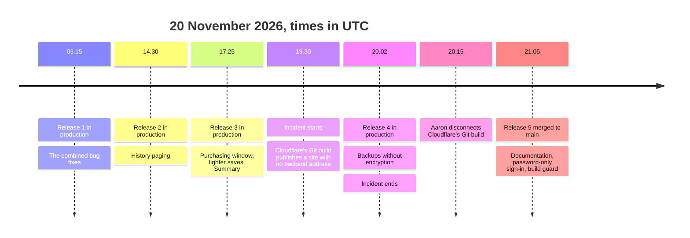

# Changelog

[Handbook](../README.md)

What changed, and when. Newest first. Each line gives the finding's id, what changed in plain words, and the commit.

- **Sources:** `git log`, the status columns of the [4 Nov security review](../../security/review-2026-11-04.md), the [2 Nov review](../../security/review-2026-11-02.md), the [10 Nov bug hunt](../../qa/bug-hunt-2026-11-10/README.md) and [REFACTOR_ROADMAP.md](../../../REFACTOR_ROADMAP.md). Nothing is listed that can't be traced to one of them.
- **Ids:**
  - RM-n is finding n in [REFACTOR_ROADMAP.md](../../../REFACTOR_ROADMAP.md#findings). OD (its owner decisions, findings 62 and 67), LO (its leftovers, finding 68) and E are from the working bug register, which is not in the repository; the roadmap names each one's commit beside its finding.
  - T, A, S, C and P are the security reviews'. In release 2, S0–S8 are the history-paging plan's stages, not security findings.
  - AC, FL, MX, NA, NB, OP, PT, SE, SZ and UI are the 10 Nov bug hunt's; B and C (stale screens) its stale-screen audit's; D1–D25 the hunt's decisions ([decisions](decisions.md)).
- The local history starts on 12 Nov 2026 (`fcadec0`), so earlier commits named in the docs can't be opened here. For work before then, read the bug hunts' and reviews' status columns.

## 20 Nov 2026 at a glance

The day's five releases and its one incident, in UTC (03.15 means 03:15). Releases 1–4 are timed by when their Deploy run finished on GitHub Actions, release 5 by its merge; the incident's times are approximate.

## Release 6: not yet released

The review of the handbook and wiki that followed release 5:

- fixes to the handbook and the user guide, each checked against the code;
- diagrams, charts and timelines where they shorten the text;
- a Credentials page in the handbook;
- **Deployment expiring dates** in Settings names the FAA DRS API key as an example, in place of the removed sign-in client secret (text only);
- the Deploy workflow's backup tick-box asks that the password-manager copy of `CREDENTIALS_ENCRYPTION_KEY` is current (label only);
- a browser test: no technician or inspection signoff is offered until a completion date is saved.

## 20 Nov 2026, release 5: documentation and password-only sign-in

Released at `8b40038`: merged to `main` at about 21:05 UTC; Deploy publishes it when CI on that commit passes.

| Change                                                                                                                                                                     | Commit                                                                      |
| -------------------------------------------------------------------------------------------------------------------------------------------------------------------------- | --------------------------------------------------------------------------- |
| The handbook: system overview, how it works, features, capacity, services and costs, risks, changelog, decisions, operations, checklists, must-know and FAQ                | `7c813bb`, `c66140e`, `ed71bc7`, `1afc6ef`, `81c9e0d`, `63672ab`            |
| The user wiki: home, role guides, flying, maintenance, parts and purchasing, records and settings pages, offline, FAQ and troubleshooting                                  | `91dc35b`, `5c172f1`, `5a4cb85`, `d1c24e6`, `06b7995`, `99bfc4b`, `3847fc5` |
| The set-up-from-scratch guide                                                                                                                                              | `0b7986d`, `25ea0a9`                                                        |
| The code structure guide                                                                                                                                                   | `5f608e3`, `6b8d8ad`                                                        |
| The glossary checked against the code, carried in full in the handbook                                                                                                     | `17ea698`                                                                   |
| Tests: a broken relative link or anchor in tracked Markdown fails; the two glossary copies must match; CI checks the docs' formatting                                      | `486912a`, `17ea698`, `b85017e`                                             |
| The two job card texts: the completion date is needed to sign, and a new card saves first (text only; no behaviour change)                                                 | `3e4c3a9`                                                                   |
| Doc fixes: the docs brought in line with the code and the 19–20 Nov changes, Prettier on the docs, the browser tests run without `.env.local`                              | `1c297b5`, `0756c4c`, `3659378`                                             |
| The final review's fixes: the completion-date hint names the technician and inspection signoffs, "Aaron" for the person, the risk register by risk, encryption stated once | `6a55e24`, `e27a691`, `8b40038`                                             |
| A production build refuses to run in Cloudflare's Git builder (Workers Builds)                                                                                             | `341e7b6`                                                                   |
| Google and Microsoft sign-in removed ([ADR-0015](../../adr/0015-remove-google-and-microsoft-sign-in.md)); everyone signs in with a password; findings A3 and A10 closed    | `89555e7`, `130a257`, `c965324`, `f51c49d`, `da62e48`, `02fdf85`, `93dd5d0` |

## 20 Nov 2026, release 4: backups without encryption

Released to production at `8df41a2` (about 20:00 UTC). Aaron decided that day that backups run without encryption ([ADR-0014](../../adr/0014-backups-stored-unencrypted.md)).

| Change                                                                                                                                   | Commit               |
| ---------------------------------------------------------------------------------------------------------------------------------------- | -------------------- |
| Encryption optional, off by default: without `BACKUP_AGE_PUBLIC_KEY` the nightly job uploads the plain export                            | `c698f8b`            |
| A plain copy is named `.unencrypted.zip`, and the app records it                                                                         | `95f909c`, `c698f8b` |
| The sign-in tables (`authSessions`, `authRefreshTokens`, `authVerificationCodes`, `authVerifiers`) emptied in a plain copy               | `0e55670`            |
| A plain run refused, uploading nothing, when the export holds an unknown `auth*` table or lacks one of the four                          | `8df41a2`            |
| `env/` skipped without a key: the environment variables are neither read nor uploaded                                                    | `c698f8b`            |
| Settings → System and the records workbook no longer say the copy is encrypted                                                           | `295b8df`, `8df41a2` |
| Review fixes: a test helper that could fail at random, and the runbook, ADR-0008 and ADR-0014 on sessions, hashes and push subscriptions | `8df41a2`            |

### Incident: "Configuration error" after the merge

For about 30 minutes, at about 19:30–20:02 UTC on 20 Nov 2026, right after `8df41a2` reached `main`, production showed "Configuration error … VITE_CONVEX_URL is missing" with the unpinned CSP.

- **Cause:** Cloudflare's own Git build (Workers Builds) had been connected by mistake. It built the repository without the backend address and published it before the Deploy workflow did.
- **End:** Deploy published release 4 at 20:02 UTC. Until then nobody could sign in or sync.
- **Fix:** Aaron disconnected the Git build at about 20:15 UTC. Since release 5 a production build refuses to run there. The Git build must stay disconnected ([release runbook](../../runbooks/release.md#cloudflare), [risks R22](../4-money-and-risk/risks.md#r22-cloudflares-git-build-publishes-the-site)).

## 20 Nov 2026, release 3: the purchasing window, lighter saves and the Weekly summary

Released to production at `e99058c` (about 17:25 UTC). Aaron's answers that day: A, A, A, A ([decisions](decisions.md#20-nov-2026)).

| Change                                                                                                              | Commit                                     |
| ------------------------------------------------------------------------------------------------------------------- | ------------------------------------------ |
| Closed parts requests, purchase orders and flight plans leave the workspace like other history (H5, option A)       | `36074ab`                                  |
| **Load older** on Parts requests, Purchase orders and Flight plans                                                  | `dcde429`                                  |
| An older request is judged on both its work-order links                                                             | `3ae5d17`                                  |
| Purchasing lookup keys (`purchasingKeys`) kept for every request and order, so saves read only what a command names | `8a152fd`, `e48e9a4`                       |
| A request's orders found by their allocation keys; the separate allocations table dropped                           | `b33fab6`                                  |
| Summary (Weekly summary) reads each change-log row once and stops at 3 MiB, saying the period was cut short         | `31ee86b`, `b12696c`, `5cd894d`            |
| Measured again at 1, 3, 10 and 20 fleet-years: every workspace load succeeds                                        | `e99058c`                                  |
| Docs for the window, the saves and the Summary's reads                                                              | `5a4a4b2`, `87501c7`, `fa43a2a`, `32d5e68` |

## 20 Nov 2026, release 2: history paging

Released to production at `12bc9af` (about 14:30 UTC), with the catch-up migrations run afterwards. Plan stages S0–S8 ([history paging](../../history-paging.md), [ADR-0013](../../adr/0013-history-retention-window.md)).

| Stage      | Change                                                                                                                                                     | Commit                                                                      |
| ---------- | ---------------------------------------------------------------------------------------------------------------------------------------------------------- | --------------------------------------------------------------------------- |
| S0         | Multi-year test fixture and read baselines; the uuid lookups the window could break listed                                                                 | `526f897`, `3a115b0`, `18b6070`                                             |
| S0         | ADR-0013: keep a window and page the rest                                                                                                                  | `5e5dda4`                                                                   |
| S1         | The retention window defined in the domain                                                                                                                 | `cea3d69`                                                                   |
| S2         | Derived columns stored on every write, with a backfill                                                                                                     | `01b8241`, `91574b4`, `a0786fc`                                             |
| S3         | Number rows for work orders and job cards; bounded saves for work orders, job cards, evidence, parts requests, costs, purchase orders, ADs and the Summary | `1b89a7d`, `5c68f57`, `31cd0d6`, `58ceb6e`, `144f08e`, `557f34a`, `b1c52bf` |
| PT-12, D13 | An issued part keeps the price it was issued at, on the work order's administrator-only cost record                                                        | `7f5bdf3`                                                                   |
| S4         | A cost ledger; the board and the Costs report total from it                                                                                                | `c0f3c3c`, `280d5dc`                                                        |
| S5         | Paged history queries on the server, the Convex adapter and the demo, attacked in the isolation suite                                                      | `d0d9ab3`, `3c70555`, `c245aef`                                             |
| S6         | **Load older** on the Flight log, Discrepancies, Work orders and Change history                                                                            | `150ea5b`, `5e76d08`, `5f85206`, `99fc51a`                                  |
| S6         | An older job card opens instead of a blank form; the records package pages full history; the AD report, paper check and logbook import read older records  | `c60506b`, `0382955`, `1fc979c`                                             |
| S6         | A logbook photo of an older record uploads instead of waiting forever                                                                                      | `fa38d2a`                                                                   |
| S7         | Only the window is loaded into the workspace; the demo shows the same window                                                                               | `ddf85ee`, `a31d4a5`, `c8158a4`                                             |
| S7         | Records the window leaves out are looked up by uuid where a form names them                                                                                | `51799cf`, `a494ea5`, `3f30c48`, `5fd8908`                                  |
| S7         | Loaded pages reload when the window moves a day                                                                                                            | `ce9f2f4`                                                                   |
| S8         | Files read by work order and program, cutting the administrator's index ranges from 1,793 to 404                                                           | `1bcd728`                                                                   |
| S8         | Measured at 20 fleet-years                                                                                                                                 | `d7aad16`, `1d17ec8`                                                        |

## 20 Nov 2026, release 1: the combined bug-fix release

Released to production at `0651e97` (about 03:15 UTC): every open register bug, the 10 Nov bug hunt's 19 open findings, the open security findings, and the 19 Nov decisions. Ten branches were joined ([list below](#branches-joined)).

### Bug register

| Id                | Fix                                                                                                                                        | Commit               |
| ----------------- | ------------------------------------------------------------------------------------------------------------------------------------------ | -------------------- |
| OD-1              | Job-card signoffs offered exactly as the server accepts them; a card set back to Draft clears its signoffs                                 | `e72c57a`            |
| OD-2              | Alerts and the digest mention every AD the Overview's AD panel lists                                                                       | `7602179`            |
| OD-3              | The AD work-order button shows whenever an action is open (the commit message says "overdue" where it means "due-soon"; the code is right) | `f13ecef`            |
| OD-4              | **Check FAA now** offered exactly when the server accepts a check                                                                          | `a2257dc`            |
| OD-5              | Status sheet and workbook colour statuses by value, not text                                                                               | `9bfd107`            |
| OD-6              | The correction addendum ends its description with a full stop                                                                              | `8662242`            |
| OD-7              | Dashboard search matches the aircraft make                                                                                                 | `d4bf151`            |
| OD-8              | The Planning CSV exports the status words the screen shows                                                                                 | `31d336b`            |
| OD-9              | The scanner stops the camera on an unknown label and says why beside it                                                                    | `ebe8ef5`            |
| OD-10             | Requirements from templates get the same warning defaults as the form                                                                      | `3053bfd`            |
| OD-11             | An over-long transfer reason is refused on the server too                                                                                  | `d7a1a66`            |
| RM-08             | Address lookup accepts every address the app can store                                                                                     | `b958c3e`            |
| RM-09             | A ZIP code with a leading space no longer blocks the address check                                                                         | `5c53457`            |
| RM-10             | The phone message asks only for what it checks                                                                                             | `a241bb6`            |
| RM-15             | Logbook PDFs keep the text after a tab                                                                                                     | `e466087`            |
| RM-18             | A refused SSO sign-in spends neither log allowance when one drops the entry                                                                | `759b5a6`            |
| RM-20             | Hours, months-in-service and ATA 67 messages match the rules                                                                               | `1faa729`            |
| RM-26             | Escape closes a dialog from the aircraft make or model field                                                                               | `98ac55f`            |
| RM-27             | A cut-short History page resumes without revealing a hidden row's time                                                                     | `9448647`            |
| RM-30             | Size limits say MiB where the limit is in MiB                                                                                              | `a9f723e`, `9a46cd7` |
| RM-33, RM-44 (T3) | Purchase-order uploads and job cards imported from a task file write change-log rows                                                       | `20c43b6`            |
| RM-34             | A blank close-out wording prints the placeholder, not an empty line                                                                        | `dd1fa28`            |
| RM-40             | A nested table in an AD Word report is read once                                                                                           | `dff6963`            |
| RM-55b            | The workbook's damaged-record notes name the field and record                                                                              | `ae51364`            |
| RM-59             | The demo's remaining rule copies moved onto the shared domain rules                                                                        | `cd5f091`            |
| RM-59b            | The retired unscoped-group note removed from the group form                                                                                | `1edf2f4`            |
| LO-1              | An edited inspection save from a manual gets a new request id                                                                              | `a3d0ea5`            |
| LO-2              | The resequence reason converts a flight's start time to UTC                                                                                | `8675ab6`            |
| LO-3              | Flight review tells the reviewer which inspection to correct                                                                               | `60d7cd3`            |
| LO-4              | An unknown sign-in provider shows a neutral icon                                                                                           | `1ffc486`            |
| E-15              | FAA key day count ("1 day") and template program wording                                                                                   | `257ceac`            |
| E-16 (T6)         | Two commands show a plain message instead of raw error text                                                                                | `dc0dad2`            |

### The 10 Nov bug hunt's 19 open findings

| Id    | Fix                                                                                                                                            | Decision | Commit                                                           |
| ----- | ---------------------------------------------------------------------------------------------------------------------------------------------- | -------- | ---------------------------------------------------------------- |
| SE-13 | One member may hold at most 200 open problem reports or 512 KiB of their text; administrators are alerted at half                              | D2       | `d418aff`, `00df9dc`                                             |
| SZ-1  | The workspace stopped loading after about two fleet-years: fixed by history paging (release 2)                                                 | D3       | see release 2                                                    |
| MX-3  | An MEL repair interval counts from the day the defect was found                                                                                | D4       | `8facd81`                                                        |
| PT-9  | A stock-replenishment request completes when its parts arrive                                                                                  | D18      | `e61bfe5`                                                        |
| PT-12 | Issued parts keep their price (release 2)                                                                                                      | D13      | `7f5bdf3`                                                        |
| AC-10 | Cost records stay with the program that paid when an aircraft moves                                                                            | D14      | `aa87fe7`                                                        |
| NA-7  | Logbook photos and Form 337 copies have separate caps                                                                                          | D12      | `73be318`                                                        |
| NA-11 | Aircraft setup refuses a duplicate inspection                                                                                                  | D11      | `01a15d5`                                                        |
| SE-3  | Each Flight Program gets a share of the day's 60 urgent emails                                                                                 | D9       | `fde4c67`                                                        |
| SE-5  | At most 30 aircraft document uploads per user an hour                                                                                          | D12      | `bac2be5`                                                        |
| PT-6  | A receipt dated before its order is refused                                                                                                    | D19      | `b01803d`                                                        |
| SE-12 | Every stored file opens through a link that expires after five minutes                                                                         | D17      | `eb5768b`, `52ea5a8`, `fd9d4c2`, `089c454`, `6af3c64`, `277a6e1` |
| SE-7  | Sign-out clears the device, after warning about unsynced work                                                                                  | D17      | `c743aa6`                                                        |
| OP-5  | A missed off-site backup is reported at the next day's digest (26 hours)                                                                       | D10      | `1434b27`                                                        |
| OP-12 | Wrangler and esbuild install from the lockfile                                                                                                 | D24      | `7a1b577`                                                        |
| OP-8  | `check:standards` to check uncommitted files: the repository is ready (`dca6fca`); the patch to the hook only Aaron may change is his to apply | D23      | `dca6fca`                                                        |
| FL-1  | A pilot's consecutive offline legs are accepted in order (settled 10 Nov, before this history)                                                 | D7       | [offline](../../offline.md#several-legs-logged-offline)          |
| FL-5  | A flight on an aircraft grounded mid-flight is held, not refused (settled 10 Nov)                                                              | D6       | [offline](../../offline.md#flights-held-for-review)              |
| NA-15 | A newly set-up aircraft reads Setup incomplete (decided 10 Nov)                                                                                | D5       | [glossary](../../../GLOSSARY.md)                                 |

Bug-hunt and stale-screen findings fixed in part or left open before, finished here:

| Id          | Fix                                                                           | Commit                          |
| ----------- | ----------------------------------------------------------------------------- | ------------------------------- |
| AC-5, AC-11 | Owners get compliance records built from named fields, without user ids (D15) | `87eca56`                       |
| SE-8        | A system administrator gets a program's alerts through a group only (D8)      | `6e82622`                       |
| SE-15       | Changing the FAA key's renewal date schedules the system alert check          | `82987da`                       |
| AC-7        | Only administrators are offered saving an address                             | `c701917`, `481f95e`, `3dacd1a` |
| UI-12       | Purchasing quantity and cost fields keep typed text                           | `1e56398`                       |
| B7 (D20)    | Owners and board members are told where their settings went                   | `36d1c16`                       |
| B9          | Theme offers "Match this device"                                              | `224c24f`                       |
| C5 (D21)    | The glossary and docs say "job card"                                          | `5d340c5`, `b0c6465`            |
| C6 (D22)    | "Problem report" defined in the glossary                                      | `7a674ae`                       |
| C9          | The change-history summary tab is labelled "Summary"                          | `24cbaf4`                       |

### Security findings

| Id            | Fix                                                                                                                                                                                                            | Commit                                                |
| ------------- | -------------------------------------------------------------------------------------------------------------------------------------------------------------------------------------------------------------- | ----------------------------------------------------- |
| S20, A5       | A filed or changed certificate waits for an administrator's approval; nobody approves their own                                                                                                                | `c26ced2`                                             |
| A6            | Expired sign-in records cleaned up weekly                                                                                                                                                                      | `ffe6f63`                                             |
| A8            | A disabled account's password is checked as a wrong one                                                                                                                                                        | `327b2cc`                                             |
| A9            | A forged refresh token can't sign another session out                                                                                                                                                          | `5da10ee`                                             |
| S13, T2       | An hourly sweep of stored files nothing refers to, starting in report mode                                                                                                                                     | `337369d`, `6754f9b`, `79d37be`, `b783f01`, `6e7a062` |
| T4            | File functions check the session first and refuse unseen records as missing                                                                                                                                    | `fb974e1`, `93f40a4`                                  |
| T7            | Unassigned inventory records no longer load into every program's reads                                                                                                                                         | `d7cfecd`                                             |
| T8, S15       | The FAA and Geoapify daily caps split fairly between programs; one shared helper                                                                                                                               | `2a23a7f`, `58d2e98`                                  |
| C2            | A missing bundle gets an uncached 404 from a small Worker                                                                                                                                                      | `67fa346`                                             |
| C3            | The published CSP is pinned to production's Convex hosts                                                                                                                                                       | `8c0263c`                                             |
| S18           | Dev and preview servers listen on this computer only                                                                                                                                                           | `4c1f1be`                                             |
| S7, S6        | File links expire after five minutes; the device copy holds none (with SE-12)                                                                                                                                  | `eb5768b`, `e11ff5e`                                  |
| S10           | Sign-out clears the device (with SE-7)                                                                                                                                                                         | `c743aa6`, `a23267b`                                  |
| Upload checks | The file-contents check covers work-order, job-card, photo and license uploads, HEIC license copies, PDFs with leading bytes, and names each upload's own types; a manual that is not a PDF is deleted at once | `e6c928e`, `589ba16`, `8eed677`, `730b68e`, `50e05c2` |
| Flight review | Every flight review needs a request id, so it is never applied twice                                                                                                                                           | `c37bf0c`                                             |
| C1, C4        | Cloudflare's "Add security headers" transform and Bot Fight Mode turned off (19 Nov, Cloudflare settings)                                                                                                      | —                                                     |
| P4            | CodeQL default set-up reported on (19 Nov, a GitHub setting); GitHub showed it not configured on 20 Nov; Aaron to re-check ([risks R13](../4-money-and-risk/risks.md#r13-public-repository))                   | —                                                     |

### Other changes in the release

| Change                                                                                                                  | Commit               |
| ----------------------------------------------------------------------------------------------------------------------- | -------------------- |
| The theme switches in one frame instead of fading part of the page                                                      | `89d96fe`            |
| The board view takes its year and quarter from the records time zone (follows PT-7)                                     | `3589a76`            |
| The flight plan queue says "Profile status", not "Aircraft status", for the status typed on the aircraft (follows MX-9) | `b7398e8`            |
| `setup:auth` keeps signing keys only as a complete pair                                                                 | `a63d451`            |
| The release CSP check refuses a Convex URL with a port                                                                  | `5e65c35`            |
| A held flight's offset start shows in UTC in its review                                                                 | `468d37a`            |
| The size-test scripts kept in the repository                                                                            | `01b680b`            |
| Headers on the Dockerfile, `_headers` and `wrangler.jsonc` for the stricter standards check                             | `dca6fca`            |
| Status tables updated with each fix                                                                                     | `4625c7e`, `b5f2f56` |
| The secret scan allows the file-link tests' made-up key; CI had failed on `b5f2f56` without it                          | `0651e97`            |

### Branches joined

`fix/theme-switch-at-once`, `work/ui-bugs`, `work/register-bugs`, `work/server-bugs`, `work/alerts-and-access`, `work/loadtest-and-small-fixes`, `work/records-rules`, `work/uploads-security`, `work/device-data`, `work/combine-chores` (merges `eaf599b` to `4627685`).

## Before 20 Nov 2026

| Date   | What                                                                                                                 | Where                                                                                                     |
| ------ | -------------------------------------------------------------------------------------------------------------------- | --------------------------------------------------------------------------------------------------------- |
| 12 Nov | The redesign pushed: new look, grouped navigation, charts, a rebuilt Discrepancies screen; same data and permissions | Deployed at `fcadec0`; [roadmap](../../../REFACTOR_ROADMAP.md#findings) finding 70                        |
| 10 Nov | Second bug hunt: 132 findings, 111 fixed                                                                             | [Bug hunt 10 Nov](../../qa/bug-hunt-2026-11-10/README.md)                                                 |
| 9 Nov  | Urgent alerts by Web Push and email; expiring dates                                                                  | [ADR-0012](../../adr/0012-urgent-alerts-by-web-push-and-immediate-email.md)                               |
| 4 Nov  | Second security review; fixes A1, A2, T1, C9, P1–P3                                                                  | [Review 4 Nov](../../security/review-2026-11-04.md)                                                       |
| 3 Nov  | First bug hunt, all fixed; production deployment started fresh and first deployed                                    | [Bug hunt 3 Nov](../../qa/bug-hunt-2026-11-03/README.md), [go-live checklist](../../go-live-checklist.md) |
| 2 Nov  | First security review; the critical auth-library flaw S1 fixed by upgrading to 0.0.96                                | [Review 2 Nov](../../security/review-2026-11-02.md)                                                       |
