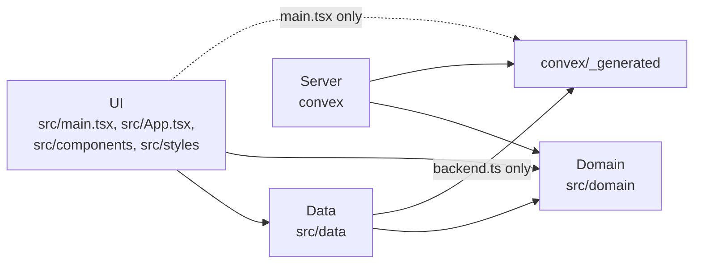
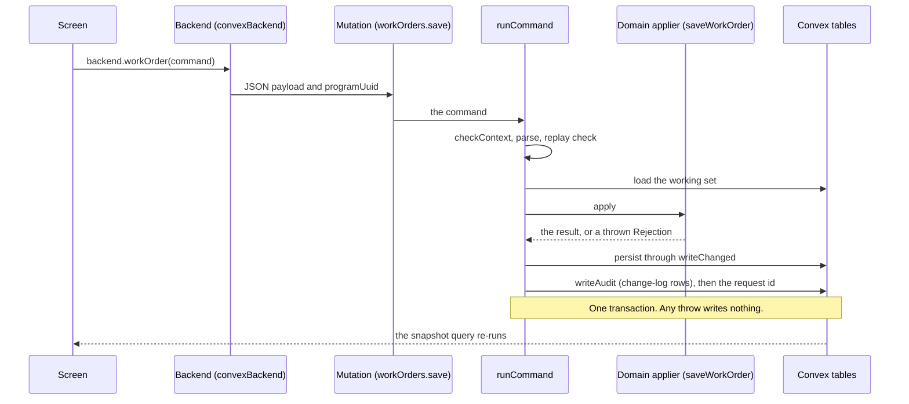

# How the code is structured

A guide for developers to the repository, its layers, and how a request moves through them. It builds on [CONTEXT.md](../../../CONTEXT.md), the system map and boundary rules. Where the two overlap, CONTEXT.md is the source and this page links to it. Rules for every change are in [CONSTRAINTS.md](../../../CONSTRAINTS.md). Words such as Flight Program, permission group and job card mean what [GLOSSARY.md](../../../GLOSSARY.md) says.

Verified against the code on 20 Nov 2026, after Google and Microsoft sign-in were removed ([ADR-0015](../../adr/0015-remove-google-and-microsoft-sign-in.md)).

## 1. Repository map

```text
.
├── src/                    Browser app (React 19, Vite, Zustand, TanStack Router)
│   ├── main.tsx            Entry: picks live or demo, creates the Convex client, sign-in, access gate
│   ├── App.tsx             App shell and lazy route table
│   ├── sw.ts               Service worker: offline app shell, pushed urgent alerts
│   ├── components/         UI: screens, forms and shared building blocks (ui.tsx, design.tsx)
│   ├── styles/             UI: tokens, shared styles, per-screen CSS in screens/
│   ├── data/               Data: workspace store and outbox, Backend and its adapters, IndexedDB, PDFs
│   └── domain/             Domain: types, zod schemas, appliers and rules shared with the server
│       ├── components/     Component life, requirements and status
│       ├── costs/          Cost records, the cost ledger and reports
│       ├── management/     The inventory and inspection command (applyManagement)
│       ├── work-order-closeout/  Close-out rules behind workOrderCloseout.ts
│       └── pdf/            ICAO flight-plan parsing
├── convex/                 Server: schema, auth, every public function, permission checks, crons
│   ├── _generated/         GENERATED by Convex codegen (api, dataModel). Never edit by hand.
│   └── __golden__/         Golden read baselines (snapshot and history cost); tests write them
├── worker/assets.ts        Cloudflare Worker for requests no built file matches (404 or app shell)
├── public/                 Security headers (_headers), icons, fonts, theme script
├── scripts/                Setup, CSP checks, local server and smoke test
│   ├── backup/             Nightly off-site backup and the readable records workbook
│   └── loadtest/           Size test against a local backend only
├── tests/                  Playwright specs (e2e/), shared fixtures (fixtures/), CSP teardown
├── docs/                   Feature pages, handbook, wiki, ADRs, runbooks, architecture report, QA, security, research
├── .github/                CI, Deploy, nightly backup, first-time setup, Dependabot
├── .claude/                Standards hooks and settings (Aaron only); skills/ is VENDORED
├── .agents/                VENDORED skills. Never edit by hand.
├── .devcontainer/          Dev container
├── legecy php_project/     RETIRED PHP system, reference only. Never edit.
└── dist/                   Build output (git-ignored)
```

Links: [src](../../../src/), [convex](../../../convex/), [worker/assets.ts](../../../worker/assets.ts), [public](../../../public/), [scripts](../../../scripts/), [tests](../../../tests/), [docs](../../), [.github/workflows](../../../.github/workflows/), [legecy php_project](../../../legecy%20php_project/).

Do not edit by hand:

| Path                                                                                               | Why                                                      | How it changes                               |
| -------------------------------------------------------------------------------------------------- | -------------------------------------------------------- | -------------------------------------------- |
| [convex/\_generated/](../../../convex/_generated/)                                                 | Convex codegen                                           | `npx convex dev` or `npx convex codegen`     |
| [.claude/skills/](../../../.claude/skills/), [.agents/](../../../.agents/)                         | Vendored ([skills-lock.json](../../../skills-lock.json)) | `npx skills update`                          |
| [.claude/settings.json](../../../.claude/settings.json), [.claude/hooks/](../../../.claude/hooks/) | Enforcement; Aaron decides                               | A reviewed commit by Aaron                   |
| [legecy php_project/](../../../legecy%20php_project/)                                              | Retired system                                           | Never                                        |
| [convex/\_\_golden\_\_/](../../../convex/__golden__/)                                              | Test baselines                                           | Rerun the test with `-u` and review the diff |

## 2. Layers and the rule between them

Layer names match the `Layer:` label in each file header ([CONSTRAINTS.md §2](../../../CONSTRAINTS.md#2-file-header-enforced)).



| Layer  | May import                                                                                                                                              | Must not                                                                                                                                      |
| ------ | ------------------------------------------------------------------------------------------------------------------------------------------------------- | --------------------------------------------------------------------------------------------------------------------------------------------- |
| UI     | `src/data`, `src/domain`                                                                                                                                | Import `convex/` (exceptions in [CONTEXT.md §5](../../../CONTEXT.md#5-module-boundary-rules)); write the snapshot; re-implement a domain rule |
| Data   | `src/domain`; `convex/_generated`, `convex/react` and `convex/server` in [backend.ts](../../../src/data/backend.ts); `ConvexError` from `convex/values` | Import `src/components`; decide a permission the server does not also decide                                                                  |
| Domain | Other `src/domain` modules, zod                                                                                                                         | Import React, Zustand, Convex, `src/data` or `src/components`; do I/O                                                                         |
| Server | `src/domain`, `convex/_generated`, npm packages such as Convex, Convex Auth and zod                                                                     | Import `src/data` or `src/components` outside tests                                                                                           |

Why the domain is shared: a business rule must give the same answer everywhere it runs. The server runs the domain appliers (functions that apply one command to a copy of the records) inside its transaction. The demo adapter runs the same appliers on an in-browser copy. Screens call the same functions to decide what to show. One copy of each rule means the demo cannot drift from production, and a rule is tested once ([CONTEXT.md §5](../../../CONTEXT.md#5-module-boundary-rules), invariants 1 and 4).

No linter enforces these imports yet. CONTEXT.md §5 lists the `rg` commands that check them.

## 3. How a request flows

### 3.1 Read: the workspace snapshot

One reactive query feeds every screen.

| Step | Where                                                                                                                                                                     | What happens                                                                                                                               |
| ---- | ------------------------------------------------------------------------------------------------------------------------------------------------------------------------- | ------------------------------------------------------------------------------------------------------------------------------------------ |
| 1    | [src/main.tsx](../../../src/main.tsx)                                                                                                                                     | `useQueries` subscribes to `operations.snapshot`; a failure shows [WorkspaceUnavailable](../../../src/components/WorkspaceUnavailable.tsx) |
| 2    | [convex/operations.ts](../../../convex/operations.ts) `snapshot`                                                                                                          | `activeIdentity` (no session: `null`), then `context()`                                                                                    |
| 3    | [convex/programContext.ts](../../../convex/programContext.ts) `context`                                                                                                   | The caller's programs, groups and aircraft; loaders such as `managementDocs` and `inspectionDocs` read by program or aircraft              |
| 4    | [convex/historyWindow.ts](../../../convex/historyWindow.ts) `windowedHistory`, [convex/windowedPurchasing.ts](../../../convex/windowedPurchasing.ts) `windowedPurchasing` | History and purchasing read by the window's indexes, never in full ([ADR-0013](../../adr/0013-history-retention-window.md))                |
| 5    | [src/domain/retention.ts](../../../src/domain/retention.ts) `workspaceWindow`                                                                                             | Narrows history to the retention window                                                                                                    |
| 6    | [src/domain/programs.ts](../../../src/domain/programs.ts) `scopedSnapshot`                                                                                                | Called inside `workspaceWindow`: strips what the caller may not see; owners and board members get `reducedSnapshot`                        |
| 7    | `workspaceSnapshot` in operations.ts                                                                                                                                      | Adds photo flags and file lists                                                                                                            |
| 8    | [src/data/store.ts](../../../src/data/store.ts) `receive`                                                                                                                 | Stores the `Snapshot` and saves it to IndexedDB ([local.ts](../../../src/data/local.ts) `saveSnapshot`)                                    |
| 9    | Screens                                                                                                                                                                   | Read `useWorkspace().snapshot`                                                                                                             |

Owners and board members take a shorter path: `reducedViewRecords` reads only what their whitelists use. The board's cost totals come from the `costLedger`.

### 3.2 Write: one command transaction

Server writes go through one transaction per command ([ADR-0003](../../adr/0003-server-writes-through-one-command-transaction.md)). Pattern: [convex/workOrders.ts](../../../convex/workOrders.ts) `save`. Who calls whom when a work order is saved:



The steps in detail:

1. A screen calls one `Backend` method, for example `backend.workOrder(command)`.
2. [convexBackend](../../../src/data/backend.ts) calls the mutation with the JSON payload and the active `programUuid`.
3. The mutation calls `runCommand` ([convex/runCommand.ts](../../../convex/runCommand.ts)). In order:
   - `checkContext`: active session, read permission, not an owner or board view, `programUuid` still active;
   - `parse` the command;
   - a request id already in `commandRequests` with the same payload returns early (replay); with another payload it is refused;
   - `load` the working set: `hydrate(needs)` or the bounded reads in [convex/workingSet.ts](../../../convex/workingSet.ts);
   - `apply`: the domain applier, for example `saveWorkOrder` in [src/domain/workOrders.ts](../../../src/domain/workOrders.ts). The record-level check is `authorized()` in `load` or `can()` in the applier;
   - `afterApply` (optional), then `persist`;
   - `audit`: the change-log rows, collected in `CommandLog` and written once through `writeAudit` ([convex/access.ts](../../../convex/access.ts));
   - record the request id.
4. `persist` uses `writeChanged`: it encodes each record ([convex/collections.ts](../../../convex/collections.ts) `encode`), skips unchanged rows, refuses a uuid stored outside the loaded rows (`RECORD_TAKEN`), never deletes, and keeps derived data in step (`syncRecordNumber`, `syncPurchasingKeys`, `moveInventoryFiles`).
5. Convex re-runs the snapshot query and the screen updates.

A Convex mutation is one transaction: any throw writes nothing. A domain `Rejection` becomes a `ConvexError` so the user sees its message; other errors stay hidden as "Server Error", unless the command's `expose` gives a message for them.

24 call sites use `runCommand` today. Administration, upload and a few other mutations check access themselves (`checkContext` with `authorized` or `admin`) and write the change log through `audit()` or `writeAudit()`. The change log is append-only: `writeAudit` is the only insert into `audit`.

### 3.3 Offline: outbox, then sync

Only flights and problem reports queue offline (`operationSchema` in [src/domain/model.ts](../../../src/domain/model.ts)). Every other write needs a connection.

| Step                                                                                              | Where                                                                                                                              |
| ------------------------------------------------------------------------------------------------- | ---------------------------------------------------------------------------------------------------------------------------------- |
| Check and queue: lease, author, `can()`, flight validation, checklist, dispatch gate, flight plan | `enqueue` in [src/data/store.ts](../../../src/data/store.ts)                                                                       |
| Store on the device                                                                               | `persistOperation` in [src/data/local.ts](../../../src/data/local.ts)                                                              |
| Send when online, for the signed-in author and active program                                     | `flush` → `flushPass` → `submitEntry` → `backend.submit`                                                                           |
| Apply on the server, idempotent on the entry's uuid                                               | `operations.submit` → `runCommand` → `submitOperation` ([src/domain/flightSubmission.ts](../../../src/domain/flightSubmission.ts)) |
| Classify a failure: a `ConvexError` stays in the Sync center; anything else retries               | `permanentSyncError` in store.ts                                                                                                   |

A flight that conflicts with the aircraft's counters is stored as a held flight (`status: "review"`). Logbook page photos wait in their own queue and upload after their flight syncs (`flushPhotos`). Details: [CONTEXT.md §4](../../../CONTEXT.md#4-data-flow), [offline](../../offline.md).

### 3.4 History pages

The snapshot keeps only the retention window. Older records load on demand from [convex/history.ts](../../../convex/history.ts) ([history paging](../../history-paging.md)).

| Backend method                                                                                       | Server query                                                                                                                               |
| ---------------------------------------------------------------------------------------------------- | ------------------------------------------------------------------------------------------------------------------------------------------ |
| `historyPage` (flights, problem reports, work orders, parts requests, purchase orders, flight plans) | `history.flights`, `history.discrepancies`, `history.workOrders`, `history.partsRequests`, `history.purchaseOrders`, `history.flightPlans` |
| `workOrderHistory`                                                                                   | `history.workOrder`                                                                                                                        |
| `historyRecords`                                                                                     | `history.records`                                                                                                                          |
| `flightsInRange`                                                                                     | `history.flightsInRange`                                                                                                                   |
| `costReport`                                                                                         | `history.costReport` (from the `costLedger`)                                                                                               |
| `auditPage`, `auditSummary`                                                                          | `auditHistory.page`, `auditHistory.summary` ([convex/auditHistory.ts](../../../convex/auditHistory.ts))                                    |

Each page query:

1. `openList` calls `checkContext` and builds the readable aircraft set; another aircraft gets "History not found.";
2. `scanHistory` ([convex/historyScan.ts](../../../convex/historyScan.ts)) merges index ranges newest first, under a `ReadBudget`;
3. records go back through `scopedSnapshot`, so redaction matches the workspace;
4. the page equals `historyPage` ([src/domain/retention.ts](../../../src/domain/retention.ts)) on the caller's scoped snapshot, unless the budget cuts it short.

On the client, [src/data/historyPages.ts](../../../src/data/historyPages.ts) (`useHistoryPages`, `withHistory`) and [historyLoads.ts](../../../src/data/historyLoads.ts) load pages and merge them into the screen's records. [HistoryPager](../../../src/components/HistoryPager.tsx) draws the controls.

### 3.5 File links

No stored file reaches the device by address ([file links](../../file-links.md)).

1. The snapshot and listings name files (`FileRef`), never URLs.
2. A screen shows a file through [src/components/FileLink.tsx](../../../src/components/FileLink.tsx) (`useFileLink`), which asks [src/data/fileLinks.ts](../../../src/data/fileLinks.ts) (`fileLink`, cached by `fileLinkCache`).
3. `Backend.fileLinks` calls `fileLinks.links` ([convex/fileLinks.ts](../../../convex/fileLinks.ts)): it rebuilds the caller's scoped view and returns a link only for a file that view lists, else `null`.
4. `issueFileLink` ([convex/fileTokens.ts](../../../convex/fileTokens.ts)) signs a token valid for five minutes (`FILE_LINK_TTL_MS`, [src/domain/fileLinks.ts](../../../src/domain/fileLinks.ts)).
5. `GET /files/v1/<token>` is served by `serve` in fileTokens.ts, routed in [convex/http.ts](../../../convex/http.ts). The signed token is the credential.

## 4. The `Backend` interface

[src/data/backend.ts](../../../src/data/backend.ts) defines `Backend`: every read and write the workspace makes outside the snapshot. Screens call `useWorkspace().backend`, never Convex.

| Adapter | File                                                                           | How it works                                                                                                                                                                                                                                                                                                                                 |
| ------- | ------------------------------------------------------------------------------ | -------------------------------------------------------------------------------------------------------------------------------------------------------------------------------------------------------------------------------------------------------------------------------------------------------------------------------------------- |
| Convex  | `convexBackend(client)` in [backend.ts](../../../src/data/backend.ts)          | One server function per method; no rules. Set up in [src/main.tsx](../../../src/main.tsx).                                                                                                                                                                                                                                                   |
| Demo    | `demoBackend(workspace)` in [demoBackend.ts](../../../src/data/demoBackend.ts) | Keeps the full fictional snapshot under `<namespace>:all` in IndexedDB. `modify()` clones it, runs the same domain applier, saves it, and calls `receive(demoWorkspaceView(s))` ([demoHistory.ts](../../../src/data/demoHistory.ts)). Writes run one at a time and need `online`. Seed: [demo.ts](../../../src/data/demo.ts) `demoSnapshot`. |

Why two adapters: the demo and the browser tests run the real app with no server. Because both adapters call the same domain functions, a demo run exercises the same rules as production. A rejected demo outbox entry is rethrown as `ConvexError`, so the Sync center treats it like a server refusal.

A new method goes in all three places: the interface, `convexBackend` and `demoBackend`.

## 5. Key modules

| Module                                                                                                                      | Owns                                                          | Main exports                                                                                 |
| --------------------------------------------------------------------------------------------------------------------------- | ------------------------------------------------------------- | -------------------------------------------------------------------------------------------- |
| [src/main.tsx](../../../src/main.tsx)                                                                                       | Boot, live or demo, Convex client, sign-in, access gate       | (entry)                                                                                      |
| [src/App.tsx](../../../src/App.tsx)                                                                                         | Shell and lazy route table                                    | (entry)                                                                                      |
| [src/components/AppShell.tsx](../../../src/components/AppShell.tsx)                                                         | Navigation layout                                             | `AppShell`                                                                                   |
| [src/components/ui.tsx](../../../src/components/ui.tsx)                                                                     | Forms, modal, error reveal                                    | `Modal`, `AsyncForm`, `Field`, `useRevealError`                                              |
| [src/components/design.tsx](../../../src/components/design.tsx)                                                             | Design-system blocks, theme, breakpoints                      | `useBreakpoint`, `setTheme`                                                                  |
| [src/data/store.ts](../../../src/data/store.ts)                                                                             | Workspace snapshot, outbox, sync                              | `useWorkspace`, `permanentSyncError`                                                         |
| [src/data/backend.ts](../../../src/data/backend.ts)                                                                         | `Backend` contract, Convex adapter                            | `Backend`, `convexBackend`                                                                   |
| [src/data/demoBackend.ts](../../../src/data/demoBackend.ts)                                                                 | Demo adapter                                                  | `demoBackend`                                                                                |
| [src/data/demoHistory.ts](../../../src/data/demoHistory.ts)                                                                 | Demo windowed view and history reads                          | `demoWorkspaceView`, `demoHistoryCalls`                                                      |
| [src/data/local.ts](../../../src/data/local.ts)                                                                             | IndexedDB copy, outbox, photo queue                           | `saveSnapshot`, `readQueue`, `persistOperation`, `clearUserData`                             |
| [src/data/historyPages.ts](../../../src/data/historyPages.ts)                                                               | Older history for screens                                     | `useHistoryPages`, `useWorkOrderHistory`, `withHistory`                                      |
| [src/data/errors.ts](../../../src/data/errors.ts)                                                                           | The one user-facing error message helper                      | `errorText`, `isStaleSave`                                                                   |
| [src/domain/model.ts](../../../src/domain/model.ts)                                                                         | Core records, `Snapshot`, outbox entry, permissions           | `Snapshot`, `can`, `permissionSchema`, `operationSchema`, `OFFLINE_WINDOW`                   |
| [src/domain/programs.ts](../../../src/domain/programs.ts)                                                                   | Flight Program access and redaction                           | `activeProgram`, `programPermission`, `scopedSnapshot`, `auditVisible`                       |
| [src/domain/ownerView.ts](../../../src/domain/ownerView.ts), [boardView.ts](../../../src/domain/boardView.ts)               | Owner portal and board view whitelists                        | `isOwnerView`, `ownerSnapshot`, `isBoardView`, `boardSnapshot`                               |
| [src/domain/retention.ts](../../../src/domain/retention.ts)                                                                 | Retention window, history order and cursors                   | `workspaceWindow`, `historyPage`, `RETENTION_DAYS`, `FLIGHT_RETENTION_DAYS`                  |
| [src/domain/purchasingWindow.ts](../../../src/domain/purchasingWindow.ts)                                                   | Which requests, orders and plans the window keeps             | `isKeptRequest`, `isKeptPurchaseOrder`, `isKeptPlan`                                         |
| [src/domain/flightSubmission.ts](../../../src/domain/flightSubmission.ts)                                                   | Flights and problem reports from the outbox                   | `submitOperation`, `FlightRejection`, `aircraftAfterPendingFlights`                          |
| [src/domain/aircraftStatus.ts](../../../src/domain/aircraftStatus.ts)                                                       | Airworthy, due soon, grounded; dispatch gate                  | `dispatchGate`                                                                               |
| [src/domain/dueItems.ts](../../../src/domain/dueItems.ts)                                                                   | What falls due, per program or aircraft                       | `dueItems`                                                                                   |
| [src/domain/workOrders.ts](../../../src/domain/workOrders.ts)                                                               | Work-order record, commands, applier                          | `workOrderSchema`, `workOrderCommandSchema`, `saveWorkOrder`                                 |
| [src/domain/workOrderCloseout.ts](../../../src/domain/workOrderCloseout.ts)                                                 | Close-out and logbook text (rules in `work-order-closeout/`)  | (re-exports)                                                                                 |
| [src/domain/management/apply.ts](../../../src/domain/management/apply.ts)                                                   | Inventory and inspection command                              | `applyManagement`                                                                            |
| [src/domain/changeLog.ts](../../../src/domain/changeLog.ts)                                                                 | One change-log row                                            | `auditEntry`                                                                                 |
| [src/domain/rejection.ts](../../../src/domain/rejection.ts)                                                                 | Refusals written for the user                                 | `Rejection`, `StaleRecordRejection`                                                          |
| [convex/schema.ts](../../../convex/schema.ts)                                                                               | Tables and indexes                                            | (default)                                                                                    |
| [convex/operations.ts](../../../convex/operations.ts)                                                                       | Snapshot query, outbox submit, problem reports, flight review | `snapshot`, `submit`, `reviewFlight`                                                         |
| [convex/programContext.ts](../../../convex/programContext.ts)                                                               | Caller's program context, its check, row loaders              | `context`, `checkContext`, `managementDocs`                                                  |
| [convex/access.ts](../../../convex/access.ts)                                                                               | Who the caller is; the audit writer                           | `activeIdentity`, `currentUser`, `admin`, `authorized`, `writeAudit`, `audit`                |
| [convex/runCommand.ts](../../../convex/runCommand.ts)                                                                       | The command transaction                                       | `runCommand`, `hydrate`, `writeChanged`, `CommandLog`                                        |
| [convex/collections.ts](../../../convex/collections.ts)                                                                     | Row codec and derived columns                                 | `encode`, `decode`, `flightColumns`                                                          |
| [convex/workingSet.ts](../../../convex/workingSet.ts)                                                                       | Bounded reads for saves                                       | `openWorkOrderDocs`, `requestDocsByKey`                                                      |
| [convex/historyWindow.ts](../../../convex/historyWindow.ts), [windowedPurchasing.ts](../../../convex/windowedPurchasing.ts) | Window reads for the snapshot                                 | `windowedHistory`, `windowedPurchasing`                                                      |
| [convex/history.ts](../../../convex/history.ts)                                                                             | History page queries                                          | `flights`, `workOrders`, `records`, `costReport`                                             |
| [convex/fileLinks.ts](../../../convex/fileLinks.ts), [fileTokens.ts](../../../convex/fileTokens.ts)                         | Who gets a file link; signing and serving                     | `links`; `issueFileLink`, `serve`                                                            |
| [convex/migrations.ts](../../../convex/migrations.ts)                                                                       | Backfill and rebuild of derived data                          | `backfillHistoryColumns`, `rebuildRecordNumbers`, `rebuildCostLedger`, `reconcileCostLedger` |
| [convex/secrets.ts](../../../convex/secrets.ts)                                                                             | Credentials sealed at rest                                    | `sealSecret`, `openSecret`, `fileLinkKey`                                                    |
| [convex/crons.ts](../../../convex/crons.ts)                                                                                 | Scheduled jobs                                                | (default)                                                                                    |
| [convex/auth.ts](../../../convex/auth.ts)                                                                                   | Sign-in configuration and rules                               | `auth`, `signIn`, `signOut`                                                                  |
| [scripts/backup/nightly.sh](../../../scripts/backup/nightly.sh)                                                             | Nightly off-site backup                                       | (script)                                                                                     |
| [worker/assets.ts](../../../worker/assets.ts)                                                                               | Unmatched requests on Cloudflare                              | (default)                                                                                    |

## 6. Data model

Source: [convex/schema.ts](../../../convex/schema.ts). Most records are one JSON `payload` per row, validated by the domain's zod schemas through [convex/collections.ts](../../../convex/collections.ts) (`PayloadCollection`). A new record field changes the domain schema, not `schema.ts`, unless it needs an index.

| Group                        | Tables                                                                                                                                             |
| ---------------------------- | -------------------------------------------------------------------------------------------------------------------------------------------------- |
| Accounts and access          | Convex Auth tables, `users`, `groups`, `programs`, `memberships` (derived), `rateLimits`                                                           |
| Fleet and flight line        | `aircraft`, `flights`, `discrepancies`, `flightPlans`, `checklists`, `engineTrends`, `engineTrendLimits`                                           |
| Maintenance records          | `inspections`, `management` (components, requirements, movements, stock, locations, vendors), `airworthiness`, `faaMonitors`, `expiringItems`      |
| Maintenance work             | `workOrders`, `taskCards`, `archivedTaskCards`, `workOrderCopyJobs`, `workOrderCopyBatches`, `costs`                                               |
| Templates                    | `componentTemplates`, `componentSetups`, `inspectionTemplates`                                                                                     |
| Purchasing                   | `partsRequests`, `purchaseOrders`, `savedAddresses`, `spruceAccounts`, `spruceOrders`                                                              |
| Files                        | `aircraftPhotos`, `aircraftFiles`, `certificationFiles`, `taskEvidence`, `workOrderFiles`, `inventoryFiles`, `poFiles`, `manuals`, `manualUploads` |
| Change log and commands      | `audit`, `transferredAudit`, `commandRequests`, `managementRequests` (retired, kept until empty)                                                   |
| Alerts                       | `alertReads`, `alertDeliveries`, `pushSubscriptions`                                                                                               |
| Deployment settings and jobs | `faaCredentials`, `addressVerificationSettings`, `credentialMigrations`, `backupRuns`, `fileSweep`                                                 |

### Derived data

Derived data is a copy, never a record. It never reaches the change log, and it can always be rebuilt from the records ([CONTEXT.md §5](../../../CONTEXT.md#5-module-boundary-rules), invariant 7).

| Derived                                     | What it holds                                                                                | Kept in step by                                                                                                          | Rebuilt by                                                                            |
| ------------------------------------------- | -------------------------------------------------------------------------------------------- | ------------------------------------------------------------------------------------------------------------------------ | ------------------------------------------------------------------------------------- |
| `recordNumbers` table                       | Every work-order and job-card number by aircraft                                             | `writeChanged` → `syncRecordNumber` ([recordNumbers.ts](../../../convex/recordNumbers.ts))                               | `migrations:rebuildRecordNumbers`                                                     |
| `costLedger` table                          | Each work order's cost by day                                                                | `syncWorkOrderLedger` ([costLedger.ts](../../../convex/costLedger.ts)) on cost commands, issues, a card joining an order | `migrations:rebuildCostLedger`; the daily `reconcileCostLedger` cron logs differences |
| `purchasingKeys` table                      | Lookup keys of requests and orders (request ids, components, allocations, lists)             | `writeChanged` → `syncPurchasingKeys` ([purchasingKeys.ts](../../../convex/purchasingKeys.ts))                           | `migrations:backfillHistoryColumns`                                                   |
| `memberships` table                         | Index of `users.groupIds`                                                                    | `syncMemberships` ([memberships.ts](../../../convex/memberships.ts))                                                     | `memberships:backfill`                                                                |
| Columns on `workOrders`                     | `status`, `closedAt`, `completionDate`, `numberKey`, `changedAt`                             | `encode` on every write                                                                                                  | `migrations:backfillHistoryColumns`                                                   |
| Columns on `taskCards`, `archivedTaskCards` | `workOrderUuid`, `numberKey`; `closedAt` on `taskCards`                                      | `encode`                                                                                                                 | same                                                                                  |
| Columns on `costs`                          | `kind`, `workOrderUuid`, `changedAt`                                                         | `encode`                                                                                                                 | same                                                                                  |
| Columns on `partsRequests`                  | `sourceWorkOrderUuid`, `sourceUuid`, `numberValue`, `aircraftUuid`, `createdAt`, `settledAt` | `encode`                                                                                                                 | same                                                                                  |
| Columns on `purchaseOrders`                 | `numberValue`, `createdAt`, `settledAt`                                                      | `encode`                                                                                                                 | same                                                                                  |
| Columns on `flightPlans`                    | `departedAt`, `createdAt`                                                                    | `encode`                                                                                                                 | same                                                                                  |
| Columns on `flights`                        | `startedAt`, `latestAt`                                                                      | `flightColumns` on every write of a start time                                                                           | same                                                                                  |
| File owner columns                          | `taskEvidence.workOrderUuid`, `inventoryFiles.programUuid`                                   | [fileColumns.ts](../../../convex/fileColumns.ts) on upload and move                                                      | same                                                                                  |

Reads decode the derived columns away, so screens never see them. Runbook-level steps: [history paging](../../history-paging.md), README "One-off steps for deployments with older data" ([README.md](../../../README.md#one-off-steps-for-deployments-with-older-data)).

## 7. Permissions and redaction

The server decides every permission. Client checks only hide controls ([CONTEXT.md §5](../../../CONTEXT.md#5-module-boundary-rules), invariant 2; [Flight Program access](../../flight-program-access.md)).

| Piece             | Where                                                                                                                                                                                                                                               | Role                                                                                                                                                    |
| ----------------- | --------------------------------------------------------------------------------------------------------------------------------------------------------------------------------------------------------------------------------------------------- | ------------------------------------------------------------------------------------------------------------------------------------------------------- |
| Permissions       | `permissionSchema` in [model.ts](../../../src/domain/model.ts); `permission` in [convex/validators.ts](../../../convex/validators.ts)                                                                                                               | `read`, `flight`, `discrepancy`, `resolve`, `maintenance`                                                                                               |
| Per-aircraft rule | `can` in [model.ts](../../../src/domain/model.ts)                                                                                                                                                                                                   | Active user, aircraft in active program; a system administrator, or a group covering it with `read` plus the permission (program-admin groups hold all) |
| Program rule      | `programPermission`, `activeProgram` in [programs.ts](../../../src/domain/programs.ts)                                                                                                                                                              | Program-level permissions, including `admin`                                                                                                            |
| Redaction         | `scopedSnapshot` in [programs.ts](../../../src/domain/programs.ts); `reducedSnapshot` in [reducedViews.ts](../../../src/domain/reducedViews.ts); [ownerView.ts](../../../src/domain/ownerView.ts), [boardView.ts](../../../src/domain/boardView.ts) | What a caller may read; the same function runs on the server and in the demo                                                                            |
| Server checks     | `checkContext` in [programContext.ts](../../../convex/programContext.ts); `activeIdentity`, `currentUser`, `admin`, `authorized` in [access.ts](../../../convex/access.ts)                                                                          | Gate each public function                                                                                                                               |
| Navigation        | [AppShell.tsx](../../../src/components/AppShell.tsx), `pilotNavigation` in [pilotView.ts](../../../src/domain/pilotView.ts)                                                                                                                         | Convenience only                                                                                                                                        |

How each kind of call is checked:

| Call          | Check                                                                                  |
| ------------- | -------------------------------------------------------------------------------------- |
| Snapshot      | `activeIdentity`, then `scopedSnapshot` (inside `workspaceWindow`)                     |
| Command write | `runCommand` → `checkContext`, then `authorized()` in `load` or `can()` in the applier |
| Other writes  | `checkContext` plus `authorized` or `admin`, in the mutation                           |
| History pages | `checkContext`, readable aircraft only, results through `scopedSnapshot`               |
| File links    | The caller's scoped view; unlisted files return `null`                                 |
| Actions       | Call an internal function that checks first                                            |

`checkContext` refuses, in order: no read permission, an owner view, a board view, a stale `programUuid`. The only public functions without a check are listed in CONTEXT.md §5 (invariant 2).

## 8. Tests

| Kind                              | Where                                                                                                                                                                                                                                                                                                                                                                                  | Runs with                                                              |
| --------------------------------- | -------------------------------------------------------------------------------------------------------------------------------------------------------------------------------------------------------------------------------------------------------------------------------------------------------------------------------------------------------------------------------------- | ---------------------------------------------------------------------- |
| Domain unit tests                 | `src/domain/**/*.test.ts`, beside the code                                                                                                                                                                                                                                                                                                                                             | `npm test`                                                             |
| Data and component logic          | `src/data/*.test.ts`, `src/components/*.test.ts`                                                                                                                                                                                                                                                                                                                                       | `npm test`                                                             |
| Server (convex-test)              | `convex/*.test.ts`; most seed from `demoSnapshot()` or [sampleProgram.ts](../../../convex/sampleProgram.ts)                                                                                                                                                                                                                                                                            | `npm test`                                                             |
| Golden read baselines             | [convex/historyCost.test.ts](../../../convex/historyCost.test.ts), [snapshotCost.test.ts](../../../convex/snapshotCost.test.ts), [collections.test.ts](../../../convex/collections.test.ts) → [convex/\_\_golden\_\_/](../../../convex/__golden__/)                                                                                                                                    | `npm test`; update with `npx vitest run <file> -u` and review the diff |
| Window equivalence                | [snapshotWindow.test.ts](../../../convex/snapshotWindow.test.ts), [historyVolume.test.ts](../../../convex/historyVolume.test.ts), [boundedSaves.test.ts](../../../convex/boundedSaves.test.ts)                                                                                                                                                                                         | `npm test`                                                             |
| Isolation and permission matrices | [tenantIsolation.test.ts](../../../convex/tenantIsolation.test.ts) (every public function from another program), [fileLinkRules.test.ts](../../../convex/fileLinkRules.test.ts) (files per role), [reducedViews.test.ts](../../../convex/reducedViews.test.ts), [groupAccess.test.ts](../../../convex/groupAccess.test.ts), [ownerPortal.test.ts](../../../convex/ownerPortal.test.ts) | `npm test`                                                             |
| Scripts                           | `scripts/*.test.ts`, `scripts/backup/*.test.ts`                                                                                                                                                                                                                                                                                                                                        | `npm test`                                                             |
| Browser (Playwright)              | [tests/e2e/](../../../tests/e2e/), fixtures in [tests/fixtures/](../../../tests/fixtures/); demo build, production headers, fails on CSP violations                                                                                                                                                                                                                                    | `npm run test:e2e`                                                     |
| Backup shell tests                | [scripts/backup/nightly.test.sh](../../../scripts/backup/nightly.test.sh); fake Convex and R2                                                                                                                                                                                                                                                                                          | `npm run test:backup`                                                  |
| Local smoke test                  | [scripts/smoke-local.mjs](../../../scripts/smoke-local.mjs), against `npm run dev:local`                                                                                                                                                                                                                                                                                               | `npm run test:local`                                                   |
| Load test                         | [scripts/loadtest/](../../../scripts/loadtest/README.md); local backends only, guard pinned by [loadtestGuard.test.ts](../../../scripts/loadtestGuard.test.ts)                                                                                                                                                                                                                         | By hand, see its README                                                |

Vitest picks files by [vitest.config.ts](../../../vitest.config.ts) (edge-runtime, like Convex). Playwright is set up in [playwright.config.ts](../../../playwright.config.ts). The browser suite never reaches Convex, so server behaviour is covered by the convex-test suites.

## 9. Making a change safely

| Gate                      | What it does                                                                                     | Read                                                                                              |
| ------------------------- | ------------------------------------------------------------------------------------------------ | ------------------------------------------------------------------------------------------------- |
| Standards                 | Header, TSDoc, WHY comments, size and nesting limits, no suppressions                            | [CONSTRAINTS.md](../../../CONSTRAINTS.md)                                                         |
| Edit hook                 | Checks each file an agent edits; exit 2 on a missing header or a suppression                     | [CONSTRAINTS.md §11](../../../CONSTRAINTS.md#11-enforcement-and-its-limits)                       |
| `npm run check`           | Typecheck, oxlint, vitest, build                                                                 | [package.json](../../../package.json)                                                             |
| `npm run check:standards` | Headers and suppressions in files changed since `origin/main`                                    | [check-standards.mjs](../../../.claude/hooks/check-standards.mjs)                                 |
| CI                        | Standards, check, Prettier on the docs, backup tests, e2e, production dependency audit, gitleaks | [ci.yml](../../../.github/workflows/ci.yml)                                                       |
| Secret scan               | gitleaks on full history; test values allowed in [.gitleaks.toml](../../../.gitleaks.toml)       | [release runbook](../../runbooks/release.md)                                                      |
| Release                   | Deploy runs after green CI on `main`, newest commit only                                         | [deploy.yml](../../../.github/workflows/deploy.yml), [release runbook](../../runbooks/release.md) |

Before you start:

1. Read [CONTEXT.md](../../../CONTEXT.md) and the feature page in [docs/](../../).
2. Keep corrections appended; never weaken an authorization or audit path ([AGENTS.md](../../../AGENTS.md)).
3. Refactors change no behaviour; work in batches of one to three files ([CONSTRAINTS.md §8](../../../CONSTRAINTS.md#8-changing-code-safely)). Queued refactors: [REFACTOR_ROADMAP.md](../../../REFACTOR_ROADMAP.md).
4. A decision that changes an ADR needs a new ADR in [docs/adr/](../../adr/).
5. Run the checks in [CONSTRAINTS.md §9](../../../CONSTRAINTS.md#9-checks-before-you-finish).

Other runbooks: [backup and restore](../../runbooks/backup-restore.md), [credentials key](../../runbooks/credentials-key.md), [monitoring](../../runbooks/monitoring.md), [incident response](../../runbooks/incident-response.md), [go-live checklist](../../go-live-checklist.md).

## 10. Where to start reading

| Task                    | Start here                                                                                                                                                                                     | Then                                                                                                                                                                                                                             | Tests                                                                                                                                                                                                                                                                     |
| ----------------------- | ---------------------------------------------------------------------------------------------------------------------------------------------------------------------------------------------- | -------------------------------------------------------------------------------------------------------------------------------------------------------------------------------------------------------------------------------- | ------------------------------------------------------------------------------------------------------------------------------------------------------------------------------------------------------------------------------------------------------------------------- |
| Add a field to a record | The record's zod schema in `src/domain`, for example `workOrderSchema` in [workOrders.ts](../../../src/domain/workOrders.ts). Make it optional or defaulted so old payloads still parse.       | The screen in `src/components`; [schema.ts](../../../convex/schema.ts) only for an index; exports in [logbookPdf.ts](../../../src/data/logbookPdf.ts) and [recordsWorkbook.ts](../../../scripts/backup/recordsWorkbook.ts)       | The domain test, the `convex/` suite, the e2e spec                                                                                                                                                                                                                        |
| Add a screen            | Lazy route in [App.tsx](../../../src/App.tsx)                                                                                                                                                  | Navigation in [AppShell.tsx](../../../src/components/AppShell.tsx) (and `pilotNavigation` if pilots see it); styles in [src/styles/screens/](../../../src/styles/screens/)                                                       | A spec in [tests/e2e/](../../../tests/e2e/)                                                                                                                                                                                                                               |
| Add a Convex function   | `convex/<feature>.ts`. Applier-backed write: `runCommand` like [workOrders.ts](../../../convex/workOrders.ts) `save`. Other write: `checkContext` plus `authorized` or `admin` plus `audit()`. | Add the method to `Backend`, `convexBackend` and `demoBackend`                                                                                                                                                                   | convex-test suite; add a case to [tenantIsolation.test.ts](../../../convex/tenantIsolation.test.ts)                                                                                                                                                                       |
| Add a permission        | `permissionSchema` in [model.ts](../../../src/domain/model.ts) and `permission` in [validators.ts](../../../convex/validators.ts)                                                              | `can`, `programPermission`, [defaultPermissionGroups.ts](../../../src/domain/defaultPermissionGroups.ts), [PermissionGroupForm.tsx](../../../src/components/PermissionGroupForm.tsx), `scopedSnapshot`                           | [groupAccess.test.ts](../../../convex/groupAccess.test.ts), [tenantIsolation.test.ts](../../../convex/tenantIsolation.test.ts), [fileLinkRules.test.ts](../../../convex/fileLinkRules.test.ts), [permission-groups.spec.ts](../../../tests/e2e/permission-groups.spec.ts) |
| Change a retention rule | [ADR-0013](../../adr/0013-history-retention-window.md); [retention.ts](../../../src/domain/retention.ts), [purchasingWindow.ts](../../../src/domain/purchasingWindow.ts)                       | The window reads [historyWindow.ts](../../../convex/historyWindow.ts) and [windowedPurchasing.ts](../../../convex/windowedPurchasing.ts); derived columns in [collections.ts](../../../convex/collections.ts) and their backfill | [retention.test.ts](../../../src/domain/retention.test.ts), [snapshotWindow.test.ts](../../../convex/snapshotWindow.test.ts), [historyVolume.test.ts](../../../convex/historyVolume.test.ts), the golden baselines                                                        |

More starting points (offline, scheduled jobs, integration keys, backups): [CONTEXT.md §7](../../../CONTEXT.md#7-where-to-look).
