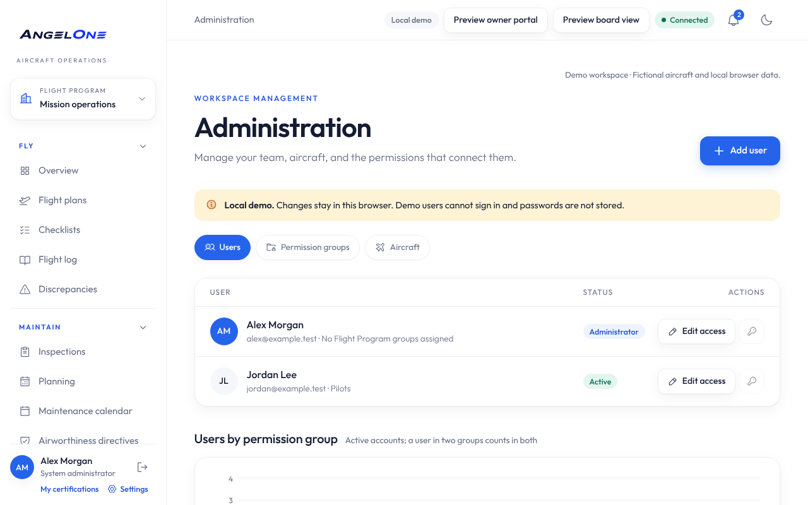

# Administration

[User guide](Home.md)

**Administration** (under Manage) decides who can do what: users, permission
groups and aircraft access. **Flight Programs** and **Aircraft** sit beside it.
Administration needs a connection: "Administration requires a connection."

## Flight Programs and switching

A **Flight Program** owns aircraft, people, storage locations and stock.
Everything you see belongs to the **active** program, chosen at the top of the
sidebar (or under **All sections** on a phone).

- With one program, you enter it automatically. The last one you chose is
  remembered on your account.
- Switching needs a connection.
- System administrators also see **Unassigned records**: records no program
  owns, and account-wide history.

## Users

### Add a user

| Who                           | Button                | Does                                                           |
| ----------------------------- | --------------------- | -------------------------------------------------------------- |
| System administrators         | **Add user**          | Creates an account with groups in any program                  |
| Flight Program administrators | **Add user**          | Creates an account in the active program only                  |
| Flight Program administrators | **Add existing user** | Adds an active account by email, without changing its password |

1. Enter **Full name**, **Email** and **Initial password** (at least 15
   characters; common passwords are refused). Share it privately.
2. Tick the permission groups. **Observers** is read-only. A system
   administrator ticks them under **Flight Program access**, program by
   program, and can also tick certifications if known.
3. Choose **Create account**.

There is no public sign-up and no self-service password reset.

### Change a user

| Task                        | How                                                                                                                                                         | Who                   |
| --------------------------- | ----------------------------------------------------------------------------------------------------------------------------------------------------------- | --------------------- |
| Change groups               | **Edit access** (a Flight Program administrator sees **Edit program access**), tick or untick groups                                                        | Administrators        |
| Remove from a program       | System administrators: untick every group in that program. Flight Program administrators: tick **Remove access to this Flight Program**. The account stays. | Administrators        |
| Reset a password            | **Reset password**, enter a **New password**. "Existing sessions will be revoked when the device reconnects." It also clears a sign-in lockout.             | System administrators |
| Disable an account          | **Edit access**, untick **Account active**. Every session ends.                                                                                             | System administrators |
| Make a global administrator | **Global administrator (all aircraft and settings)**                                                                                                        | System administrators |

The last active system administrator cannot be disabled or lose the global
administrator tick: "Keep at least one active administrator."

### Approve a certificate

Certificates waiting for approval are listed at the top of **Administration →
Users**: every member's for a system administrator, the active program's
members' for a Flight Program administrator.

1. Check the holder, number, ratings and dates against their real certificate.
2. Choose **Approve**.

Nobody approves their own certificate. If the holder changed it meanwhile:
"This certificate changed since you opened it. Review it again."

## Permission groups

A **permission group** is a set of permissions over all or some aircraft in
one program.

### Default groups

Each new program gets:

| Group                   | Permissions                                                 |
| ----------------------- | ----------------------------------------------------------- |
| Observers               | Read                                                        |
| Pilots                  | Read, add flights, report discrepancies                     |
| Maintenance technicians | Read, report and resolve discrepancies, manage maintenance  |
| Program managers        | Flight Program administrator                                |
| Aircraft owners         | Owner portal (read-only); no aircraft until you assign them |
| Board (read-only)       | Board view                                                  |

### Create or edit a group

1. **Permission groups → Add group**, or **Edit group**.
2. Enter the **Group name**.
3. Tick permissions: **Add flights**, **Report discrepancies**, **Resolve
   discrepancies online**, **Manage inspections and components online**. All
   groups can read their aircraft.
4. Or tick one role: **Aircraft owner (read-only owner portal)**, **Board member
   (read-only board view)** or **Flight Program administrator**. Owner and
   board groups cannot write.
5. Under **Aircraft access**, choose **All aircraft in this program** or **Only
   selected aircraft** and tick them. You must choose one.
6. Save.

A group's program cannot be changed after saving. **Delete group** lists the
users affected first.

A member with flight permission only gets the simplified
[pilot view](Pilot.md#what-you-see).

### Groups to review

System administrators may see groups listed above the group cards as
**Opened to all aircraft** or **Review**: older groups whose aircraft list
became empty. **Edit group** and choose aircraft or all aircraft to clear it.

## Aircraft

**Add aircraft** on the **Aircraft** page (or the Administration **Aircraft**
tab) adds one to the active program with verified opening readings.

### Set up an aircraft

**Aircraft → Set up an aircraft** (Flight Program administrators) loads an
aircraft's existing history in order, with a dry run first.

| Step                    | You do                                                                                          |
| ----------------------- | ----------------------------------------------------------------------------------------------- |
| 1. Aircraft             | Registration, make, model, serial, options, time source and baseline readings from the logbooks |
| 2. Components installed | **Add installed component**, or apply a component template                                      |
| 3. Inspections          | Download the CSV template, fill it in, paste or upload it                                       |
| 4. AD compliance        | The same for ADs                                                                                |
| 5. Review (dry run)     | Check what will be saved and fix rows it lists                                                  |
| 6. Save                 | Saves each row. On a failure, **Retry from the failed row** or **Fix the file**.                |

Until every step holds data, the aircraft reads **Setup incomplete**. The
chips on its row ("Baseline readings missing", "Components missing",
"Inspections missing", "ADs not reviewed") reopen the right step. A draft is
kept in this browser until you sign out.

## Transfer records between programs

System administrators, on **Flight Programs**:

1. Choose the **Record type**: **Aircraft**, **Stored component** or **Storage
   location**.
2. Choose the **Record to transfer** and the **Destination Flight Program**.
3. Enter the **Transfer reason** and choose **Transfer record**.

An aircraft takes its flights, problems, inspections, components and history.
Its costs stay with the program that paid. A transfer waits while the aircraft
has open parts requests or undelivered purchase-order lines; the message lists
them. A component must be removed from its aircraft first. Transfers do not
change anyone's access.

**Add Flight Program** and **Edit Flight Program details** are on the same
page.
