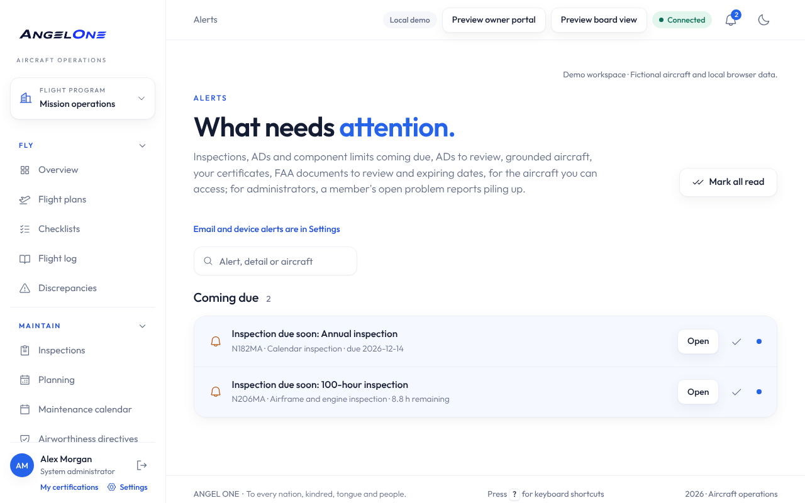
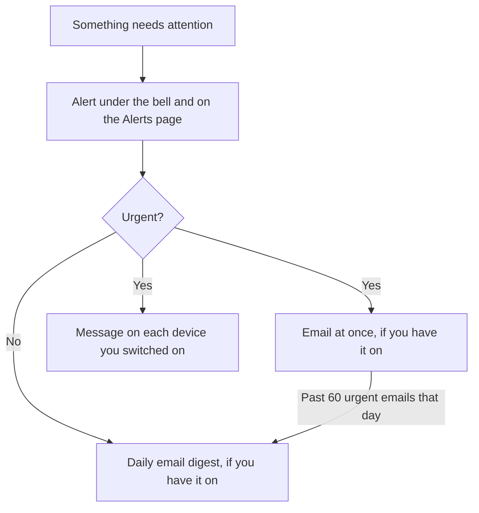

# Alerts

[User guide](Home.md)

An **alert** tells you what needs attention in your Flight Program. They are
under the bell in the top bar and on the **Alerts** page (under Manage). They
work offline from the copy on the device.

## What raises an alert

| Alert                                                                        | Who gets it                                                                | Urgent |
| ---------------------------------------------------------------------------- | -------------------------------------------------------------------------- | ------ |
| Inspection, AD or component limit due soon                                   | Members who can read the aircraft                                          |        |
| Inspection or AD overdue, component past its limit                           | Members who can read the aircraft                                          | Yes    |
| Aircraft grounded                                                            | Members who can read the aircraft                                          | Yes    |
| AD to review                                                                 | Members who can read the aircraft                                          |        |
| FAA documents to review                                                      | Members who can read the aircraft                                          |        |
| Your own certificate, medical or IA renewal: expiring in 30 days, or expired | You                                                                        |        |
| Expiring date coming due                                                     | Program dates: program administrators; system dates: system administrators |        |
| Expiring date passed                                                         | Same                                                                       | Yes    |
| One member's open problem reports reach half their limit                     | The program's administrators                                               | Yes    |

## Use the Alerts page

1. Open the bell or **Alerts**.
2. Use the search to narrow by title, detail or registration.
3. Choose **Open** on an alert to go to its record.
4. **Mark all read** marks every current alert read.

An alert whose substance changes (a new due point, for example) is unread
again. An alert that ends and later comes back is new again.

## Email and device alerts

Set them in **Settings → Alerts**. How one alert reaches you:

| Channel                            | What arrives                              | When                                  | On by default for              |
| ---------------------------------- | ----------------------------------------- | ------------------------------------- | ------------------------------ |
| **Email me a daily alert digest**  | New alerts, grouped by severity           | Daily at 13:00 UTC                    | Program administrators         |
| **Email me urgent alerts at once** | New urgent alerts                         | As soon as they arise                 | Administrators and maintenance |
| **Alert this device**              | Urgent alerts as a message on this device | As soon as they arise, app closed too | Off; switch it on per device   |

Urgent emails stop at 60 a day for the whole deployment, shared between the
Flight Programs. Past that they come in the next digest. The bell is never
held back.

Device alerts:

- On iPhone and iPad, add the app to the Home Screen first (iOS 16.4 or later).
- Supported browsers: Chrome, Edge, Firefox and Safari. Others get "This
  browser cannot receive alerts. Use a current Chrome, Edge, Firefox or
  Safari." or "This browser's alert service is not supported. Use Chrome,
  Edge, Firefox or Safari."
- Signing out releases the device. The next person to switch it on takes it
  over.
- The demo sends no alerts.

Emails judge dates in the program's records time zone; the bell uses your
device's date. They may change a few hours apart.

## Expiring dates

An **expiring date** is a renewal you must not miss: insurance, registration,
a service key, anything else.

| List                      | Where                                                     | Who                           |
| ------------------------- | --------------------------------------------------------- | ----------------------------- |
| Program expiring dates    | **Settings → Flight Program → Add program expiring date** | Flight Program administrators |
| Deployment expiring dates | **Settings → System → Add deployment expiring date**      | System administrators         |

1. Enter the label, kind, date and how many days before to warn (60 by
   default, up to 730). Optionally a note and an aircraft.
2. Save. It alerts from the warning window, and urgently from the day after
   the date.
3. Archive a date to stop its alerts. The record and its history are kept.

A date tied to an aircraft moves with the aircraft to another program.
