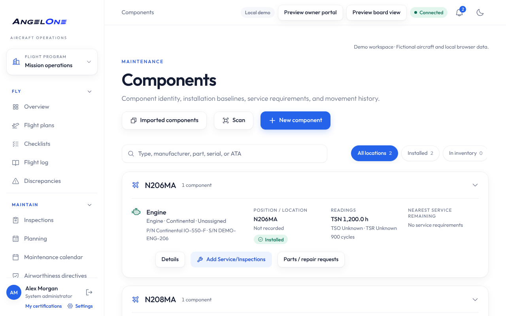

# Components

[User guide](Home.md)

A **component** is one serialized, life-tracked part: an engine, a propeller,
a pump. It is either installed on an aircraft at a position or held in
inventory. **Components** is under **Maintain**.

Changes need maintenance permission on the aircraft and a connection.

## The list

Components are grouped by aircraft, then in inventory. Each row shows the part
and serial number, position or location, readings (TSN, TSO, TSR, cycles) and
the nearest service limit.

| Button                      | Does                                                                                                                   |
| --------------------------- | ---------------------------------------------------------------------------------------------------------------------- |
| **New component**           | Adds a component (new components are received into inventory)                                                          |
| **Imported components**     | Components added from templates that still need their serial and readings                                              |
| **Scan**                    | Opens a component from its printed label ([Scan label](#scan-label))                                                   |
| **Details**                 | The component's record                                                                                                 |
| **Add Service/Inspections** | Adds a service requirement                                                                                             |
| **Parts / repair requests** | Requests parts, or sends the component for repair ([how](Inventory-and-Parts-Requests.md#send-a-component-for-repair)) |

## Component templates

A **component template** is a list of the components an aircraft make and
model should have. Applying one adds them without serial numbers or readings.

1. Choose **Imported components**, then **Component templates**.
2. Choose **New template / import CSV**. Enter the **Template name**, make and
   model (they must match the aircraft profile) and the component rows, then
   **Save template**. **Download CSV columns** gives the column headings; a
   CSV must be under 2 MiB.
3. Choose **Preview / apply to aircraft**, pick the **Target aircraft**, tick
   the rows and choose **Import selected as setup incomplete**.
4. On **Imported components**, choose **Complete setup** on each row: confirm
   it is installed and enter its serial number and opening readings. A parent
   component comes before its parts.

Templates need maintenance permission and a connection.

## A component's record

**Details** shows identity, location, attachments, service requirements,
movement and baseline history, and record history.

| Button                         | Does                                                                                                                                    |
| ------------------------------ | --------------------------------------------------------------------------------------------------------------------------------------- |
| **Edit component**             | Identity and location details                                                                                                           |
| **Set baseline**               | Verified opening readings                                                                                                               |
| **Move / service**             | Plans an install or removal on a work order, or records an overhaul or repair of a stored component (needs **Work performed / reason**) |
| **Add service requirement**    | A life limit, overhaul or inspection, by hours, cycles, landings or calendar                                                            |
| **Add trackable parts**        | Parts tracked under this component                                                                                                      |
| **Print Tag**, **Print Label** | Stickers for the part ([Inventory](Inventory-and-Parts-Requests.md#labels-and-tags))                                                    |
| **Upload attachment**          | Photos, invoices, certificates; PDF, JPEG, PNG or WebP, up to 7 MiB                                                                     |

## Install or remove a component

Installs and removals are planned on a work order and applied at close-out.

1. On the work order, choose **Install/remove component** under Requested
   work. Or start from the component: **Move / service** in its record, or
   **Inventory → Install / service** for a part in stock, then **Add movement
   to work order**.
2. Choose the component, and the position or the storage location.
3. Save the work order.
4. Close the work order with verified readings
   ([Work orders](Work-Orders.md#close-out)).

Planning a movement does not reserve the component. Removal freezes its hours
and cycles; calendar limits keep running in storage. On installation, its
requirements and inspections follow it to the new aircraft.

## Limits and statuses

| Label                                   | Means                                                                                                                    |
| --------------------------------------- | ------------------------------------------------------------------------------------------------------------------------ |
| Due now                                 | A usage limit at exactly 0 remaining; overdue, grounds the aircraft                                                      |
| Past due                                | Beyond a usage limit, or after a calendar due date; overdue, grounds the aircraft                                        |
| Set time baseline, Set landing baseline | The limit cannot be measured until a verified baseline is entered (**Set baseline**; for landings, **Edit requirement**) |
| Out for repair                          | Sent to a vendor; cannot be installed or edited until it returns                                                         |

Repair resets TSR, overhaul resets TSO; lifetime totals never reset. That is
chosen at close-out ([Work orders](Work-Orders.md#close-out)).

## Rules

- **Set baseline** is refused if the new totals fall below the last
  compliance recorded on one of the component's inspections, requirements or
  ADs, for example "Baseline would precede recorded inspection compliance."
  Correct that record first.
- Components are never deleted. Their history stays with the serial number.
- A component that changed since you opened it, or moved after a backdated
  close-out, needs review before close-out.

## Scan label

**Scan label** (under Maintain) opens a part or component from its printed QR
label with the device's camera. Without a camera, type the label link, serial
number or part number and choose **Open item**.
