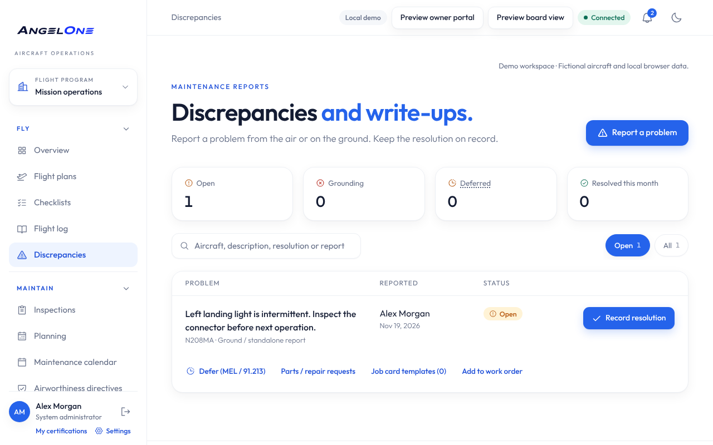
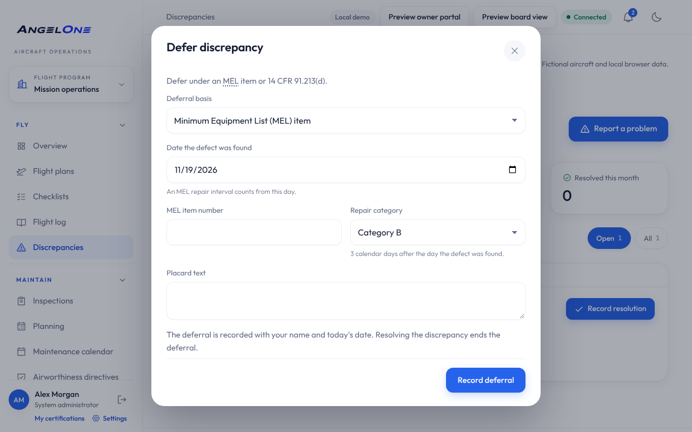

# Discrepancies

A **discrepancy** is a defect reported on an aircraft. It stays open until it
is resolved or deferred. "Problem" is the act of reporting; "discrepancy" is
the record. The screen is under **Fly**.

## The screen

| Part              | Shows                                                           |
| ----------------- | --------------------------------------------------------------- |
| Tiles             | Open, Grounding, Deferred, Resolved this month                  |
| **Open**, **All** | Open reports only, or every report                              |
| Each row          | The problem, the aircraft, who reported it and when, its status |

## Report a problem

Anyone with "Report discrepancies" permission can report, online or offline.

1. Choose **Report a problem**.
2. Choose the aircraft and answer **What did you observe?**
3. Tick **Aircraft not airworthy until resolved** if it must not fly. The
   aircraft is then grounded until the report is resolved or deferred.
4. Choose **Save report**.

A pilot can also report from the flight form's **Discrepancy** field.

| Limit                                                                         | What happens                                                                                                                            |
| ----------------------------------------------------------------------------- | --------------------------------------------------------------------------------------------------------------------------------------- |
| 200 open reports, or about 500,000 characters of text, per member per program | "You have too many open problem reports. Ask an administrator to resolve or defer some of your open reports, then send this one again." |
| Half that (100 reports or about 250,000 characters)                           | The program's administrators get an alert                                                                                               |

Deferred and resolved reports do not count.

## Resolve a problem

Needs "Resolve discrepancies online" permission and a connection.

1. Choose **Record resolution** on the report.
2. Answer **What fixed the problem?**
3. Choose **Mark resolved**.

"Your name, the time, and this explanation will remain in the history."
Resolved reports are read-only.

## Defer a problem

Same permission as resolving. Choose **Defer (MEL / 91.213)**.

1. Choose the **Deferral basis**: **Minimum Equipment List (MEL) item** or
   **14 CFR 91.213(d) inoperative equipment**.
2. Enter **Date the defect was found**. The repair interval counts from this
   day, not the day you defer.
3. For an MEL item: the **MEL item number** and **Repair category**.
4. Enter the **Placard text**.
5. Choose **Record deferral**.

| Category  | Repair interval, after the day the defect was found |
| --------- | --------------------------------------------------- |
| A         | The days the MEL states (1 to 365)                  |
| B         | 3 calendar days                                     |
| C         | 10 calendar days                                    |
| D         | 120 calendar days                                   |
| 91.213(d) | No expiry                                           |

An expired deferral grounds the aircraft. The deferral is recorded with your
name and today's date; the deferral date must be today. Resolving the
discrepancy ends the deferral.

## Other actions on a report

Mechanics and administrators see these; the pilot view hides them.

| Button                      | Does                                                                                       |
| --------------------------- | ------------------------------------------------------------------------------------------ |
| **Parts / repair requests** | Requests parts for the repair ([how](Inventory-and-Parts-Requests.md#parts-requests))      |
| **Job card templates**      | Keeps reusable instructions for this repair ([Job cards](Job-Cards.md#job-card-templates)) |
| **Add to work order**       | Adds the report to an open work order on the aircraft ([Work orders](Work-Orders.md))      |

Adding a report to a work order does not resolve it. Resolve it here when the
work is done.

## Load older

The device holds every open report and those resolved or deferred in the last
3 months. Under **All**, **Load older** fetches older resolved reports. It
needs a connection. See [what the device keeps](Offline.md#what-the-device-keeps).
