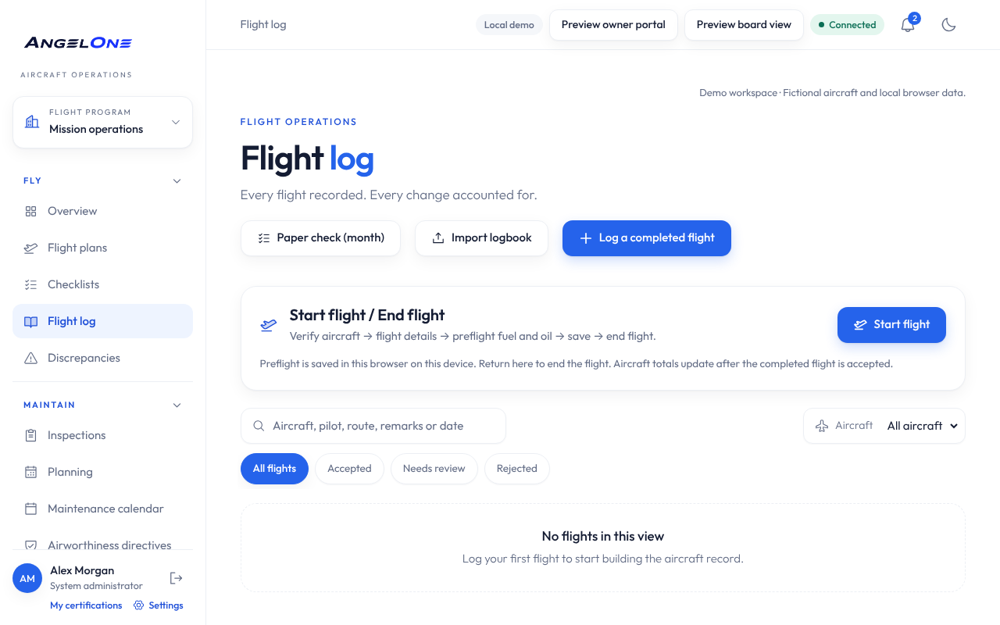

# Flight log

The **Flight log** (under Fly) lists every flight, newest first. Logging a
flight advances the aircraft's Hobbs, tach, total time, cycles and landings,
which drive every hours-based limit. Flights can be logged offline.

## Find a flight

| Control        | Does                                                                                                        |
| -------------- | ----------------------------------------------------------------------------------------------------------- |
| Search         | Matches registration, pilot, copilot, origin, destination, remarks and date (`2026-11-03` or `Nov 3, 2026`) |
| **Aircraft**   | One aircraft, or **All aircraft**                                                                           |
| Status         | **All flights**, **Accepted**, **Needs review**, **Rejected**                                               |
| **Show more**  | Shows 50 more of the flights already loaded                                                                 |
| **Load older** | Loads flights older than the last 6 months ([below](#load-older))                                           |

## Log a flight

Use any of these: **Log a completed flight** on the Flight log, **Log a
flight** on the Overview, **Log flight** on an aircraft card or in the phone's
bottom bar, or **N** on a keyboard. The steps are in the
[Pilot guide](Pilot.md#log-a-flight).

| Field                   | Rule                                                                                                                                                       |
| ----------------------- | ---------------------------------------------------------------------------------------------------------------------------------------------------------- |
| Starting Hobbs and tach | Read-only, from the aircraft's totals. Verify them against the meters.                                                                                     |
| Ending readings         | Required for the aircraft's tracking meter. Use a point for decimals.                                                                                      |
| Flight date & time      | Your time zone is shown; the flight is stored with a UTC timestamp.                                                                                        |
| Fuel and oil            | Starting level is before additions. Enter 0 when none was added. Changing a unit does not convert values.                                                  |
| Engine oil from stock   | **Use inventory for engine oil** issues oil an administrator marked **Engine oil**. It is deducted once when the flight syncs, even if the flight is held. |
| Discrepancy             | Opens a linked problem report, even if the flight needs review.                                                                                            |

Aircraft options add fields: turbine aircraft get engine start time and maximum
start EGT; twins get left and right; amphibians get **Sea/Land** beside the
landing count. An aircraft with **Flight time log** on asks for cumulative
flight time instead of timestamps.

The **Origin** and **Destination** fields suggest the program's eight most-used
places. **Same as last flight** fills crew and route, never readings.

### Start flight and End flight

1. Choose **Start flight** on the Flight log.
2. Verify the aircraft's readings, enter the flight details and preflight fuel
   and oil.
3. After landing, open the flight again and choose **End flight**. Enter the
   ending readings and save.

"Preflight is saved in this browser on this device." Return on the same
device to end the flight.

### Import a logbook

**Import logbook** reads a CSV exported from ForeFlight or Garmin Pilot.
Choose the operation and flight rules, then **Preview flights**. Rows without
the aircraft's required meter reading cannot be imported. Each row is checked
like a logged flight.

## Rules

### The dispatch gate

You cannot log a flight on a grounded aircraft. The form says the aircraft "is
grounded. Flights cannot be logged until these items are resolved or
deferred:" and lists why.

| You are                      | What you can do                                                                                                                 |
| ---------------------------- | ------------------------------------------------------------------------------------------------------------------------------- |
| Pilot or mechanic            | "Ask a Flight Program administrator to resolve or defer these items, or to record a dispatch override."                         |
| Flight Program administrator | Enter an **Administrator dispatch override reason** (at least 10 characters). It is kept with the flight and in Change history. |

A flight on an aircraft grounded only by a problem reported after the flight
began is not refused. It is held with "The aircraft was grounded during this
flight."

### Flights held for review

A flight that reaches the server after the aircraft moved on is held:
status **Needs review**. It does not change the aircraft's totals until an
administrator decides. Nothing is lost. The reasons, checked in this order:

| Reason shown                                                                                                                             | Usual cause                                             |
| ---------------------------------------------------------------------------------------------------------------------------------------- | ------------------------------------------------------- |
| "The aircraft was grounded during this flight."                                                                                          | A grounding problem was reported while flying           |
| "Aircraft totals changed after this entry was started."                                                                                  | Someone else logged a flight first                      |
| "Flight predates an aircraft counter change and requires chronology review."                                                             | The aircraft's totals were corrected after this flight  |
| "Backdated or duplicate-time flight requires a chronology review."                                                                       | The start time is before the aircraft's latest flight   |
| "Hobbs reading is lower than the current counter." (or Tach, Flight time log)                                                            | A typing slip, or a missed flight                       |
| "Hobbs reading is N hours past the current counter, longer than any single flight. Check for a missed decimal point or a decimal comma." | More than 24 hours on a meter: usually 23425 for 2342.5 |

Several flights logged offline on one aircraft are queued in order, so the
later legs are not held. If an earlier leg is held, the later legs are held
too.

### Review a held flight

Flight Program administrators only.

1. Filter the Flight log to **Needs review**.
2. Choose **Review** on the flight. The reason is on top, and each reading that
   differs is shown beside the aircraft's current total.
3. Correct the readings if needed.
4. Under **Review decision**, choose **Accept corrected entry and recalculate
   totals** or **Reject entry and exclude it from totals**.
5. Write an **Explanation** (at least 5 characters) and choose **Record
   review**.

Both decisions keep the original values and the explanation in Change history.
Accepting rebuilds the totals and later flights.

### Correct a flight

Administrators choose **Correct** on an accepted flight. It opens the same
form with a **Review decision** and a required **Explanation**: accept the
corrected entry, or reject it to exclude it from totals. The original stays in
Change history. Corrections need a connection. Oil already issued from stock is
not returned; fix stock with an inventory adjustment.

### Number formats

Number fields refuse a decimal comma: "Use a point for decimals, as in 2342.5,
and leave out thousands commas."

## Logbook page photos

While the program keeps paper logbooks, attach a photo of the handwritten line:

1. Choose **Add a photo of the logbook line** in the **Flight saved** notice,
   or in the flight's **Logbook page** column later.
2. On a phone the camera opens; elsewhere, a file picker.

| Rule     | Detail                                                                                               |
| -------- | ---------------------------------------------------------------------------------------------------- |
| Who      | Members with flight permission on the aircraft                                                       |
| Files    | JPEG, PNG, WebP or PDF, up to 7 MiB. HEIC is refused ([fix](Troubleshooting.md#a-photo-is-refused)). |
| Offline  | The photo waits on the device, marked **Waiting**, and uploads after its flight syncs                |
| Removing | Photos are never deleted. **Archive photo** asks for a reason.                                       |

## Paper check

**Paper check (month)** lists one aircraft's flights and completed work orders
for a month, to tick against the paper logbook. See
[Records package and exports](Records-Package-and-Exports.md#paper-check).

## Load older

The log holds the last 6 months of flights, plus every held flight. **Load
older** under the list fetches older flights page by page. It needs a
connection; offline it reads "Older records need a connection". The search,
counts and charts cover the flights loaded. See
[what the device keeps](Offline.md#what-the-device-keeps).
