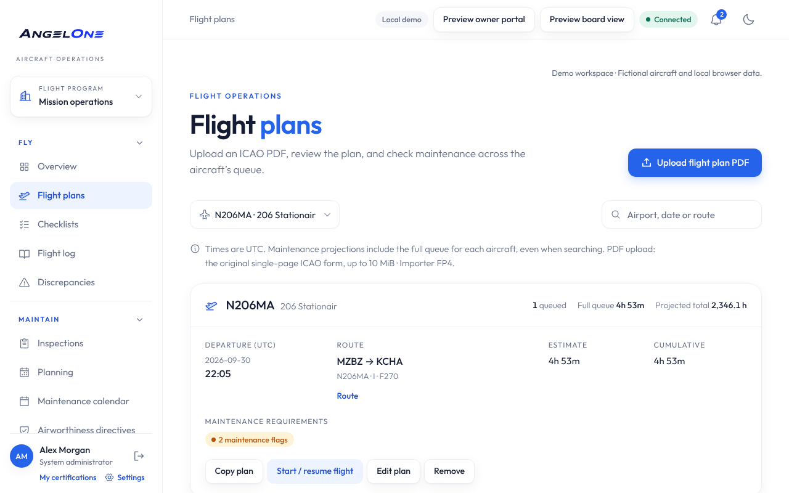

# Flight plans and checklists

[User guide](Home.md)

Both are under **Fly**. Flight plans check what maintenance falls due across
an aircraft's queued flights. Checklists are ForeFlight-compatible checklists
you can run on the device.

## Flight plans

### Upload a plan

1. Choose **Upload flight plan PDF**.
2. Select the original single-page ICAO PDF (up to 10 MiB). Scanned or
   multi-page PDFs are refused.
3. Review the fields the app read. Fill in anything missing.
4. Check the aircraft. A different aircraft than the PDF names needs you to
   acknowledge the mismatch.
5. Confirm the estimated landings, and cycles on a turbine aircraft (default
   1), and choose **Save flight plan**.

The PDF itself is not stored, only the fields. Times are UTC.

### Read the queue

Plans are listed by departure time. Each row adds the plan's estimated time to
the aircraft's total and checks inspections, component limits, open problems
and the profile status. Open **N maintenance flags** on a row to read them. An
inspection the queue would reach reads "Due before further Flight" after its
name. These are estimates and change no totals.

### Fly, copy or remove a plan

| Button                    | Does                                                                                                                                                                                                                                                                           |
| ------------------------- | ------------------------------------------------------------------------------------------------------------------------------------------------------------------------------------------------------------------------------------------------------------------------------ |
| **Start / resume flight** | Runs [Start flight and End flight](Flight-Log.md#start-flight-and-end-flight) with the plan's route, date, rules, cycles and landings filled in. Verify the pilot and time. After landing, choose it again, or **End flight** on the Flight log, to enter the ending readings. |
| **Copy plan**             | Opens a copy. Set the new flight date and departure time, then **Save copy**.                                                                                                                                                                                                  |
| **Edit plan**             | Changes a proposed plan                                                                                                                                                                                                                                                        |
| **Remove**                | **Remove from queue** cancels a proposed plan. A plan with a flight logged or waiting to sync has no flight, edit or remove buttons.                                                                                                                                           |

A plan can be flown once. Rejecting its flight makes the plan available
again. Uploading, copying, editing and removing plans, and starting a plan's
flight, need a connection and flight permission; **End flight** on the
Flight log works offline. Flown and removed plans are under **Logged and removed plans**.

### Load older

Plans still to fly, and those departed in the last 6 months, are on the
device. **Load older** under the list fetches older plans, for the chosen
aircraft if one is chosen, and needs a connection.

## Checklists

### Add a checklist

| Button             | Does                                                                                            |
| ------------------ | ----------------------------------------------------------------------------------------------- |
| **Import .fmd**    | Reads a ForeFlight checklist file. Review name, aircraft and contents, then **Save checklist**. |
| **New checklist**  | A blank set with Normal, Abnormal and Emergency categories                                      |
| **Edit checklist** | Change groups, checklists, items, headings and notes. Nothing saves until **Save checklist**.   |
| **Export .fmd**    | Downloads the saved checklist for ForeFlight                                                    |

Editing an aircraft's checklist needs flight or maintenance permission on it.
Editing the program-wide library needs a Flight Program administrator. Edits
need a connection.

### Run a checklist

1. Open the checklist and pick a category tab.
2. Tap an item, or use **Check next item**. **Skip next item** marks it
   skipped.
3. When done, choose **Reset checklist**, or **Reset all checklists** for the
   whole set.

Your checkmarks are personal, kept on this device and work offline. They are
not a flight record or a sign-off. A new revision of the checklist starts
fresh progress.

### Guided flight trial

Tick **Enable guided flight trial** to run a whole flight from one screen:

1. Choose the aircraft, one of its unlogged flight plans and a checklist.
2. Choose the **Preflight section** and **Shutdown section**, then **Start
   guided checklist**.
3. At preflight, confirm the last recorded meters and enter fuel and oil
   starting levels before additions, and what you added.
4. Run the checklist.
5. At shutdown, enter the ending meters and fuel.
6. **Review flight log** opens the flight form. Check it and save.

The draft is saved in this browser and survives a reload, offline too. It does
not move between devices. **Discard draft** deletes only the unfinished run.
Turning the trial off keeps drafts and saved flights.
