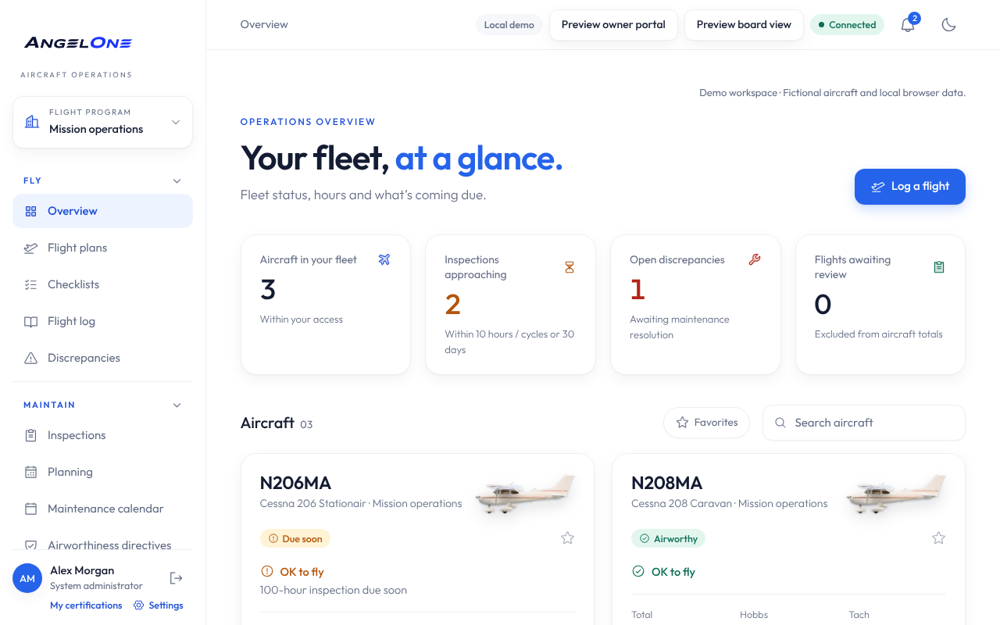
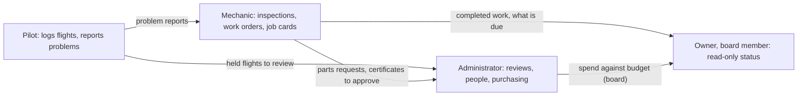

# Angel One user guide

Angel One keeps the maintenance records of a mission flight program's aircraft
and runs the daily work that produces them. [Who does what](#roles) is below.

> The signed paper logbook is the maintenance record. Angel One writes the
> logbook entry wording for signature and keeps the status records 14 CFR
> 91.417(a)(2) requires.

**Start here:**
[What everyone needs to know](../handbook/1-start-here/must-know.md) ·
[Regular checklists](../handbook/3-running-it/checklists.md) (daily to yearly) ·
[Glossary](../handbook/1-start-here/glossary.md) (the words the app uses)

## Sign in

1. Open the app's address in a browser on a phone, tablet or computer.
2. Enter your **Email** and **Password**, then **Sign in**.
3. The first sign-in on a device needs a connection.

| Situation                                                                                                                             | What to do                                                                                                     |
| ------------------------------------------------------------------------------------------------------------------------------------- | -------------------------------------------------------------------------------------------------------------- |
| No account                                                                                                                            | Ask your administrator. "Accounts are created by your administrator. No public signup."                        |
| Forgot your password                                                                                                                  | Choose **Forgot?**: "Ask your administrator to reset your password." Only a system administrator can reset it. |
| "Email or password is incorrect. After too many wrong tries, sign-in pauses for a while; your administrator can reset your password." | Check the email and password. After 10 wrong tries in an hour, wait or ask for a reset.                        |

You stay signed in for seven days, online or offline. Then the app shows
**Time to reconnect.** and asks you to sign in again. See
[Offline](Offline.md).

### Install it on a phone

| Device             | Steps                                   |
| ------------------ | --------------------------------------- |
| iPhone, iPad       | Safari → Share → **Add to Home Screen** |
| Android, computers | Use the browser's install action        |

Phones and tablets used for the app must have a screen lock.

## Roles

What you see depends on your permission groups in the active Flight Program.
Your role shows under your name at the bottom of the sidebar.

Who hands what to whom:

| Role                         | What they do                                                     | Guide                                 |
| ---------------------------- | ---------------------------------------------------------------- | ------------------------------------- |
| Pilot                        | Log flights, report problems, read checklists                    | [Pilot](Pilot.md)                     |
| Mechanic                     | Inspections, work orders, job cards, components, ADs             | [Mechanic](Mechanic.md)               |
| Flight Program administrator | Everything in one program: people, aircraft, purchasing, reviews | [Administrator](Administrator.md)     |
| System administrator         | Every program, accounts, system settings                         | [Administrator](Administrator.md)     |
| Aircraft owner, board member | Read-only owner portal or board view                             | [Owner and board](Owner-and-Board.md) |

## Find your way

[All pages](_Sidebar.md) lists every page of this guide.

The sidebar groups screens under **Fly**, **Maintain** and **Manage**. On a
phone, the bottom bar has **Overview**, **Flight log**, **Log flight**,
**Inspections** (not in the pilot view) and **More**.

| Screen or feature                                 | Page                                                            |
| ------------------------------------------------- | --------------------------------------------------------------- |
| Overview, aircraft, OK to fly                     | [Overview and aircraft](Overview-and-Aircraft.md)               |
| Flight log, logging and reviewing flights         | [Flight log](Flight-Log.md)                                     |
| Flight plans, checklists, guided flight           | [Flight plans and checklists](Flight-Plans-and-Checklists.md)   |
| Discrepancies, deferrals                          | [Discrepancies](Discrepancies.md)                               |
| Work orders, close-out, logbook entries           | [Work orders](Work-Orders.md)                                   |
| Job cards and signoffs                            | [Job cards and sign-off](Job-Cards.md)                          |
| Inspections and airworthiness directives          | [Inspections and ADs](Inspections-and-ADs.md)                   |
| Components                                        | [Components](Components.md)                                     |
| Inventory and parts requests                      | [Inventory and parts requests](Inventory-and-Parts-Requests.md) |
| Purchase orders, vendors, saved addresses         | [Purchase orders and vendors](Purchase-Orders-and-Vendors.md)   |
| Planning, maintenance calendar, due items         | [Planning and due items](Planning-and-Due-Items.md)             |
| Status sheet, records package, paper check, costs | [Records package and exports](Records-Package-and-Exports.md)   |
| Change history                                    | [Change history](Change-History.md)                             |
| Weekly summary                                    | [Weekly summary](Weekly-Summary.md)                             |
| Alerts and expiring dates                         | [Alerts](Alerts.md)                                             |
| Reference library and manuals                     | [Reference library](Reference-Library.md)                       |
| Settings                                          | [Settings](Settings.md)                                         |
| Administration, Flight Programs, aircraft setup   | [Administration](Administration.md)                             |
| Working without a connection, Sync center         | [Offline](Offline.md)                                           |
| Questions and problems                            | [FAQ](FAQ.md) · [Troubleshooting](Troubleshooting.md)           |

## Words you will see

The app's **Glossary** (under Manage) explains every term. Dotted-underlined
words, such as **Hobbs** or **MEL**, open a short tip when tapped.

| Word             | Meaning                                                                                                   |
| ---------------- | --------------------------------------------------------------------------------------------------------- |
| Flight Program   | The group that owns aircraft, people and stock. Switch it at the top of the sidebar.                      |
| Airworthy        | Nothing is due soon or overdue, and setup is complete.                                                    |
| Due soon         | Something comes due within the warning window.                                                            |
| Grounded         | Something is overdue, a grounding problem is open, a deferral expired, or the profile is marked grounded. |
| Setup incomplete | The aircraft's records are still being loaded. It never reads Airworthy, but it can fly.                  |
| Overdue          | An hours, cycles or landings limit at 0 remaining, or a calendar limit the day after its due date.        |
| Correction       | A change to a finished record. It keeps the original and needs a reason.                                  |

## Why records are corrected, never edited

Finished records are safety records. The app appends a correction with your
name, the time and a reason, and keeps the original. Every change is in
[Change history](Change-History.md), and nothing in it can be edited or
deleted.

## Keyboard shortcuts

On a computer: **/** jumps to the search box, **N** opens the flight form if
you may log flights, and **?** lists the shortcuts.

## More reading

- [How the app works, costs, risks, changes](../handbook/README.md)
- [Set up Angel One from scratch](../handbook/3-running-it/setup-from-scratch.md)
- For developers: [How the code is structured](../handbook/6-for-developers/code-structure.md)
