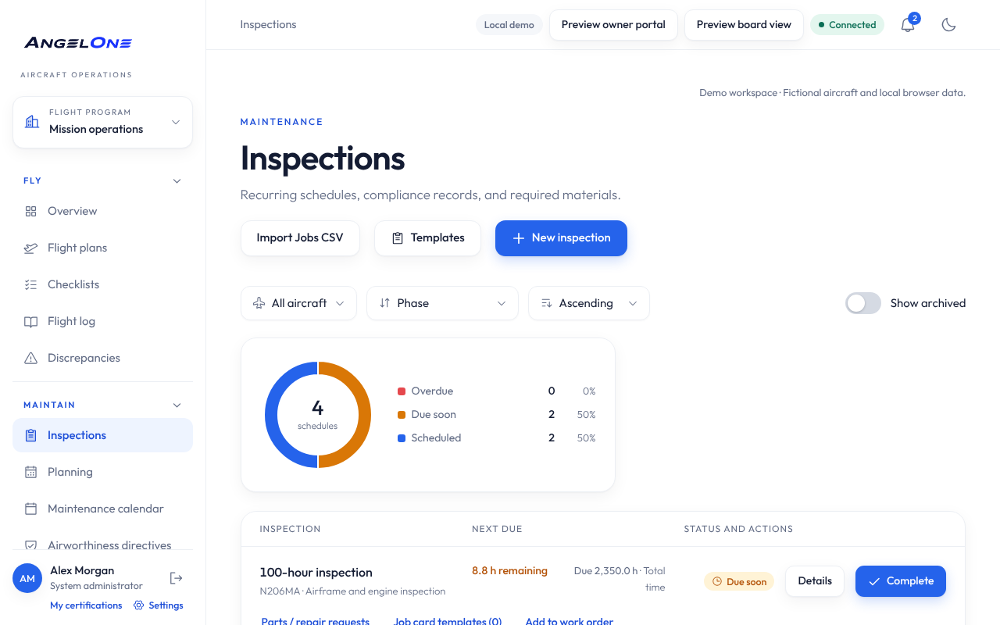
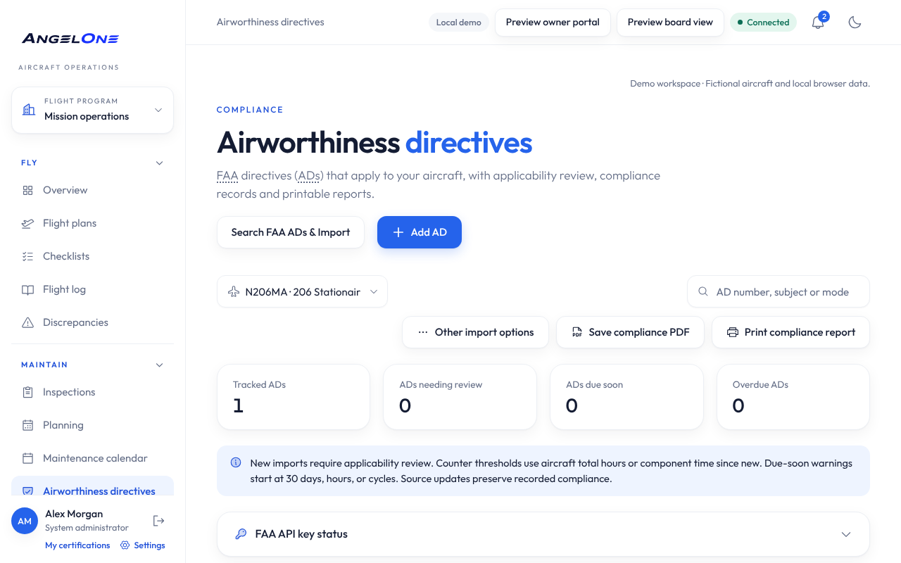

# Inspections and ADs

**Inspections** and **Airworthiness directives** are under **Maintain**. Both
track limits by hours, cycles, landings or calendar, and both ground the
aircraft once a limit is overdue
([when a limit is overdue](Overview-and-Aircraft.md#when-a-limit-is-overdue)).

Changes need maintenance permission on the aircraft and a connection.

## Inspections

### The list

| Control           | Does                                                                     |
| ----------------- | ------------------------------------------------------------------------ |
| Aircraft          | One aircraft or all                                                      |
| Sort              | Phase, next due date, hours, cycles or landings; ascending or descending |
| **Show archived** | Includes completed one-time and archived schedules                       |
| Chart             | Schedules by status: Overdue, Due soon, Scheduled (not on a phone)       |

Each row shows what is due, what remains, a meter of the interval left, and its
status. The meter is green while scheduled, amber when due soon, and an empty
red track marked **Overdue** once reached.

### Add an inspection

| Way                 | How                                                                                                             |
| ------------------- | --------------------------------------------------------------------------------------------------------------- |
| **New inspection**  | Enter the reference, description, intervals (hours, cycles, months, landings) and the last-done values for each |
| **Templates**       | Open **Inspection templates**, then **Create inspection** on a template                                         |
| **Import Jobs CSV** | Load inspections from a CSV file                                                                                |
| Aircraft setup      | Administrators load an aircraft's history ([Administration](Administration.md#set-up-an-aircraft))              |
| From a manual       | **Find maintenance items** in the [Reference library](Reference-Library.md#find-maintenance-items)              |

Monthly intervals fall due on the last day of the target month. An inspection
can follow the aircraft's time or one of its components. A component's
inspections stay with that serial number, even in storage. In storage they
still alert, but no longer ground the aircraft it came off.

### Record a completion

Completion is usually recorded by closing a work order
([Work orders](Work-Orders.md#close-out)). To record one directly:

1. Choose **Complete** on the inspection.
2. Enter the **Completion date**, **Tracked total at completion (hours)**,
   **Tracked cycles at completion** and, for a landings limit, **Aircraft
   total landings at completion**.
3. Enter **Work performed / reason** (required).
4. Choose **Record completion**.

Recurring limits move forward from the completion. A one-time inspection is
archived. **Record history** under the form lists every change.

### Other actions

**Details** edits the schedule. **Parts / repair requests**, **Job card
templates**, **Add to work order** and **Create PO for parts** start related
work.

## Airworthiness directives

Choose an aircraft. The search narrows by AD number, subject, section, make,
model, amendment, superseding AD or required action.

| Tile               | Counts                                           |
| ------------------ | ------------------------------------------------ |
| Tracked ADs        | ADs on the aircraft and its components           |
| ADs needing review | Imported or changed ADs not yet reviewed         |
| ADs due soon       | 30 or fewer days, hours, cycles or landings left |
| Overdue ADs        | Past a limit; these ground the aircraft          |

### Add ADs

| Way                         | How                                                                                                    |
| --------------------------- | ------------------------------------------------------------------------------------------------------ |
| **Search FAA ADs & Import** | Searches the FAA by the aircraft's and components' models. Pick matches, then import. Not in the demo. |
| **Add AD**                  | Type the AD by hand                                                                                    |
| **Other import options**    | **Import Word report** imports a `.docx` compliance report                                             |

Imported ADs start as **Needs review**. Importing never fills in compliance or
deadlines.

### Review an AD

1. Choose **Edit** on the AD (or **Details**, then **Review / edit AD**).
2. Set **Applicability**: Needs review, Applicable, Not applicable,
   Superseded, or Previously Complied With (PCW). Give the reason for "Not
   applicable".
3. For an applicable AD, **Add required action** for each action, with its
   recurrence and first due limits.
4. Tick **Applicability and source changes reviewed**. Until it is ticked, an
   applicable AD still reads **Needs review** and compliance cannot be
   recorded on it.
5. Choose **Save AD**.

Changing an AD after its applicability is decided, or after compliance is
recorded, is a correction: **Save AD** then asks for a **Reason for change**.

### Record AD compliance

Closing a work order does not record AD compliance.

1. Choose **Details** on the AD, then **Record compliance** on the action. It
   is disabled until the AD is reviewed as Applicable or PCW.
2. Enter the method, date and counters, mechanic and certificate, service
   bulletin, evidence or logbook reference, and work order.
3. Choose **Save compliance**.

Repeating limits move forward from the compliance. A first-time limit without
a repeat interval is cleared. A terminating action ends the recurrence. An
action that repeats without a fixed interval reads **Due not set** until its
next limit is entered.

### Correct a compliance entry

Compliance history is never edited. Flight Program administrators only:

1. Choose **Details** on the AD, open **Compliance history**, and choose
   **Correct entry**.
2. Enter the corrected values and a **Reason for correction**.
3. Choose **Save correction**.

The correction is appended; the original stays in the history, the reports and
Change history.

### Statuses you may see

| Status                                                                                                                  | Means                                                                               |
| ----------------------------------------------------------------------------------------------------------------------- | ----------------------------------------------------------------------------------- |
| Needs review                                                                                                            | Imported or changed and not yet reviewed; compliance cannot be recorded until it is |
| Due now                                                                                                                 | An hours, cycles or landings limit at 0 remaining: overdue                          |
| Counter unavailable                                                                                                     | A limit the app cannot read, for example hours on a part that does not track time   |
| Due not set                                                                                                             | Recurs without a fixed interval; enter the next limit                               |
| "This one-time limit (…) was not cleared when compliance was recorded on (date). If compliance satisfied it, clear it." | Older data; use **Clear initial limit** if it was satisfied                         |

### Reports

**Save compliance PDF** downloads a dated report. **Print compliance report**
opens it for printing (allow the new tab). Reports record what was entered;
they are not signatures.

### FAA monitoring

Under **FAA monitoring and updates**: **Enable daily checks**, **Save
monitoring settings**, and **Check FAA now**. New matches arrive as candidates
to review. A program can monitor up to 25 aircraft. The FAA key is set by a
system administrator ([Settings](Settings.md#system)).
