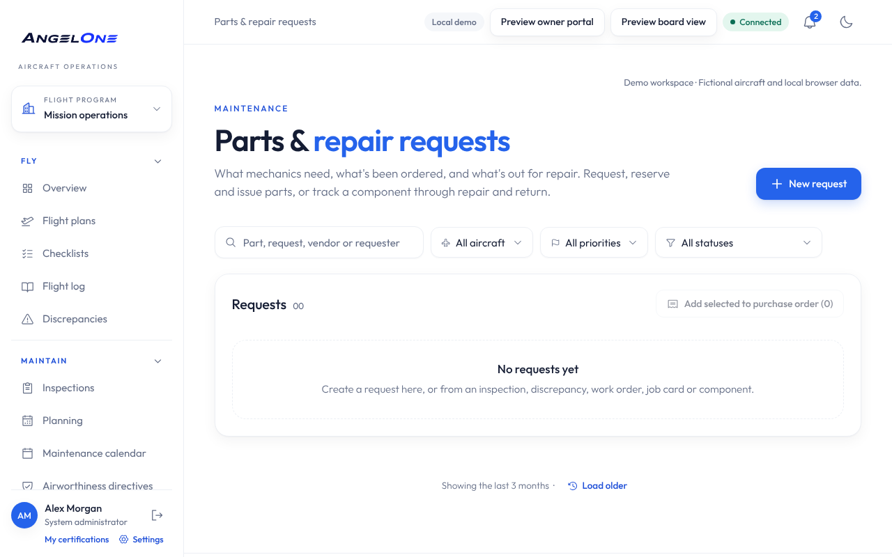
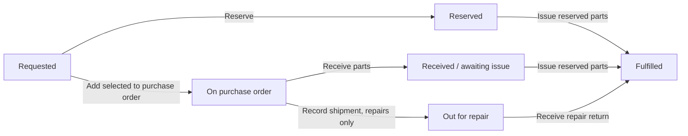

# Inventory and parts requests

[User guide](Home.md)

**Parts & repair requests** is how mechanics ask for parts or a repair.
**Inventory** holds the program's storage locations and stock. Both are under
**Maintain**.

| Who                           | Can                                                                                        |
| ----------------------------- | ------------------------------------------------------------------------------------------ |
| Mechanics                     | Create requests for aircraft they maintain; see stock and order progress on their requests |
| Flight Program administrators | Everything: Inventory, reservations, issues, cancellations and purchasing                  |

All changes need a connection. Offline, quantities are marked as cached.

## Parts requests

### Filters

| Filter   | Values                                                                                                                               |
| -------- | ------------------------------------------------------------------------------------------------------------------------------------ |
| Aircraft | One aircraft or all                                                                                                                  |
| Priority | P1 AOG, P2 Routine, P3 Stock                                                                                                         |
| Status   | Recurring, Requested, Reserved, On purchase order, Out for repair, Received / awaiting issue, Partially issued, Fulfilled, Cancelled |

### Request parts

1. Choose **New request**, or **Parts / repair requests** on a problem report,
   inspection, AD task, job card, component or stock item, or **Request parts
   for task** on a work-order task. The source and aircraft fill in. A
   number on the button, such as **Parts / repair requests (2)**, counts that
   record's open requests.
2. **Request type**: **Parts**.
3. Enter the priority, **Required by**, preferred vendor and **Deliver / return
   to** address.
4. Add each part: part number, alternate, name, quantity, manual reference.
   The table below shows on hand, reserved and available stock by location.
5. Choose **Save request**.

For scheduled work, tick **Recurring — required each time this
inspection/service/AD task is performed**. The list then makes a separate
request each time that work is added to a work order. A recurring list itself
cannot reserve or order parts.

### Reserve, order and issue (administrators)

A request's status, and the action that moves it on:

A request issued in part reads **Partially issued**. A request to restock
inventory, rather than for an aircraft, is **Fulfilled** as soon as its parts
are received.

| Step                       | How                                                                                                                         |
| -------------------------- | --------------------------------------------------------------------------------------------------------------------------- |
| Hold stock for the request | **Reserve**; **Release reservation** gives it back                                                                          |
| Use the parts              | **Issue reserved parts** (dated today)                                                                                      |
| Order what is short        | Select requests with the same vendor, currency and ship-to address, then **Add selected to purchase order**                 |
| Receive                    | On the purchase order; parts received for a request are reserved for it ([Purchase orders](Purchase-Orders-and-Vendors.md)) |
| Cancel                     | **Cancel request**, a reason, then **Cancel request and release reservations**; issued parts stay recorded                  |

Rules:

- Stock past its shelf life is never available. It cannot be reserved or
  issued, and is shown as expired.
- An alternate part number needs "I confirm use of the listed alternate part
  number."
- Lines become fixed once reserved, issued or on a purchase order.
- An issue to a work order records the stock's unit cost at that moment.
- A request with quantities ordered but not yet received cannot be cancelled:
  "Remove draft allocations or cancel outstanding PO quantities first."

### Send a component for repair

1. **New request**, **Request type**: **Component repair / service**.
2. Choose an uninstalled component. Enter the defect, work requested,
   quoted cost, addresses and shipping instructions.
3. Select the request, choose **Add selected to purchase order**, then
   **Issue PO** on the order.
4. **Download repair order / tag** and **Download packing slip** from the
   request.
5. Choose **Record shipment** on the order. The component reads **Out for
   repair** and cannot be installed or edited.
6. Choose **Receive repair return** on the order, with the same serial number
   and verified hours and cycles. The same component record is updated.

### Load older

The device holds open requests, those changed in the last 3 months, recurring
lists and requests counted by kept work orders. **Load older** under the table
fetches older ones, with their purchases. Needs a connection.

## Inventory

Administrators only.

| Tile                 | Shows                                |
| -------------------- | ------------------------------------ |
| Stock items          | Count of items                       |
| At or below reorder  | Items to reorder                     |
| Expired or expiring  | Past or within 30 days of shelf life |
| Recorded stock value | Sum of recorded costs                |

### Set up stock

1. **New location**: a storage place with address and contact.
2. **New stock item**: part and alternate numbers, description, condition,
   location, quantity, reorder threshold, optional vendor, invoice, PO and cost.
3. For a serialized part, choose **Category → Trackable Aircraft Component**.
   It then also appears under [Components](Components.md).
4. Tick **Engine oil** on oil, so pilots can draw it down when logging oil.

### Move stock

**Move stock** records a receipt, an issue or an adjustment to a counted
balance. Each movement keeps who, when and the balance before and after.
Stock can never go negative.

Installing a component or completing an inspection does not use stock by
itself. Record what you used with an issue.

### Labels and tags

| Button          | Prints                                                                                            |
| --------------- | ------------------------------------------------------------------------------------------------- |
| **Print Label** | A 2-inch sticker with part number, QR code and, for components, serial                            |
| **Print Tag**   | A 2-inch-wide parts-removal sticker for a hang tag, 4 inches long by default (tracked components) |

1. Enter the **QR website address** (the app's shared address) and **Save
   print settings**. Printing is off until it is set.
2. **Test inventory link** before printing a batch.
3. In the print dialog: your label printer, 2-inch paper, scale **100%**, no
   margins, headers and footers off.

The QR code opens that exact record after sign-in.
