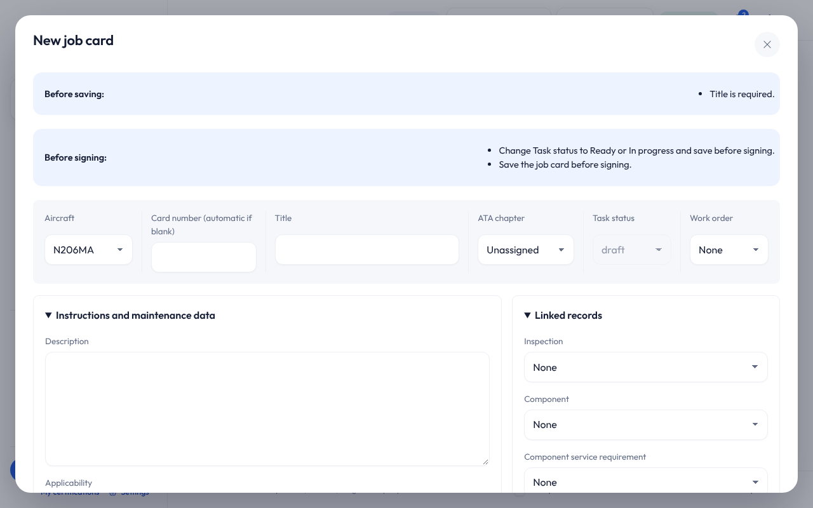

# Job cards and sign-off

A **job card** (`TC-YYYY-NNNN`) is where the work is recorded: findings,
actual work, parts used, evidence and signoffs. Cards usually belong to a work
order; a card can also stand alone. The screen is **Job cards** under
**Maintain**.

Changes need maintenance permission and a connection. Cards already on the
device stay readable offline.

## The list

| Control             | Does                                                              |
| ------------------- | ----------------------------------------------------------------- |
| Search              | Matches card number, title, description, registration, work order |
| Aircraft, status    | Filter; **Reusable templates** lists templates                    |
| Order               | **Order by zone** or **Order by card number**                     |
| **New job card**    | A standalone card                                                 |
| **Import Jobs CSV** | Loads cards from a CSV file                                       |

## Job card templates

A **job card template** is a card kept on an inspection, component service
requirement or problem report, as reusable instructions, notes and required
parts. It is never worked or signed.

1. On the inspection, requirement or report, choose **Job card templates**.
2. Create the template.
3. When its source is added to a work order, each template is copied into the
   order as a new job card.

Later template edits change future copies only.

## Complete and sign a job card

1. Open the card from its work order, or **New job card**.
2. Fill in the title, description, ATA chapter and **Maintenance-data
   reference** (or a **Reference library manual** and page).
3. Change **Task status** from draft to **ready** or **in progress** and choose
   **Save job card**.
4. Under **Execution**, enter **Actual work performed** and a **Completion
   date** (today or earlier). Save.
5. Record parts under **Parts used and component changes**: a **Non-stock
   item**, or **Inventory stock** from a location.
6. Upload evidence (photos, documents or parts traceability; PDF, JPEG or PNG,
   up to 7 MiB). Save the draft first.
7. Choose **Technician signoff**.
8. If **Inspection signoff required** is ticked, a second person chooses
   **Inspection signoff**.
9. Set the status to **completed** and save.

The boxes **Before saving** and **Before signing** at the top list what is
still missing.

| Status              | Means                              |
| ------------------- | ---------------------------------- |
| draft               | Not ready to sign                  |
| ready, in progress  | Can be signed                      |
| awaiting parts      | Waiting for parts                  |
| awaiting inspection | Waiting for the inspection signoff |
| completed, canceled | Read-only                          |

## Who can sign

| Signoff    | Who                                                                                           | Why                                                              |
| ---------- | --------------------------------------------------------------------------------------------- | ---------------------------------------------------------------- |
| Technician | Anyone with maintenance permission on the aircraft                                            | 14 CFR 43.3(d) lets supervised uncertificated people do the work |
| Inspection | A different person, with an approved, numbered mechanic certificate issued on or before today | It is the approval under 14 CFR 43.7                             |

A pilot certificate alone does not qualify. The inspection signoff comes after
the technician signoff.

A signoff the app would refuse is disabled, with the reason beside it:

| Message                                                                                                                                                         | Fix                                                              |
| --------------------------------------------------------------------------------------------------------------------------------------------------------------- | ---------------------------------------------------------------- |
| "Make the task ready before signing."                                                                                                                           | Set the status past draft and save                               |
| "Enter a completion date (today or earlier) before signing or completing this job card."                                                                        | Enter the completion date and save                               |
| "Technician signoff is required before inspection signoff."                                                                                                     | The technician signs first                                       |
| "Inspection signoff must be by a different person than the technician."                                                                                         | Ask another qualified person                                     |
| "Add your certificate type and number under My certifications to sign as inspector."                                                                            | File your certificate ([Mechanic](Mechanic.md#your-certificate)) |
| "Add a mechanic, repairman or inspection authorization certificate under My certifications to sign as inspector."                                               | Only a maintenance certificate counts                            |
| "Your mechanic certificate is waiting for a Flight Program administrator or system administrator to approve it; you can sign as inspector once it is approved." | Ask an administrator to approve it                               |
| "Sign the work-order job card, not the reusable template."                                                                                                      | Open the copy in the work order                                  |

## What clears a signoff

| Change                               | Signoffs                      |
| ------------------------------------ | ----------------------------- |
| Editing the content, or new evidence | Cleared; sign again           |
| A status change                      | Kept                          |
| Back to draft                        | Cleared                       |
| A new technician signoff             | Clears the inspection signoff |

Save content changes before signing. A cleared signoff stays in the card's
history.

## What a card does not do

Completing a card does not record inspection compliance, resolve a problem or
move a component. Close the work order for compliance
([Work orders](Work-Orders.md#close-out)); resolve problems on
[Discrepancies](Discrepancies.md). Linking stock to a card records where a
part came from; issue the stock separately with **Inventory → Move stock**.

Signoffs record your account and the server's time. They are not a return to
service; the signed paper logbook is.

## Older cards

A card whose work order is older than the device holds loads with its order
when you are connected. Offline, the card says to reconnect.
