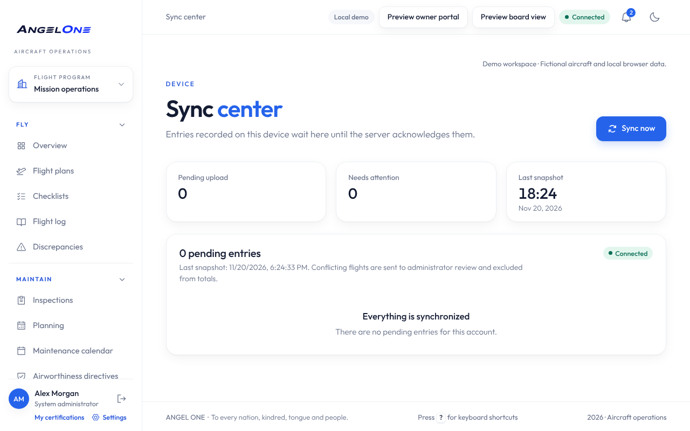
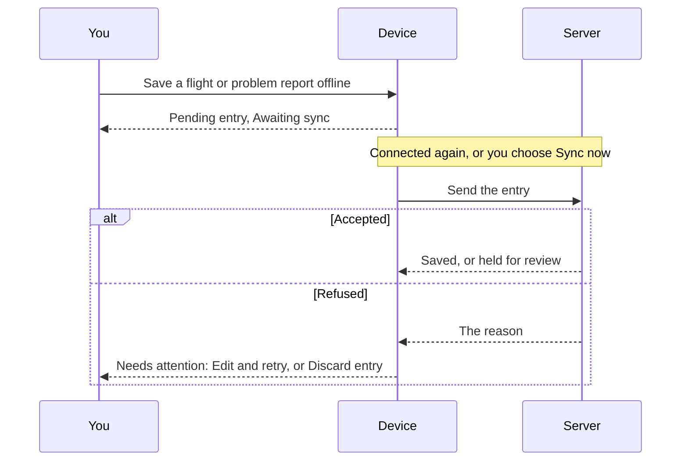
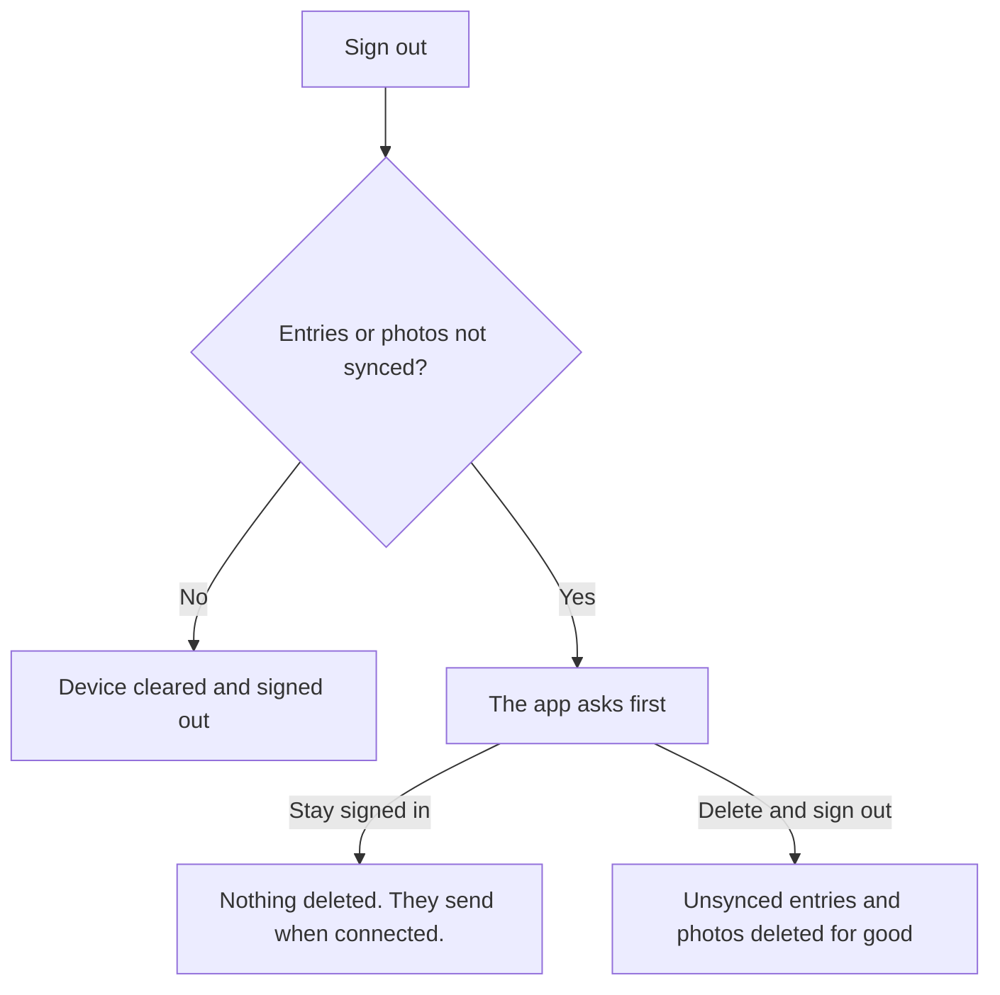

# Offline

[User guide](Home.md)

Pilots can log flights and report problems with no signal. Everything else
needs a connection. The device keeps a copy of your Flight Program for seven
days from sign-in.

## What works offline

| Works offline                                         | Needs a connection                                                |
| ----------------------------------------------------- | ----------------------------------------------------------------- |
| Log flights, Start flight and End flight              | First sign-in on a device                                         |
| Resume a flight plan's preflight saved on the device  | Starting a flight from a flight plan                              |
| Report problems                                       | Resolving and deferring problems                                  |
| Photograph the logbook line for a flight              | Work orders, job cards, inspections, components, ADs              |
| Read every screen from the copy on the device         | Inventory, parts requests, purchasing                             |
| Checklists and their checkmarks; guided flight drafts | Corrections, flight reviews, access changes                       |
| Manuals kept on the device                            | Switching Flight Program                                          |
| Alerts under the bell                                 | **Load older**, Change history in full, Costs, the Weekly summary |

The pill in the top bar says **Connected** or **Offline**.

## Pending entries and the Sync center

A flight or problem report saved offline is a **pending entry**. It waits on
the device and is sent by itself when connected.

- A line under the top bar says how many wait, such as "3 entries waiting to
  send", and links to the Sync center (**See entries**).
- **Sync center** (under Manage) lists your entries, oldest first, and
  waiting photos as **Photo waiting**.

| Control or status          | Means                                                                  |
| -------------------------- | ---------------------------------------------------------------------- |
| **Sync now**               | Send now                                                               |
| Awaiting sync              | Waiting for a connection                                               |
| **Needs attention**        | The server refused it, with the reason shown                           |
| **Edit and retry**         | Opens the form filled in from the entry, to fix and save again         |
| **Discard entry**          | Deletes it from the device after confirmation. It cannot be recovered. |
| **Export pending entries** | Saves your entries as a file, for a record or for support              |

The server checks every entry again when it arrives. It may refuse one for
good: an aircraft grounded before the flight began, a pilot no longer in the
program, oil not in stock. A dropped connection is simply retried.

A flight that reaches the server after the aircraft changed is not refused but
held for review ([Flight log](Flight-Log.md#flights-held-for-review)).

Entries made in another Flight Program sync once you switch back to it.

## What the device keeps

The device keeps what logging a flight and daily work need, not the whole
history.

| Kept on the device                                                                                                  | Loaded with **Load older** (needs a connection) |
| ------------------------------------------------------------------------------------------------------------------- | ----------------------------------------------- |
| Aircraft, inspections, ADs, components, checklists, members                                                         |                                                 |
| Every open item: held flights, open and deferred problems, open work orders and job cards, open requests and orders |                                                 |
| Flights from the last 6 months                                                                                      | Older flights                                   |
| Flight plans still to fly or departed in the last 6 months                                                          | Older flight plans                              |
| Problems resolved or deferred in the last 3 months                                                                  | Older resolved problems                         |
| Work orders changed in the last 3 months, and the 5 latest completed per aircraft                                   | Older closed work orders                        |
| Parts requests and orders changed in the last 3 months                                                              | Older requests and orders                       |
| The recent change-log entries                                                                                       | The full change log                             |

Under each such list: "Showing the last 3 months · Load older" (6 months for
flights and plans), ending "All records loaded". Offline, the button is off
and reads "Older records need a connection". A form that names an older
record loads it when connected and says it needs a connection otherwise.

## Seven days

Offline access lasts 7 days from sign-in. **Settings → This device** shows
when it ends. Then the app shows **Time to reconnect.**:

- "Your seven-day offline access has expired. Pending entries are preserved.
  Sign in again to continue."
- **Return to sign in** and **Export my pending entries** are offered.

Sign in with the same account to send the waiting entries.

A device clock running behind gets "This device's clock is behind the time you
signed in. Set the date and time to update automatically, then reopen the
app."

## Signing out

Sign out with the arrow beside your name (or **Sign out** in **More** on a
phone). It deletes from the device everything the app keeps for you:

- the copy of the Flight Program;
- your pending entries and waiting photos;
- favorites and which alerts you have read;
- unsent drafts: preflight sessions, checklist progress, guided flight and
  aircraft setup drafts;
- manuals kept on the device.

Device settings stay: theme, larger text, collapsed menu groups and label
printer settings.

If anything has not synced, the app asks first, for example "2 entries and 1
photo haven't synced":

On a shared device, entries someone else left stay until they sign in.

A session that ends without signing out (after seven days, or when an
administrator resets your password or disables your account) removes the copy
and kept manuals when next connected. Pending entries and photos stay and sync
when you sign in again.

## A new version

"A new version is ready. Save any open form first." **Reload now** switches to
it. An unsaved form is lost, so save first.

## Install for offline use

Install the app ([Home](Home.md#install-it-on-a-phone)) and open it online once
so it can save itself for offline use. The notice "App installed for offline
use." confirms it.
