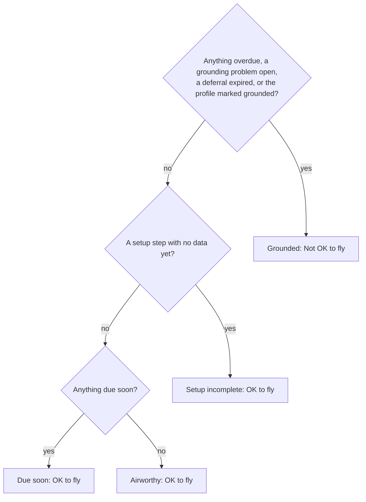

# Overview and aircraft

[User guide](Home.md)

The **Overview** is the first screen: fleet counts, each aircraft's status and
what comes due. The **Aircraft** page (under Manage) lists the aircraft with
their meters and profile.

## The Overview

| Part                     | Shows                                                                                                                                                        |
| ------------------------ | ------------------------------------------------------------------------------------------------------------------------------------------------------------ |
| Counts                   | Aircraft in your fleet, inspections approaching (within 10 hours or cycles, or 30 days), open discrepancies, flights awaiting review (not in the pilot view) |
| Aircraft cards           | Status, **OK to fly** line, totals, Hobbs, tach, landings, hours this week, next inspection                                                                  |
| Hours flown              | Accepted flights over the last 8 weeks                                                                                                                       |
| Fleet readiness          | How many aircraft are Airworthy, Due soon, Setup incomplete or Grounded                                                                                      |
| Airworthiness directives | AD alerts                                                                                                                                                    |
| Maintenance outlook      | Inspections, component limits, ADs and open problems by urgency (not in the pilot view)                                                                      |

The order changes by role: pilots see their aircraft first, mechanics the
maintenance outlook first, administrators the fleet summary first.

Use the star on a card to make an aircraft a favorite. Favorites are kept on
this device.

## Aircraft status

The app checks in this order and shows the first status that applies:

| Status           | Means                                                                                                        |
| ---------------- | ------------------------------------------------------------------------------------------------------------ |
| Airworthy        | Nothing due soon or overdue, and setup is complete                                                           |
| Due soon         | An inspection, component limit or AD comes due soon, or a deferral expires within 3 days                     |
| Setup incomplete | A setup step has no data yet; it shows the missing steps. It does not ground the aircraft                    |
| Grounded         | Something is overdue, a grounding problem is open, a deferral has expired, or the profile is marked grounded |

"Missing information never implies aircraft readiness." Only a fully set-up
aircraft can read Airworthy.

### OK to fly

Each card and the aircraft detail open with one line:

- **Not OK to fly** exactly when the aircraft is grounded. You cannot log a
  flight on it ([the dispatch gate](Flight-Log.md#the-dispatch-gate)).
- **OK to fly** otherwise, with an amber note when something is due soon.

It names one reason, chosen in this order: a missing setup step (on a
setup-incomplete aircraft), grounded in the aircraft profile, an open
grounding problem, a deferral, then inspections, ADs and component limits.
"+N more" counts the rest.

### When a limit is overdue

| Limit                     | Due soon                  | Overdue (grounds the aircraft)                  |
| ------------------------- | ------------------------- | ----------------------------------------------- |
| Hours, cycles or landings | Inside the warning window | At 0 remaining: the next flight would exceed it |
| Calendar date             | Up to and on the due date | From the day after the due date                 |

Component screens label a usage limit at exactly 0 **Due now** and beyond it
**Past due**. Both are overdue.

| Item                  | Warning window (due soon)                          |
| --------------------- | -------------------------------------------------- |
| Inspection            | 10 hours, cycles or landings, or 30 days           |
| AD action             | 30 hours, cycles, landings or days                 |
| Component requirement | The **Due soon** values entered on the requirement |
| MEL deferral          | 3 days before it expires                           |

## View aircraft

**View aircraft** on a card opens the aircraft's detail.

| Section                        | What you can do                                                                                                                           |
| ------------------------------ | ----------------------------------------------------------------------------------------------------------------------------------------- |
| Status notes                   | Read every reason behind the status                                                                                                       |
| Hours flown                    | Accepted flights, last 6 months                                                                                                           |
| Inspection schedules           | Sort by name or what remains; **Manage** opens Inspections (not in the pilot view)                                                        |
| Airworthiness directives       | AD alerts; **Manage ADs and compliance reports**                                                                                          |
| Form 337 copies                | **Upload Form 337 copy** (PDF, JPEG, PNG or WebP, up to 7 MiB)                                                                            |
| Maintenance parts availability | Shortages for open maintenance (not in the pilot view)                                                                                    |
| Buttons                        | **Export status sheet**, **Export records package** (maintenance permission), **Paper check (month)**, **Flight history**, **Log flight** |

The exports are described in
[Records package and exports](Records-Package-and-Exports.md).

## The Aircraft page

Each aircraft row shows total time source, Hobbs and tach, landings, profile
status and its status. Actions:

| Button                 | Does                                                                                                                                                                               | Who                   |
| ---------------------- | ---------------------------------------------------------------------------------------------------------------------------------------------------------------------------------- | --------------------- |
| **Add aircraft**       | Adds an aircraft to the active Flight Program                                                                                                                                      | Administrators        |
| **Set up an aircraft** | Loads an aircraft's history step by step ([how](Administration.md#set-up-an-aircraft))                                                                                             | Administrators        |
| **Edit aircraft**      | Changes identity, options, readings and the time source. **Dashboard photo** at the top sets the picture on the aircraft's card (JPEG, PNG or WebP, up to 5 MiB; it saves at once) | Maintenance           |
| **Add component**      | Adds an installed component                                                                                                                                                        | Maintenance           |
| **Manuals**            | Opens the aircraft's manuals ([Reference library](Reference-Library.md))                                                                                                           | Everyone who reads it |
| **Engine trends**      | Shows engine-monitor file summaries against limits ([below](#engine-trends))                                                                                                       | Everyone who reads it |

Administrators see setup chips such as "Components missing" or "ADs not
reviewed"; each opens the setup step that fills it.

### Engine trends

**Engine trends** on an aircraft's row charts each imported flight's engine
readings and flags the ones outside the aircraft's limits. It needs a
connection.

1. Choose the **Engine monitor CSV**: a JPI EDM CSV export, or a Garmin
   G1000/G3X data log from the SD card (up to 7 MiB).
2. Choose **Preview summary**, check it, then **Save engine summary**.

| Flag                         | Limit                                                    |
| ---------------------------- | -------------------------------------------------------- |
| Hottest CHT                  | **CHT limit (°F)**, 435 unless changed                   |
| Cruise oil pressure          | **Minimum cruise oil pressure (psi)**, 25 unless changed |
| CHT spread between cylinders | 50 °F, fixed                                             |

Importing, removing an import and **Save limits** need maintenance permission.
A file can be imported once, and an aircraft keeps up to 1,000 imports.

### Time source and total time

Total time is the chosen meter (Hobbs, tach or flight time log) plus the
**Total time adjustment**. Switching the source keeps total time unchanged.

A correction to total time, cycles or landings is refused if it would fall
below the last compliance recorded on an inspection or AD. Correct that
record first.
