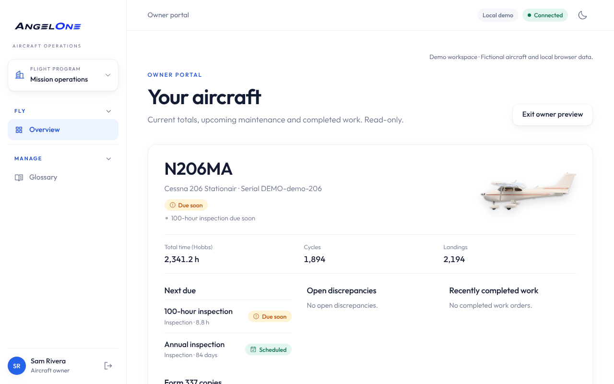
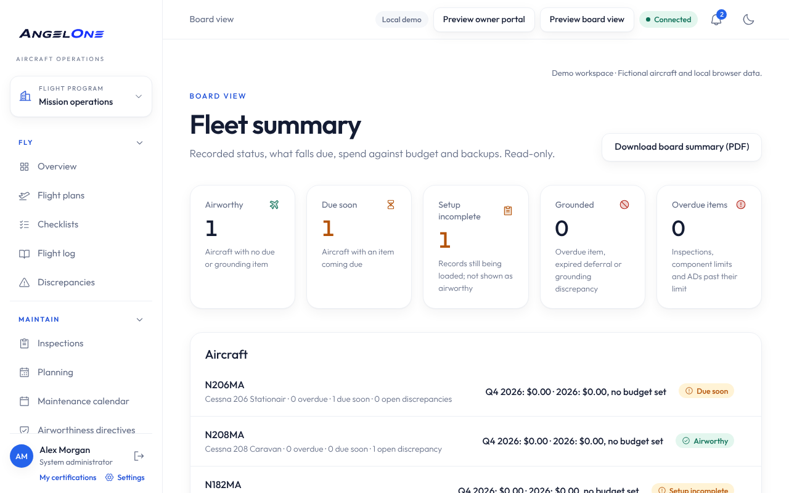

# Owner and board member guide

Owners and board members get one read-only view. They cannot change any
record. Every other request is refused with "Aircraft owner access is
read-only." or "Board access is read-only."

| You hold                   | You see                                               |
| -------------------------- | ----------------------------------------------------- |
| An aircraft owner group    | The **owner portal** for the aircraft the group names |
| A board group              | The **board view** for the program's aircraft         |
| Both                       | The owner portal, and **Board view** in the menu      |
| Any ordinary group as well | The full workspace instead                            |

There is no Settings page. The sun and moon button at the top switches the
theme. Your administrators change your name, email, password or access. The
**Glossary** explains the app's words.

## Owner portal

For each of your aircraft:

| Section                 | Shows                                                                                                                                |
| ----------------------- | ------------------------------------------------------------------------------------------------------------------------------------ |
| Header                  | Status (Airworthy, Due soon, Grounded or Setup incomplete) and why                                                                   |
| Totals                  | Total time, cycles, landings                                                                                                         |
| Next due                | Inspections, component limits and ADs, with what remains. "Review" means the app cannot work a limit out yet; ask your administrator |
| Open discrepancies      | Open problem reports and their deferrals                                                                                             |
| Recently completed work | Completed work orders                                                                                                                |
| Form 337 copies         | Major repair and alteration forms on file                                                                                            |

Buttons:

- **Export status sheet**: a PDF of the aircraft's status records.
- **AD compliance report**: a PDF of every AD with its compliance history.

The owner portal does not show flights, logbook photos or the change log.

## Board view

| Section                 | Shows                                                                                                                        |
| ----------------------- | ---------------------------------------------------------------------------------------------------------------------------- |
| Fleet status tiles      | Airworthy, Due soon, Setup incomplete, Grounded and Overdue items                                                            |
| Aircraft                | Each aircraft's status, overdue and due-soon counts, open discrepancies, spend this quarter and this year against the budget |
| Due in the next 30 days | Inspections, component limits and ADs, worst first, then soonest                                                             |
| Off-site backup         | When the newest backup was made, or "No off-site backup has been recorded yet."                                              |

**Download board summary (PDF)** saves the same summary to take to a meeting.

The board sees cost totals only, never prices, vendors or invoices. It sees no
flights, people, files or problem descriptions.

## Good to know

- Both views show recorded status only: "Missing information never implies
  aircraft readiness; this is not a maintenance release."
- The quarter and year for spending follow the program's records time zone.

## Your regular checks

1. Before a board meeting: download the board summary PDF.
2. Monthly (owners): open the owner portal and check **Next due** and **Open
   discrepancies**.
