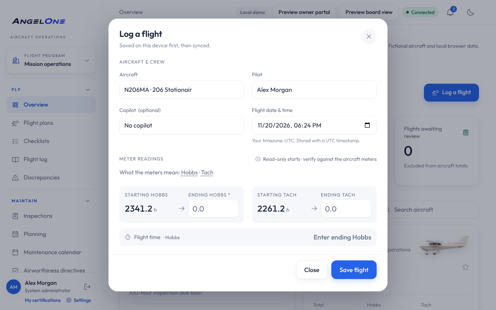

# Pilot guide

You log flights, report problems and read checklists and manuals. All of it
works without a connection (manuals once kept on the device). See the
[rules for flights](Flight-Log.md#rules) and [Offline](Offline.md).

## What you see

A member who may log flights, but has no maintenance, resolve or administrator
permission, gets the pilot view:

| Group  | Screens                                                       |
| ------ | ------------------------------------------------------------- |
| Fly    | Overview, Flight plans, Checklists, Flight log, Discrepancies |
| Manage | Reference library, Sync center, Glossary, Settings            |

Your alerts are under the bell in the top bar ([Alerts](Alerts.md)). The
Overview shows your aircraft cards first, each with **OK to fly** or
**Not OK to fly**, **Log flight**, **Report a problem** and **View aircraft**.

## Before a flight

1. Open **Overview** and check the aircraft's line: **OK to fly** or
   **Not OK to fly**, with the main reason.
2. Choose **View aircraft** for the full status notes, inspections and ADs.
3. If you use them, open your flight plan in **Flight plans** and your
   checklist in **Checklists**
   ([Flight plans and checklists](Flight-Plans-and-Checklists.md)).

If the aircraft is grounded, you cannot log a flight on it. Ask a Flight
Program administrator to resolve or defer the items, or to record a dispatch
override.

## Log a flight

1. Choose **Log flight** on the aircraft card, **Log a flight** on the
   Overview, or **Log flight** in the phone's bottom bar.
2. Check the aircraft, **Pilot**, **Copilot** and **Flight date & time**.
   **Same as last flight** fills the crew and route from the aircraft's last
   flight.
3. Compare **Starting Hobbs** and **Starting tach** with the meters in the
   aircraft. You cannot change them.
4. Enter the ending readings, the route, landings, flight rules and type of
   operation.
5. Enter fuel and oil if your program records them.
6. Write any problem in **Discrepancy**. It opens a report on the aircraft.
7. Choose **Save flight**. The flight is saved on the device first, then sent.
8. Choose **Add a photo of the logbook line** in the **Flight saved** notice
   if your program photographs the paper logbook.

For a flight in two steps (preflight now, end later), use **Start flight**
on the Flight log. See [Flight log](Flight-Log.md#start-flight-and-end-flight).

## Report a problem

1. Open **Discrepancies** and choose **Report a problem**, or use **Report a
   problem** on the aircraft card.
2. Choose the aircraft and describe what you observed.
3. Tick **Aircraft not airworthy until resolved** if the aircraft must not
   fly. This grounds it.
4. Choose **Save report**.

See [Discrepancies](Discrepancies.md).

## After a flight

- **Flight log** shows your flight as **Accepted**, **Needs review** or
  **Rejected**. A held flight does not change the aircraft totals until an
  administrator reviews it ([why flights are held](Flight-Log.md#flights-held-for-review)).
- Without a connection, the line under the top bar says how many entries are
  waiting. **Sync center** lists them ([Offline](Offline.md)).

## Your regular checks

See the "Daily" section of the
[checklists](../handbook/3-running-it/checklists.md).

1. Before each flight: the aircraft reads **OK to fly**; the starting meters
   match the aircraft.
2. After each flight: the flight is in the **Flight log**, and nothing waits in
   **Sync center**.
3. Before signing out on a shared device: **Sync center** is empty, so nothing
   is lost ([signing out](Offline.md#signing-out)).
