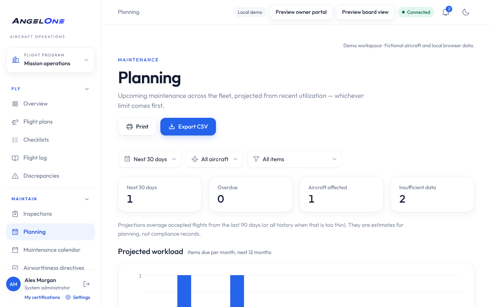
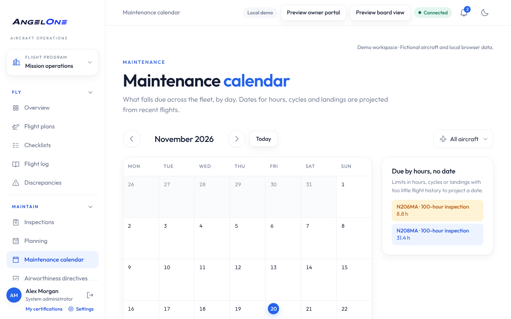

# Planning and due items

[User guide](Home.md)

Three places show what falls due: the Overview's **Maintenance outlook**,
**Planning** and the **Maintenance calendar** (both under **Maintain**). They
change no records. Dates for hours, cycles and landings limits are estimates,
not compliance records.

The rule for due soon and overdue is in
[Overview and aircraft](Overview-and-Aircraft.md#when-a-limit-is-overdue).

## Planning

Planning lists inspections, component requirements and AD actions across the
fleet, week by week, by whichever limit comes first.

| Control                   | Does                                                                     |
| ------------------------- | ------------------------------------------------------------------------ |
| Next 30, 60 or 90 days    | The window                                                               |
| Aircraft                  | One aircraft or all                                                      |
| Items                     | All items, Inspections, Component requirements, Airworthiness directives |
| **Print**, **Export CSV** | The list on paper or in a spreadsheet                                    |

| Tile              | Counts                                       |
| ----------------- | -------------------------------------------- |
| Next 30 days      | Items due in the window                      |
| Overdue           | Items past a limit                           |
| Aircraft affected | Aircraft with an item in the window          |
| Insufficient data | Usage limits with no flights to project from |

How dates are projected: the average of accepted flights over the last 90 days
(or all history when that is too thin). An aircraft with no accepted flights
shows its usage limits under **Insufficient data**, with what remains.

**Projected workload** charts the items due in each of the next 12 months.

## Maintenance calendar

A month of inspections, component requirements and AD actions on the day each
falls due.

| Item                        | Shown on                                          |
| --------------------------- | ------------------------------------------------- |
| Calendar limit              | Its due date                                      |
| Usage limit                 | The date projected from recent flights            |
| Overdue item                | Today, marked **Overdue**                         |
| Usage limit with no history | Beside the month, under **Due by hours, no date** |

Use the previous and next month buttons, **Today**, and the aircraft filter.
On a phone the month becomes a list by day. Each item opens its own screen.

## Maintenance outlook

On the Overview, the outlook lists the most urgent items: inspections,
component limits, ADs and open problems, with what remains. Mechanics see it
first. See [Overview and aircraft](Overview-and-Aircraft.md).

## Flight plan projections

[Flight plans](Flight-Plans-and-Checklists.md#read-the-queue) add queued
flights' estimated time and warn "Due before further Flight" when a plan would
reach a limit.
