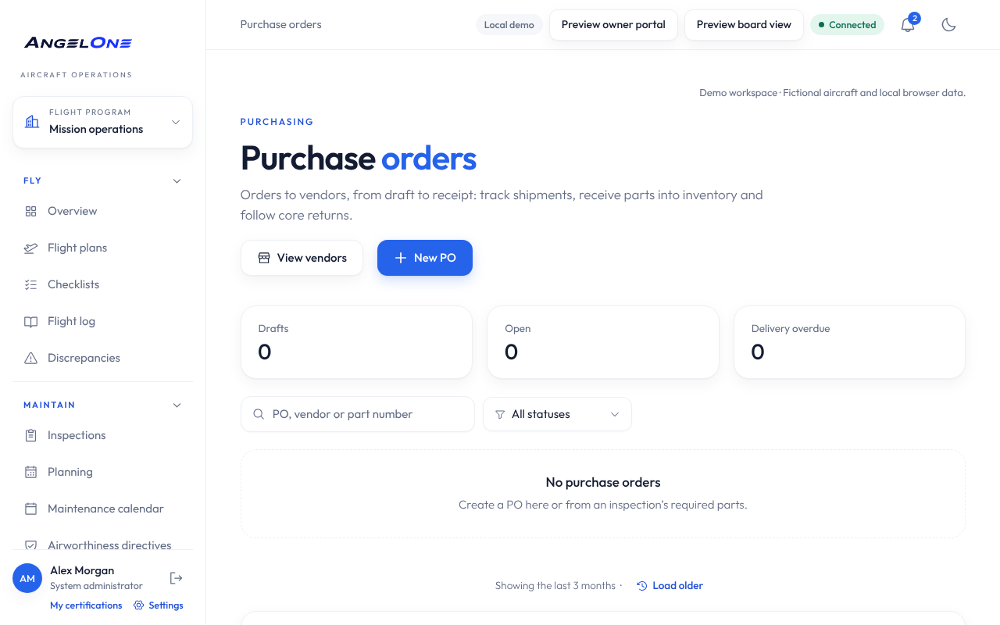

# Purchase orders and vendors

**Purchase orders**, **Vendors** and **Saved addresses** are under **Manage**.
Purchase orders and vendors are for Flight Program administrators. Mechanics
see the progress of orders on their own requests. Everything here needs a
connection.

## Purchase orders

One purchase order goes to one vendor. Its life:

| Step | Button                         | Notes                                                                                                            |
| ---- | ------------------------------ | ---------------------------------------------------------------------------------------------------------------- |
| 1    | **New PO** → **Save draft PO** | Or **Create PO for parts** on an inspection, or **Add selected to purchase order** on requests                   |
| 2    | **Issue PO**                   | Checks each line against current records                                                                         |
| 3    | **Record shipment**            | Date, carrier, tracking and quantities; partial shipments allowed                                                |
| 4    | **Receive parts**              | Adds the parts to inventory. A receipt can be backdated, but not before the order was issued or into the future. |
| 5    | **Close PO**                   | After full receipt                                                                                               |

The status filter offers Draft, Issued, Partially shipped, Shipped, Partially
received, Received, Closed and Cancelled. The tiles count drafts, open orders
and orders whose delivery is overdue.

Other actions:

| Button                        | Does                                                                                                            |
| ----------------------------- | --------------------------------------------------------------------------------------------------------------- |
| **Edit draft**                | Changes a draft                                                                                                 |
| **Revise PO**                 | Returns an issued order to draft, with a reason, before any shipment or receipt. Old revisions stay in history. |
| **Cancel remaining**          | Cancels outstanding quantities, with a reason. Received items stay in stock.                                    |
| **Print PO**, **Save PO PDF** | The order as a PDF to send to the vendor yourself                                                               |

Attach PDFs or photos (PDF, JPEG, PNG or WebP, up to 7 MiB) to the order or to
a receipt.

Rules:

- After delivery activity, quantities cannot be silently edited.
- A tracked component received needs a unique part and serial number and
  verified hours and cycles. It arrives uninstalled; install it with a work
  order.
- A refusal about a line starts with the order and line, for example
  `PO-00012, line FILTER: …`.

### Core returns

An exchange unit received on an order creates a core return. Ship the core by
its due date, then record the vendor's credit. **Show credited cores** lists
the finished ones.

### Load older

The device holds open orders, orders changed in the last 3 months, and orders
for requests it keeps. **Load older** fetches older orders. Needs a
connection.

## Vendors

Open **Vendors** in the menu or **View vendors** on Purchase orders.

1. **Add vendor**: name, address, contact, website, account number, payment
   terms, notes.
2. In a purchase order, type the vendor's name. An unknown name offers **Quick
   add** (name only) or **Add vendor** (full details).

Names must be unique in the program, ignoring case. Changing a vendor does not
rewrite earlier orders. Each vendor's **Orders** lists its orders and totals by
currency, with **Load older**.

The Aircraft Spruce account is linked in
[Settings → Flight Program](Settings.md#flight-program).

## Saved addresses

Ship-to, return and billing addresses for requests and orders, shared with
your Flight Program only. **Add new address** here, or from a request or
order.
