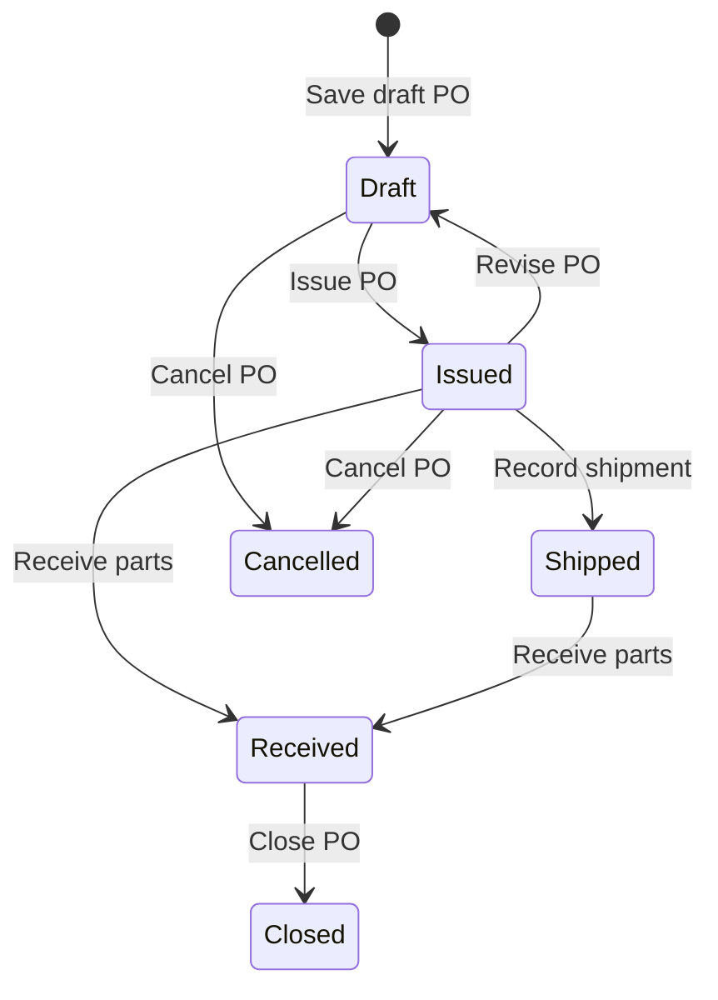
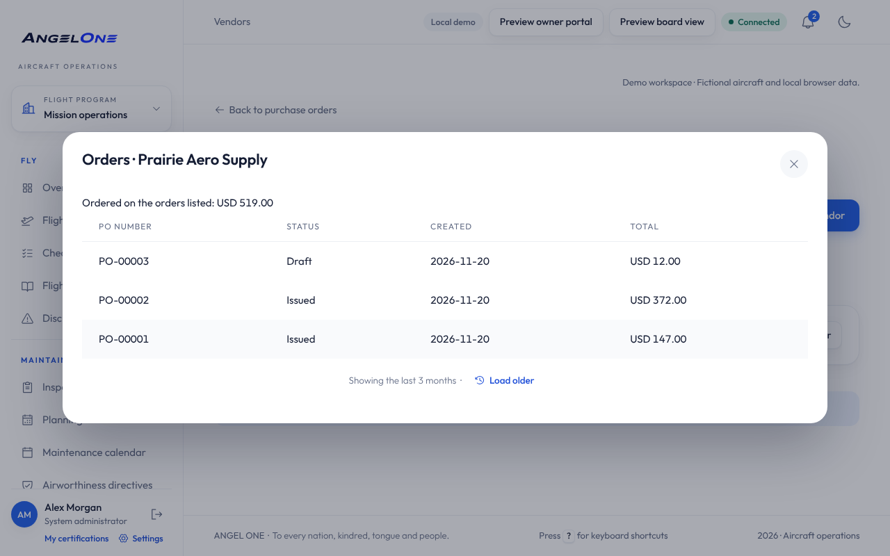

# Purchase orders and vendors

[User guide](Home.md)

**Purchase orders**, **Vendors** and **Saved addresses** are under **Manage**.
Purchase orders and vendors are for Flight Program administrators. Mechanics
see the progress of orders on their own requests. Everything here needs a
connection.

## Purchase orders

One purchase order goes to one vendor. Its statuses, and the button that moves
it on:

A part shipment or receipt reads **Partially shipped** or **Partially
received**. The steps:

| Step | Button                         | Notes                                                                                                            |
| ---- | ------------------------------ | ---------------------------------------------------------------------------------------------------------------- |
| 1    | **New PO** → **Save draft PO** | Or **Create PO for parts** on an inspection, or **Add selected to purchase order** on requests                   |
| 2    | **Issue PO** → **Finalize PO** | Checks each line; the shipping address must be confirmed first. It does not send the order to the vendor.        |
| 3    | **Record shipment**            | Date, carrier, tracking and quantities; partial shipments allowed                                                |
| 4    | **Receive parts**              | Adds the parts to inventory. A receipt can be backdated, but not before the order was issued or into the future. |
| 5    | **Close PO**                   | Once every quantity is received or cancelled                                                                     |

The status filter offers Draft, Issued, Partially shipped, Shipped, Partially
received, Received, Closed and Cancelled. The tiles count drafts, open orders
and orders whose delivery is overdue.

Other actions:

| Button                        | Does                                                                                                                                   |
| ----------------------------- | -------------------------------------------------------------------------------------------------------------------------------------- |
| **Edit draft**                | Changes a draft                                                                                                                        |
| **Revise PO**                 | Returns an issued order to draft, with a reason, before any shipment or receipt. Old revisions stay in history.                        |
| **Cancel PO**                 | Cancels a draft or issued order, with a reason. After a receipt it reads **Cancel remaining and close**: received items stay in stock. |
| **Print PO**, **Save PO PDF** | The order as a PDF to send to the vendor yourself                                                                                      |

Attach PDFs or photos (PDF, JPEG, PNG or WebP, up to 7 MiB) to the order or to
a receipt.

Rules:

- After delivery activity, quantities cannot be silently edited.
- A tracked component received needs a unique part and serial number and
  verified hours and cycles. It arrives uninstalled; install it with a work
  order.
- A refusal about a line starts with the order and line, for example
  `PO-00012, line FILTER: …`.
- A component out for repair must be received back before its order can be
  cancelled.

### Core returns

Tick **Part … is an exchange (core return due)** on an order line; the core is
due 30 days after receipt unless you change it. Receiving the unit creates a
core return in the **Core returns** list under the orders. It reads
**Pending** until you choose **Mark … core shipped** (with the tracking
number), then **Shipped** until **Mark … core credited** records the vendor's
credit. **Show credited cores** lists the finished ones.

### Load older

The device holds open orders, orders changed in the last 3 months, and orders
for requests it keeps. **Load older** fetches older orders. Needs a
connection.

An order line for a request older than the device keeps shows "Request not
loaded" until the request loads. **Print PO** and **Save PO PDF** are off until
then. Offline: "This order names requests older than this device keeps.
Reconnect to show them and print the order."

## Vendors

Open **Vendors** in the menu or **View vendors** on Purchase orders.

1. **Add vendor**: name, address, contact, website, account number, payment
   terms, notes.
2. In a purchase order, type the vendor's name. An unknown name offers **Quick
   add** (name only) or **Add vendor** (full details).

Names must be unique in the program, ignoring case. Changing a vendor does not
rewrite earlier orders.

**Orders** on a vendor's row lists its orders, newest first, with **Load
older**. "Ordered on the orders listed" totals the issued and closed orders
shown, by currency. Drafts and cancelled orders do not count; load older
orders to include them.

### Aircraft Spruce

Link the program's Aircraft Spruce account in
[Settings → Flight Program](Settings.md#flight-program). Then:

- **Refresh Aircraft Spruce catalog** downloads their catalog.
- **Find at Aircraft Spruce** on a request or draft order line records their
  part number and order unit on it, and copies their price when the
  currencies match. Check that one of their units is one of yours.
- **Aircraft Spruce order progress** → **Sync Aircraft Spruce order** on a
  saved order shows their status, quantities and tracking for it.

The app never places an order: order from Aircraft Spruce yourself, quoting
the PO number. Record shipments and receipts as for any vendor. The details
are in [Aircraft Spruce connection](../aircraft-spruce.md).

## Saved addresses

Ship-to, return and billing addresses for requests and orders, shared with
your Flight Program only. **Add new address** here, or from a request or
order. Only Flight Program administrators can save one.
