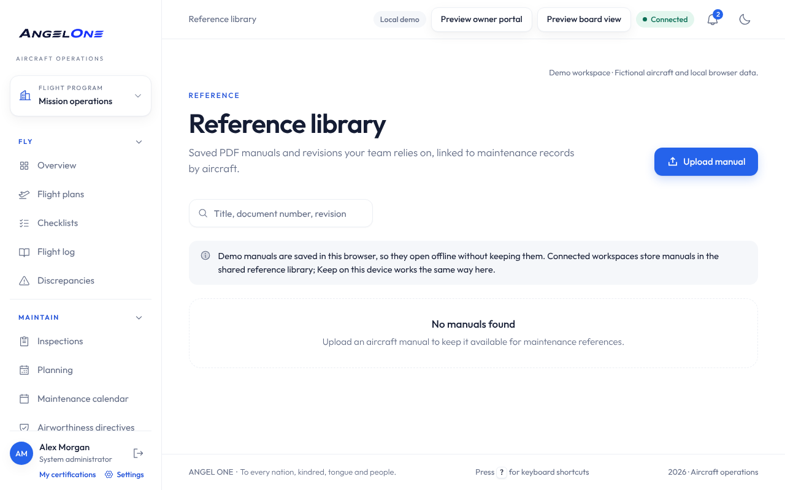

# Reference library

[User guide](Home.md)

The **Reference library** (under Manage) holds PDF manuals linked to aircraft.
Inspections, component requirements and job cards can point to a page in a
manual. Kept manuals open offline.

You see the manuals of the aircraft you can read. Uploading needs maintenance
access to the manual's aircraft and a connection.

## Upload a manual

1. Choose **Upload manual**, or **Manuals** on the **Aircraft** page.
2. Choose the **Aircraft**, then enter **Manual title**, **Document number**,
   **Revision / temporary revisions** and **Revision date**.
3. Choose the PDF (up to 200 MiB).
4. Choose **Save manual**.

Each upload is a separate record that never changes. Upload a new revision as
a new manual; references to the old revision keep working. Manuals cannot be
deleted or replaced.

## Open a manual

Choose the manual, or a manual reference on an inspection, requirement or job
card. The viewer opens at the referenced page. If your browser ignores the
page number, the number is shown above the viewer. **Open PDF in browser** and
**Download PDF** are there too.

## Keep on this device

1. Choose **Keep on this device** on the manual, in the library or the viewer.
2. Wait for the download. The row shows progress, with **Cancel download**,
   then **On this device**.
3. The manual now opens offline, from the library, the viewer and every
   reference.

**Remove from this device** deletes the copy. The library shows how many
manuals are kept and the space they use.

A kept copy is removed when you sign out, when your access to it ends, or when
another Flight Program is chosen. The browser may also remove it when storage
runs low, unless the library shows storage as protected. On an iPhone, add the
app to the Home Screen so Safari keeps it.

## Find maintenance items

On a saved manual, **Find maintenance items** searches its text for
inspections and life limits to add:

1. Confirm the model association (aircraft model, or a component's maker,
   model and part number).
2. Choose the first and last PDF pages, then **Search manual**. Start with the
   time-limits chapter.
3. Filter the results by a phrase such as "Phase 2".
4. Choose **Create inspection**, **Create component service requirement** or
   **Create component** on a result. Check every value against the manual and
   enter verified compliance history, then save.

Searching creates nothing. The search reads the PDF's text in your browser; it
cannot prove it found every item. Always read the source.

**Import maintenance CSV** on a manual is the alternative: download the
templates, fill them in, and load them into a review table.
