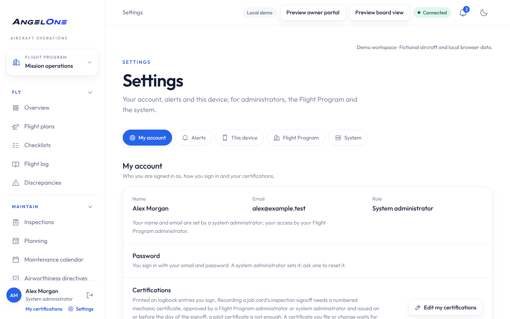

# Settings

[User guide](Home.md)

**Settings** (the last link under Manage, or **Settings** under your name)
changes how the app behaves. Each section shows only to those allowed to
change it. Owners and board members have no Settings page.

| Section        | Who                           |
| -------------- | ----------------------------- |
| My account     | Everyone                      |
| Alerts         | Everyone                      |
| This device    | Everyone                      |
| Flight Program | Flight Program administrators |
| System         | System administrators         |

## My account

| Item              | What you can do                                                                                                                   |
| ----------------- | --------------------------------------------------------------------------------------------------------------------------------- |
| Name, email, role | Read only. A system administrator sets your name and email; your Flight Program administrator sets your access.                   |
| Password          | You sign in with your email and password. The administrator who created your account set it; a system administrator can reset it. |
| Certifications    | **Edit my certifications**: Pilot, and Certified mechanic with Airframe, Powerplant and Inspection Authorization                  |

### Certifications

1. Choose **Edit my certifications** (or **My certifications** under your
   name).
2. Tick **Pilot** or **Certified mechanic** and enter the number and dates.
3. Attach copies if needed: PDF, JPEG, PNG, WebP, HEIC or HEIF, up to 5 MiB
   each. Only you and system administrators can open them.
4. Save. A new or changed certificate is "Waiting for approval" until a system
   administrator, or a Flight Program administrator of your program, approves
   it.

Until approved, it is not printed on logbook entries, not offered under **Use
saved certification**, and does not allow the inspection signoff.
Certifications grant no other permission. Nobody approves their own.

## Alerts

The bell's contents, **Email me a daily alert digest**, **Email me urgent
alerts at once** and **Alert this device**. See [Alerts](Alerts.md).

## This device

These settings stay on this device and do not follow your account.

| Setting                     | Does                                                                                               |
| --------------------------- | -------------------------------------------------------------------------------------------------- |
| Theme                       | **Light**, **Dark** or **Match this device**. The sun and moon button in the top bar switches too. |
| Text size → **Larger text** | Makes everything about a fifth larger, for reading and gloved hands                                |
| Offline data                | When your offline access ends, the last sync, pending entries, and **Open Sync center**            |
| Manuals kept on this device | Manuals saved for offline reading ([Reference library](Reference-Library.md#keep-on-this-device))  |

## Flight Program

| Item                    | Does                                                                                         |
| ----------------------- | -------------------------------------------------------------------------------------------- |
| Program details         | **Edit Flight Program details**: name, address, contact, email, website                      |
| Default labor rate      | **Rate per hour (USD)**, then **Save rate**. Existing labor keeps its rate.                  |
| Program expiring dates  | Insurance, registration and other renewals ([Alerts](Alerts.md#expiring-dates))              |
| Aircraft Spruce account | Links the program's Aircraft Spruce account (**Update…**)                                    |
| Saved addresses         | Opens [Saved addresses](Purchase-Orders-and-Vendors.md#saved-addresses)                      |
| CSV extract (partial)   | Some tables as CSV; not a backup ([CSV extract](Records-Package-and-Exports.md#csv-extract)) |

Users and access are in [Administration](Administration.md).

## System

| Item                      | Does                                                                                                                                                                                                              |
| ------------------------- | ----------------------------------------------------------------------------------------------------------------------------------------------------------------------------------------------------------------- |
| Deployment status         | What the deployment has turned on (alert email, device alerts, browser error reporting)                                                                                                                           |
| FAA API key and renewal   | **Update…** stores the FAA key and its expiry date. Status: **Active**, **Renew soon**, **Expired**, **No expiry date** or **Not set up**. **Request / renew key at FAA** opens the FAA site.                     |
| Address verification      | The address lookup key (**Update…**)                                                                                                                                                                              |
| Deployment expiring dates | Dates the deployment must renew ([Alerts](Alerts.md#expiring-dates))                                                                                                                                              |
| Off-site backups          | The nightly copy of all records and files to Cloudflare R2 (not encrypted unless a backup key is set): when the newest was made, its size, the last monthly copy, and a warning when it is more than 26 hours old |
| CSV extract (partial)     | Some tables, all programs                                                                                                                                                                                         |

Until the first nightly copy is recorded, Off-site backups reads "No off-site
backup has been recorded yet."

Keys are stored on the server and never shown again or kept offline. The demo
accepts no keys. How backups and restores work is in the handbook's
[Backups and restore](../handbook/3-running-it/operations.md#backups-and-restore).

In the demo only, System ends with **Download this demo's data**: **Download
demo data** saves everything the browser's demo holds as one JSON file. It
cannot be imported into a live deployment.
