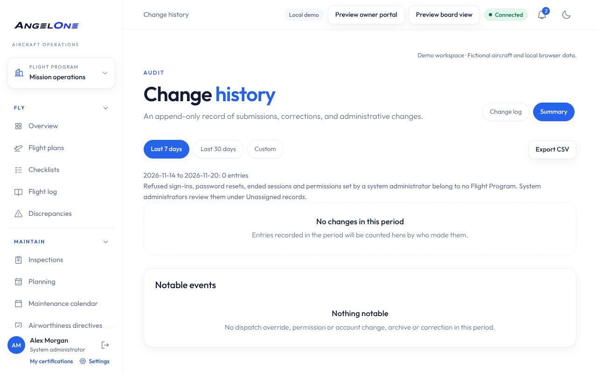

# Weekly summary

The **Summary** tab of [Change history](Change-History.md) lets a Flight
Program administrator review a period of the change log without reading it
entry by entry. It needs a connection.

## Review a week

1. Open **Change history → Summary**.
2. Choose **Last 7 days** (the default), **Last 30 days** or **Custom** dates.
   Days are your own device's days.
3. Read **Changes by person** and **Notable events**.
4. Choose **Open** on a notable event to check it on its screen.
5. **Export CSV** saves the table as `change-summary-<from>-to-<to>.csv`.

## What it shows

- **Changes by kind of work**: one bar dividing the period's entries into
  eight kinds: flights and discrepancies, inspections and components, ADs,
  work orders and job cards, parts and purchasing, users and access, FAA,
  other.
- **Changes by person**: one row per person, with a count for each kind and a
  total. Most active first.
- **Notable events**, newest first: dispatch overrides, permission changes,
  account changes, archives and deletions, and corrections (any other entry
  with a reason, shown with it).
- **Refused sign-ins**: a count only, never the email typed.

Refused sign-ins, password resets, ended sessions and permissions set by a
system administrator belong to no Flight Program. Inside a program the summary
says so; system administrators review them under **Unassigned records**, the
only place the refused sign-ins are counted.

## Limits

One summary reads a limited amount of the change log. A period that holds more
is cut short, and the summary says: "The period has more entries than one
summary reads. Older entries in it are not counted; choose a shorter period."
Its counts then cover only the newest entries.

In the demo, the summary covers only the changes made during the session.
