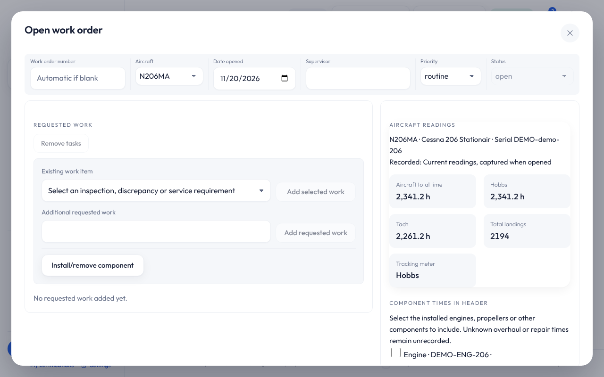

# Work orders

A **work order** (`WO-YYYY-NNNN`) holds the requested work on one aircraft,
from opening to close-out. Closing it records inspection compliance, applies
component movements and freezes the readings. It is under **Maintain**.

Creating or changing an order needs maintenance permission and a connection.
Offline, "Cached work orders are available. Reconnect to make changes."

## The list

| Control                        | Does                                                                         |
| ------------------------------ | ---------------------------------------------------------------------------- |
| Tiles                          | Open, In progress, Closed this month                                         |
| Search                         | Matches number, registration, supervisor, scope and requested work           |
| **Aircraft**                   | One aircraft or all                                                          |
| **Include closed work orders** | Shows completed and cancelled orders                                         |
| **Load older**                 | With closed orders shown, fetches older closed orders ([below](#load-older)) |

Each order shows completed and total tasks, linked open problems and tasks
delayed for parts.

## Open a work order

1. Choose **Open work order**.
2. Choose the **Aircraft**. Leave **Work order number** blank to get the next
   number.
3. Enter **Date opened**, **Supervisor**, **Priority** (routine, high, urgent)
   and the scope.
4. Under **Requested work**, add work:
   - **Existing work item**: an inspection, problem report, component service
     requirement or reviewed AD action, then **Add selected work**;
   - **Add requested work**: free text;
   - **Install/remove component**: plan a component movement.
5. Under **Component times in header**, tick the engines or propellers whose
   times belong on the order.
6. Choose **Open work order**.

Opening records the aircraft's current readings. Later flights do not change
them.

You can also use **Add to work order** on a problem report, inspection, AD
action or component requirement. It offers only open orders on that aircraft
that do not already hold the item.

## Work the order

| Task                         | How                                                                                                               |
| ---------------------------- | ----------------------------------------------------------------------------------------------------------------- |
| Track each task              | Status: requested, in progress, delayed for parts, completed, cancelled                                           |
| Reorder tasks                | **Move up**, **Move down**, then **Save work order**                                                              |
| Job cards                    | Each task lists its job cards. Open one to record work and signoffs ([Job cards](Job-Cards.md)).                  |
| Add job cards from templates | **Add missing job card templates**. It never makes duplicates.                                                    |
| Request parts                | **Request parts for task** on a saved task                                                                        |
| Attach records               | Upload PDF, JPEG or PNG, up to 7 MiB each, after the order is opened                                              |
| Costs                        | **Add labor** (hours, technician) and **Add cost** (amount, description, date). Program administrators see costs. |

Order status (open, in-progress, awaiting-approval, parts-delay, completed,
cancelled) is set on its own. Completing a task does not record compliance.

A task with job cards can be marked completed only when every one of its cards
is completed with all required signoffs.

While job cards are copied from templates, the order shows **Preparing job
cards: X of Y** and cannot be edited or closed. If it stops, choose **Resume
preparation**.

## Close-out

1. Complete or cancel every task. Every linked job card must be completed or
   cancelled.
2. Under **Closeout**, enter the **Completion date**, choose a **Release
   statement** (or type the **Release outcome**) and the final review.
3. Confirm the completion total time, Hobbs, tach and cycles. They must fall
   between the opening readings and the current totals.
4. Under **Component work performed**, choose for each component: **Inspected
   / serviced only**, **Repaired**, **Overhauled** or **Repaired and
   overhauled**. Repair and overhaul need a work description.
5. Set the status to completed and save. Confirm the permanent-close warning.

| Close-out does                                                                 | Close-out does not                     |
| ------------------------------------------------------------------------------ | -------------------------------------- |
| Records compliance for completed inspections and routine component inspections | Resolve problem reports                |
| Applies planned component installs and removals                                | Record AD compliance                   |
| Resets TSR on repair, TSO on overhaul                                          | Change the aircraft's status by itself |
| Freezes readings, work performed and your certificate details                  | Sign the paper logbook                 |

The completion date cannot be before a completed job card's date. Completed and
cancelled orders are read-only.

## Logbook entry

On a completed order, open **Details → Generate logbook entry**.

1. Choose the **Logbook template**: maintenance/inspection, component
   service/replacement, AD compliance, or **Annual / 100-Hour inspection**.
2. Enter your **License / certificate number** and **Certificate type**, or
   pick from **Use saved certification**. Only approved certificates are
   offered ([Settings](Settings.md#my-account)).
3. Review and edit the text.
4. Choose **Save as PDF** or **Copy text**.
5. Write or paste it into the paper logbook and sign it there.
6. Choose **Attach signed page photo** to attach a photo of the signed page.

Exporting is not a signature. The **Performed by** line names each technician
who signed an included job card, when that is not you (14 CFR 43.9(a)(3)).

Open orders show a **Sample log book entry** that updates as you work. Choose
which tasks to include with **Include in log book entry** and their wording
with **Log book wording**. **Manage log book phrases** and **Manage release
statements** save your own choices to your account.

## Revise a closed order

Records are corrected, never edited. On a closed order, **Revise work order**
corrects the written record: supervisor, scope, release outcome and **Work
performed / logbook wording**. A **Reason for revision** is required. The
original is kept, and each revision is listed. Dates, readings, task
completion, inspection compliance and component tracking stay as recorded.
Needs maintenance permission and a connection.

## When two people save at once

If someone saved the order after you opened it, the app shows "This record was
changed by someone else. Review the differences." See
[Troubleshooting](Troubleshooting.md#this-record-was-changed-by-someone-else).

## Load older

The device holds open orders, those changed in the last 3 months, and the 5
latest completed orders on each aircraft. With **Include closed work orders**
ticked, **Load older** fetches older closed orders for the chosen aircraft,
with their job cards and costs. Needs a connection.
